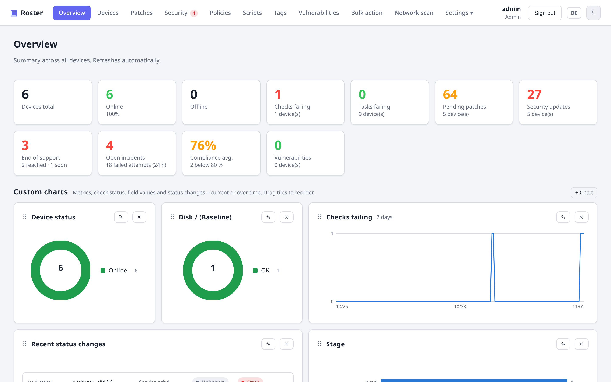
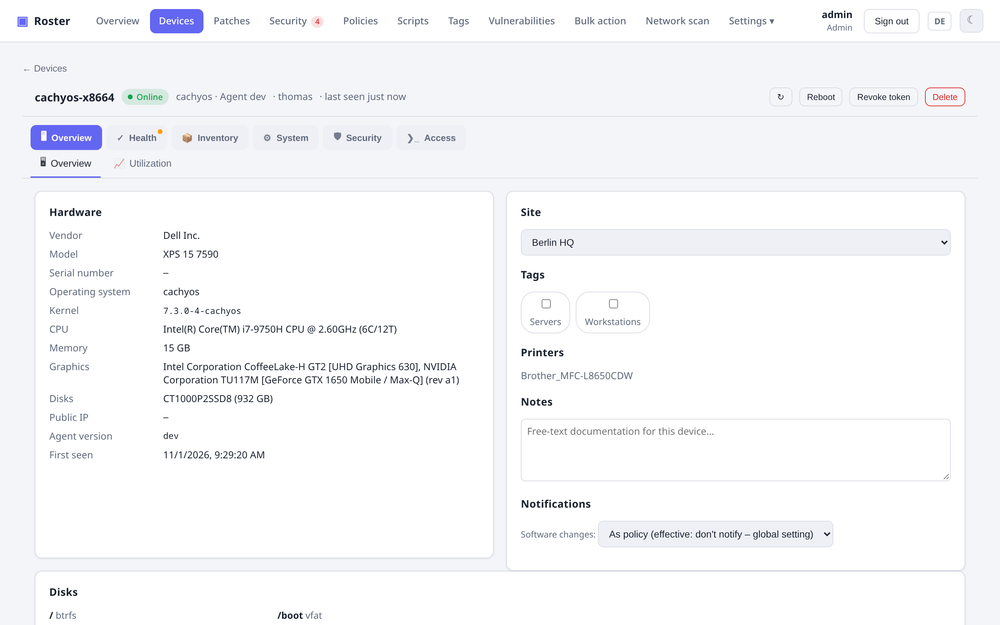
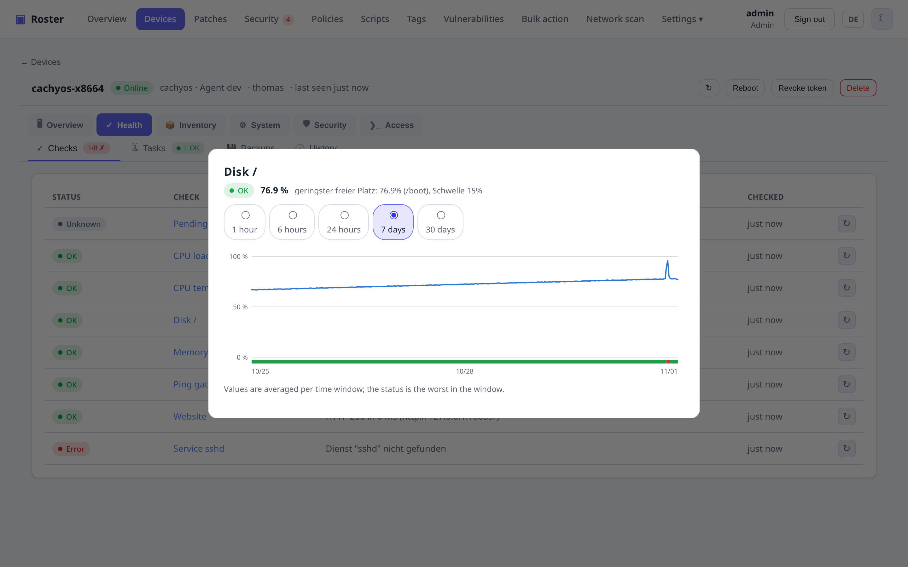
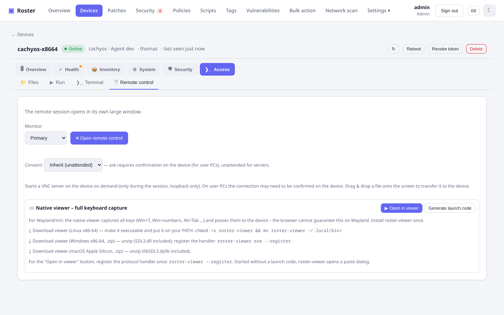

# Roster

**English** · [Deutsch](#deutsch)

A self-hosted, TacticalRMM-style **inventory & remote-management** platform for
computers and servers. A single Go server (with the React web UI and all agent
binaries embedded) talks to a lightweight cross-platform Go agent. Everything ships
as **one binary**; the UI is fully **bilingual (English / German)**.

[](LICENSE)


---

## 📖 Documentation

**Full documentation lives at [roster-rmm.dev](https://roster-rmm.dev/)** —
getting started, all features, configuration and security. Also available in
[German](https://roster-rmm.dev/de/). Release history: [CHANGELOG.md](CHANGELOG.md).

## Screenshots

**Dashboard** with configurable charts



**Device detail**



**Check history** — every result is kept, one click opens the chart



**Remote control** in the browser



More screenshots of every feature are in the [documentation](https://roster-rmm.dev/).

---

## Features

- **Inventory** – hardware, OS, network interfaces (IP/MAC), disks, installed
  software, printers. Cross-platform agents for Windows / Linux / macOS / FreeBSD with
  **auto-update**; on OPNsense the agent registers itself as plugin `os-roster-agent` so it
  survives firmware upgrades.
- **Checks** – disk / memory / CPU / pending-updates / script, plus native
  **Ping / TCP-port / HTTP-status** checks. Per-check frequency, severity, output
  comparison, platform targeting.
- **Tasks** – scheduled scripts with frequency; last run per task + full run history.
- **Live utilization + history** – on-demand CPU (per core) / RAM / disk / network graphs,
  plus stored CPU/RAM/disk **time series** with 24 h / 7 d / 30 d charts.
- **Temperatures & fans** – all hardware sensors with the chips' own limits, a temperature
  history chart, fan speeds (Linux) and **temperature** / **fan** check types.
- **Remote desktop** – built-in remote control (own RFB/VNC server, no third-party
  software) through the same tunnel: screen + mouse/keyboard on Windows and Linux (X11 and
  Wayland/wlroots, e.g. labwc on Raspberry Pi OS), login screen / UAC, clipboard
  sync, monitor selection, drag-&-drop file transfer, **live resolution switch** (+ VM
  guest-driver install for Proxmox/VirtIO/SPICE). Use it in the **browser**, or a bundled
  **native viewer** (`roster-viewer` – SDL3 via purego, **cgo-free**, cross-builds for
  Linux/Windows/macOS with no toolchain) with a floating AnyDesk-style toolbar (real
  **Ctrl+Alt+Del** via SendSAS, block local input, on-screen message, quality) and full
  keyboard capture on Wayland – one-click launch via `roster://` link.
- **Remote terminal** – interactive shell over an on-demand WebSocket (+ pop-out window).
- **Proxmox VE** – agent on a PVE host lists all VMs/containers cluster-wide (via `pvesh`,
  no API token), start / shut down / reboot / stop them, and shows each guest's backup
  state (latest backup, failed runs, not in a job) plus a **Proxmox backups** check type.
- **Taskbar app** – `roster-tray`: a system-tray icon plus a compact window listing every
  server with its check/task result, and a **Terminal** button (opens your own terminal
  emulator on the remote shell), a **Viewer** button (native remote control) and an **SFTP**
  button (hands `sftp://` to your file manager / FileZilla / WinSCP) per row.
  Same cgo-free SDL3 stack as the viewer; the icon turns red when a check or task fails.
  `roster-tray --install [--autostart]` adds it to the application launcher / Start menu;
  `roster-viewer --install` registers the `roster://` handler the same way.
- **File browser & transfer** – browse the agent's filesystem, download / upload (≤ 32 MB).
- **Services & processes** – list + start/stop/restart services, kill processes.
- **Storage explorer** – TreeSize-style live directory scan with a pie chart.
- **Security collectors** – Antivirus/Defender status, BitLocker (with recovery-key
  escrow), SMART disk health, Windows Event Log / journald viewer.
- **Patch management** – fleet-wide Patches page with security updates first, approve and
  install in bulk (apt `upgrade` vs `dist-upgrade` selectable, Ubuntu phased updates marked and
  optionally included), patch history per device and fleet, package versions and repositories across the fleet, OS lifecycle (EOL) warnings.
- **Security monitoring** (Wazuh-style) – file integrity monitoring with a baseline per
  device, login monitoring (sshd/journald, Windows Security log, macOS log) that turns brute
  force, logins after brute force, new source IPs and account changes into **incidents**,
  CIS-style **compliance** checks with a score per device, and **active response**: block
  the source IP (nftables/iptables incl. Docker forward traffic, Windows Firewall, pf) or lock
  the account. **Automatic blocking** without policy rules, fleet-wide and per /24 subnet,
  bulk blocking in the Incidents tab, plus **log sources** for web server, SSH/SFTP, FTP and
  mail logs and custom patterns (files or Docker container output, e.g. `nginx-proxy`) with a
  **test button** and a per-device read status. Source IPs carry their **country** from an
  embedded IP-to-country database (no external service): flags everywhere, country filter on
  incidents, country tiles and dashboard charts. Private addresses are never blocked
  automatically; blocks are searchable and can be released fleet-wide with one click.
- **Threat intelligence & deep host monitoring** (0.19) –
  - **Threat feeds**: Spamhaus DROP, blocklist.de, Feodo Tracker, CINS Army and Tor exit
    nodes are fetched daily and cached; listed source IPs are flagged everywhere and raise
    the incident *Known attack source* on their first event with an instant fleet-wide block.
  - **Windows events beyond logons**: service installed (7045), scheduled task (4698),
    audit log cleared (1102), suspicious process (4688) and PowerShell script block (4104)
    with pattern matching → incidents *Persistence*, *Audit log cleared*, *Suspicious process*.
  - **Registry monitoring**: `HKLM\…`, `HKU\*\…` paths in file-integrity rules, 18
    persistence locations as defaults; **who-data**: user and process of a file change via
    auditd (Linux) or SACL + event 4663 (Windows).
  - **System-state monitoring**: listening ports, kernel modules, cron, UID-0/admin accounts,
    autostart services and scheduled tasks compared hourly → incident *System change*.
  - **Rootkit & malware check**: hidden processes/modules, `ld.so.preload`, executables in
    temp directories, known rootkit paths; files changed per FIM are scanned with ClamAV or
    Defender when present.
  - **More log sources**: HAProxy, Traefik, MySQL/MariaDB, firewall drops (kernel log or
    `pfirewall.log`), systemd journal, Docker events → incidents *Port scan* and
    *Command in container*.
  - **106 compliance rules** towards CIS Level 1 with framework references (CIS, PCI DSS,
    ISO 27001) and a framework filter; **MITRE ATT&CK** techniques on every incident with a
    technique filter and a per-kind severity override.
- **Self-healing** – automatic remediation: run a script/service-restart when a check fails.
- **Software distribution** – catalog of deployable packages (winget / choco / apt / dnf /
  brew); roll out to a device / client / site / tag.
- **Vulnerability scan (CVE)** – match installed software against **OSV.dev**; per-device
  tab + fleet overview + daily background scan (best coverage for Linux packages).
- **Flows (flow designer)** – connect blocks (find files, replace text, read value, edit YAML,
  Docker Compose, command, query API, check incl. version comparison, roll back, wait) on a
  canvas; the agent runs them natively with a dry-run preview and diff on one server, a test run,
  then rollout to companies/sites/tags. YAML edits keep comments and formatting; backups per file
  and automatic rollback on failure; templates e.g. *Replace image in Compose* and *Compose: raise
  version if older*. Share flows as JSON (`roster-flow` format with published JSON Schema).
- **Container security** – packages of every running container image (apk/dpkg/rpm, read via
  `docker exec`) matched against OSV.dev with the right distro release, services such as sshd
  flagged, fleet view under *Security → Containers*; database inventory of MongoDB,
  MySQL/MariaDB and PostgreSQL containers with the incident *Database deviation* for new,
  deleted or emptied databases (database ransom pattern); Docker checks for expected databases
  and image age.
- **Network discovery** – an agent (or the server itself) scans a CIDR (TCP / ARP / DNS),
  imports hosts as **assets** into a site; adopt them as **unmanaged devices**; **SNMP**
  printer info (model / serial / firmware / page count / toner).
- **Alerting** – modular channels (email / webhook / Pushover / Telegram / ntfy),
  scoped to client/site/device, severity filter, **recovery notifications**,
  **maintenance windows**, optional software-change alerts.
- **Custom fields** – TRMM-style custom fields on client/site/device, JSON collector
  tasks, Twig-like placeholders with filters (`{{ agent.domains | first }}`).
- **Bulk actions** – run a script, update-scan/install, or install software across a whole
  client / site / tag — or reboot / update a hand-picked selection straight from the device
  list (e.g. filter by failing check "Reboot pending", tick all, reboot).
- **Tags & Smart Groups** – free labels plus **rule-based** dynamic groups
  (e.g. `OS contains windows AND updates > 0`).
- **Saved filters** – build custom device-list filters (any field, AND/OR) and save them.
- **Install one-liner** – short-URL PowerShell/bash installer per platform.
- **Wake-on-LAN** – wake an offline device via an online neighbor in the same site.
- **Dashboard** – health summary across all devices (online/offline, failing
  checks/tasks, pending patches) + recent status changes.
- **Global search** – hostname, IP/MAC, OS, serial, installed software, custom fields.
- **Reports** – health report per client as printable HTML + scheduled email delivery.
- **RBAC** – three roles: Viewer (read-only), Technician (operate devices), Admin (all).
- **Audit log** – every change action + sign-ins (incl. failed attempts).
- **2FA** – mandatory TOTP with backup codes; admin/CLI reset.
- **Bilingual UI** – switch between English and German at any time.

## Architecture

```
Agent (Go, service) --HTTPS/TLS + bearer token--> Server (Go) <--HTTPS--> Web UI (React)
   Win/Linux/macOS         enroll + check-in          REST API           embedded in binary
                                                          |
                                                   SQLite | PostgreSQL
```

- **Server** – a single Go binary with the React frontend and all agent binaries
  embedded. Runs as a Windows service or Linux systemd service. Database: **SQLite**
  (small deployments) or **PostgreSQL** (large), switchable via `database_url`.
- **Agent** – a CGo-free Go binary running as a service (`kardianos/service`).
  Inventory via `gopsutil` + OS-specific extras.
- **Communication** – outbound HTTPS polling (firewall-friendly, pull model): the
  server queues commands, the agent picks them up on check-in. An on-demand
  "wake" long-poll enables real-time terminal / immediate command execution.

## Quickstart

```bash
# 1. Build the server (embeds the web UI + cross-compiled agents)
make server            # -> bin/server

# 2. Run it (SQLite, HTTP for local testing – see below for production/TLS)
./bin/server run
# On first start it prints a generated admin password. Log in at http://localhost:8443
```

Enroll an agent: in the UI create an **enrollment token** (Settings → Enrollment
tokens), then the "Add computer" dialog generates a ready-to-run install script for
Windows / Linux / macOS.

### Build targets

```bash
make web            # build the React frontend into web/dist
make agents-embed   # cross-compile agents for all platforms into the embed dir
make server         # web + agents-embed + server binary
make agent          # agent for the current platform
make cross          # agents for all OS + server for Linux/Windows
make test           # go test ./...
```

## Configuration

Config comes from a YAML file (`--config`) or environment variables. Common ones:

| Env | Meaning |
|-----|---------|
| `ROSTER_ADDR` | Listen address (e.g. `:8443` or `:80`) |
| `ROSTER_DB` | `sqlite://./inventory.db` or `postgres://…` |
| `ROSTER_BEHIND_PROXY` | `true` when behind a TLS-terminating reverse proxy |
| `ROSTER_REQUIRE_2FA` | Enforce TOTP for all users (default `true`) |
| `ROSTER_RESULT_RETENTION_DAYS` | History retention (default 30; `0` = keep forever) |
| `ROSTER_CHECK_HISTORY_DAYS` | Check history (one sample per check-in) retention (default `10`; `0` = keep forever) |

**Production:** do **not** set a fixed seed enrollment token; create tokens in the UI.
Behind a reverse proxy, forward WebSocket upgrades and use generous timeouts (≥ 60 s)
for the `/agent/wait` long-poll and the terminal.

### Account recovery (CLI)

```bash
roster-server list-users
roster-server reset-password <user> [new-password]
roster-server disable-2fa <user>
```

## Security

1. **TLS** for the whole server (own certificate; the agent can pin the CA) or a
   TLS-terminating reverse proxy.
2. **Enrollment**: an admin issues a short-lived token; the agent exchanges it for a
   unique, per-device agent token. Tokens are stored hashed.
3. **Pull model**: agents open only outbound connections — no inbound port on clients.
4. **2FA** (mandatory TOTP), **RBAC**, **audit log**, hashed passwords.

## License

[MIT](LICENSE) © 2026 Thomas Peterson

---
---

<a name="deutsch"></a>

# Roster (Deutsch)

[English](#roster) · **Deutsch**

Eine selbst gehostete Plattform im Stil von TacticalRMM zur **Inventarisierung &
Fernverwaltung** von Computern und Servern. Ein einzelner Go-Server (mit
eingebetteter React-Oberfläche und allen Agent-Binaries) kommuniziert mit einem
schlanken, plattformübergreifenden Go-Agent. Alles kommt als **ein Binary**; die
Oberfläche ist vollständig **zweisprachig (Deutsch / Englisch)**.

## 📖 Dokumentation

**Vollständige Dokumentation unter [roster-rmm.dev/de](https://roster-rmm.dev/de/)** —
Einstieg, alle Funktionen, Konfiguration und Sicherheit (auch auf
[Englisch](https://roster-rmm.dev/)). Versionshistorie: [CHANGELOG.de.md](CHANGELOG.de.md).

## Funktionen

- **Inventar** – Hardware, OS, Netzwerkschnittstellen (IP/MAC), Datenträger,
  installierte Software, Drucker. Agents für Windows / Linux / macOS / FreeBSD mit
  **Auto-Update**; auf OPNsense registriert sich der Agent als Plugin `os-roster-agent` und
  übersteht so Firmware-Upgrades.
- **Checks** – Disk / RAM / CPU / ausstehende Updates / Skript, dazu native
  **Ping / TCP-Port / HTTP-Status**-Checks. Frequenz, Schweregrad, Ausgabe-Vergleich,
  Plattform-Targeting je Check.
- **Tasks** – geplante Skripte mit Frequenz; letzter Lauf je Task + Lauf-Historie.
- **Live-Auslastung + Verlauf** – on-demand CPU (je Kern) / RAM / Disk / Netzwerk, plus
  gespeicherte CPU/RAM/Disk-**Zeitreihen** mit 24 h / 7 d / 30 d-Charts.
- **Temperaturen & Lüfter** – alle Hardware-Sensoren mit den Grenzwerten der Chips,
  Temperaturverlauf, Lüfterdrehzahlen (Linux) und Check-Typen **Temperatur** / **Lüfter**.
- **Fernsteuerung (Remote Desktop)** – **eingebaute** Fernsteuerung (eigener RFB/VNC-
  Server, keine Fremdsoftware) über denselben Tunnel: Bildschirm + Maus/Tastatur unter
  Windows und Linux (X11 und Wayland/wlroots, z.B. labwc auf Raspberry Pi OS),
  Anmeldebildschirm / UAC, Zwischenablage-Sync, Monitor-Auswahl, Datei-Drag&Drop,
  **Live-Auflösungswechsel** (+ VM-Gasttreiber-Installer für Proxmox/VirtIO/SPICE).
  Nutzbar im **Browser** oder per mitgeliefertem **nativem Viewer** (`roster-viewer` –
  SDL3 via purego, **cgo-frei**, cross-baut für Linux/Windows/macOS ohne Toolchain) mit
  schwebender AnyDesk-artiger Bedienleiste (echtes **Strg+Alt+Entf** via SendSAS, Eingaben
  sperren, Meldung, Qualität) und vollständiger Tastatur-Erfassung auf Wayland –
  Ein-Klick-Start via `roster://`-Link.
- **Remote-Terminal** – interaktive Shell über On-demand-WebSocket (+ Popout-Fenster).
- **Proxmox VE** – Agent auf einem PVE-Host listet alle VMs/Container clusterweit (über
  `pvesh`, ohne API-Token), starten / herunterfahren / neu starten / stoppen, Backup-Status
  je Gast (letztes Backup, fehlgeschlagene Läufe, kein Job) plus Check-Typ **Proxmox-Backups**.
- **Taskleisten-App** – `roster-tray`: Symbol im System-Tray plus schlankes Fenster mit
  allen Servern samt Check- und Task-Ergebnis, je Zeile ein **Terminal**-Knopf (öffnet die
  Remote-Shell im eigenen Terminal-Emulator), ein **Viewer**-Knopf (native Fernsteuerung)
  und ein **SFTP**-Knopf (übergibt `sftp://` an Dateimanager/FileZilla/WinSCP). Gleiche
  cgo-freie SDL3-Basis wie der Viewer; das Symbol wird rot, sobald ein Check oder Task
  fehlschlägt. `roster-tray --install [--autostart]` trägt sie ins Anwendungsmenü bzw.
  Startmenü ein; `roster-viewer --install` registriert ebenso den `roster://`-Handler.
- **Dateibrowser & -transfer** – Dateisystem durchsuchen, herunter-/hochladen (≤ 32 MB).
- **Dienste & Prozesse** – auflisten + Start/Stop/Neustart, Prozesse beenden.
- **Speicher-Explorer** – TreeSize-artiger Live-Scan mit Tortendiagramm.
- **Security-Collectors** – Virenschutz/Defender, BitLocker (mit Recovery-Key-Escrow),
  SMART-Festplattengesundheit, Windows-Event-Log / journald.
- **Patch-Management** – flottenweite Patches-Seite mit Sicherheits-Updates zuerst, gesammelt
  freigeben und installieren (apt `upgrade` vs `dist-upgrade` wählbar, Ubuntu-Phased-Updates
  markiert und wahlweise mitinstalliert), Patch-Verlauf je Gerät
  und Flotte, Paketversionen und Repositories der Flotte, Support-Ende-Warnungen (EOL).
- **Sicherheitsüberwachung** (Wazuh-artig) – Datei-Integritätsüberwachung mit Baseline je
  Gerät, Anmeldungs-Überwachung (sshd/journald, Windows-Sicherheitsprotokoll, macOS-Log), die
  Brute-Force, Anmeldungen nach Brute-Force, neue Quell-IPs und Kontoänderungen zu
  **Vorfällen** macht, CIS-artige **Compliance**-Prüfungen mit Score je Gerät und **Active
  Response**: Quell-IP sperren (nftables/iptables inkl. Docker-Forward-Verkehr,
  Windows-Firewall, pf) oder Konto sperren. **Automatische Sperre** ohne Richtlinien-Regel,
  flottenweit und je /24-Netz, Mehrfach-Sperren im Tab Vorfälle, dazu **Log-Quellen** für
  Webserver-, SSH-/SFTP-, FTP- und Mail-Protokolle und eigene Muster (Dateien oder
  Docker-Container-Ausgabe, z. B. `nginx-proxy`) mit **Test-Knopf** und Lesestatus je Gerät.
  Quell-IPs tragen ihr **Land** aus einer eingebetteten IP-zu-Land-Datenbank (kein externer
  Dienst): Flaggen überall, Länderfilter bei den Vorfällen, Länder-Kacheln und
  Dashboard-Diagramme. Private Adressen werden nie automatisch gesperrt; Sperren sind
  durchsuchbar und mit einem Klick flottenweit aufhebbar.
- **Bedrohungsdaten & tiefe Host-Überwachung** (0.19) –
  - **Bedrohungsdaten**: Spamhaus DROP, blocklist.de, Feodo Tracker, CINS Army und
    Tor-Exit-Nodes werden täglich geladen und zwischengespeichert; gelistete Quell-IPs sind
    überall markiert und erzeugen beim ersten Ereignis den Vorfall *Bekannte Angriffsquelle*
    mit sofortiger Flottensperre.
  - **Windows-Ereignisse jenseits der Anmeldung**: Dienst installiert (7045), geplante
    Aufgabe (4698), Protokoll gelöscht (1102), verdächtiger Prozess (4688) und
    PowerShell-Skriptblock (4104) mit Mustererkennung → Vorfälle *Persistenz*, *Protokoll
    gelöscht*, *Verdächtiger Prozess*.
  - **Registry-Überwachung**: `HKLM\…`-, `HKU\*\…`-Pfade in FIM-Regeln, 18 Persistenz-Orte
    als Vorlage; **Who-Data**: Benutzer und Prozess einer Dateiänderung über auditd (Linux)
    bzw. SACL + Ereignis 4663 (Windows).
  - **Systemzustand**: lauschende Ports, Kernelmodule, Cron, UID-0-/Admin-Konten,
    Autostart-Dienste und geplante Aufgaben stündlich verglichen → Vorfall *Systemänderung*.
  - **Rootkit- & Malware-Prüfung**: versteckte Prozesse/Module, `ld.so.preload`,
    ausführbare Dateien in Temp-Verzeichnissen, bekannte Rootkit-Pfade; laut FIM geänderte
    Dateien werden mit ClamAV bzw. Defender geprüft, falls vorhanden.
  - **Weitere Log-Quellen**: HAProxy, Traefik, MySQL/MariaDB, Firewall-Drops (Kernel-Log
    oder `pfirewall.log`), systemd-Journal, Docker-Ereignisse → Vorfälle *Portscan* und
    *Befehl im Container*.
  - **106 Compliance-Regeln** in Richtung CIS Level 1 mit Framework-Referenzen (CIS, PCI DSS,
    ISO 27001) und Rahmenwerk-Filter; **MITRE-ATT&CK**-Techniken an jedem Vorfall mit
    Technik-Filter und Schweregrad je Art.
- **Self-Healing** – automatische Behebung: Skript/Dienst-Neustart bei fehlerhaftem Check.
- **Software-Verteilung** – Katalog verteilbarer Pakete (winget / choco / apt / dnf /
  brew); Ausrollen auf Gerät / Client / Standort / Tag.
- **Schwachstellen-Scan (CVE)** – Abgleich installierter Software gegen **OSV.dev**;
  Tab je Gerät + Flotten-Übersicht + täglicher Hintergrund-Scan (beste Abdeckung: Linux).
- **Abläufe (Flow-Designer)** – Bausteine (Dateien finden, Text ersetzen, Wert lesen, YAML ändern,
  Docker Compose, Befehl, API abfragen, Prüfen inkl. Versionsvergleich, Zurückrollen, Warten) auf
  einer Zeichenfläche verbinden; der Agent führt sie nativ aus – mit Vorschau samt Diff auf einem
  Server, Testlauf und Rollout auf Firmen/Standorte/Tags. YAML-Änderungen behalten Kommentare und
  Formatierung; Backup je Datei und automatisches Zurückrollen bei Fehlern; Vorlagen wie *Image in
  Compose ersetzen* und *Compose: Version anheben, wenn älter*. Austausch als JSON (Format
  `roster-flow` mit veröffentlichtem JSON-Schema).
- **Container-Sicherheit** – Pakete jedes laufenden Container-Images (apk/dpkg/rpm, per
  `docker exec` gelesen) gegen OSV.dev mit passendem Distributions-Release, Dienste wie sshd
  markiert, Flottenansicht unter *Sicherheit → Container*; Datenbank-Bestand von MongoDB-,
  MySQL/MariaDB- und PostgreSQL-Containern mit Vorfall *Datenbank-Abweichung* bei neuen,
  gelöschten oder geleerten Datenbanken (Muster der Datenbank-Erpressung); Docker-Checks für
  erwartete Datenbanken und Image-Alter.
- **Netzwerk-Discovery** – ein Agent (oder der Server selbst) scannt eine CIDR (TCP / ARP /
  DNS), importiert Hosts als **Assets** in eine Site; als **nicht verwaltete Geräte**
  übernehmbar; **SNMP**-Druckerinfos (Modell / Seriennr. / Firmware / Seitenzähler / Toner).
- **Alerting** – modulare Kanäle (E-Mail / Webhook / Pushover / Telegram / ntfy),
  Geltungsbereich Client/Site/Gerät, Schweregrad-Filter, **Recovery-Meldungen**,
  **Wartungsfenster**, optional Software-Änderungs-Alarme.
- **Custom Fields** – eigene Felder auf Client/Site/Gerät, JSON-Collector-Tasks,
  Twig-artige Platzhalter mit Filtern (`{{ agent.domains | first }}`).
- **Sammelaktionen** – Skript, Update-Scan/-Installation oder Software-Installation auf
  ganze Clients / Standorte / Tags – oder Neustart / Updates für eine markierte Auswahl
  direkt aus der Geräteliste (z. B. nach Check „Neustart ausstehend“ filtern, alle
  markieren, neu starten).
- **Tags & Smart Groups** – freie Labels plus **regelbasierte** dynamische Gruppen
  (z. B. `OS enthält windows UND Updates > 0`).
- **Eigene Filter** – Geräteliste per Bedingungen (beliebige Felder, UND/ODER) filtern und
  benannt speichern.
- **Install-One-Liner** – Kurz-URL-Installer (PowerShell/bash) je Plattform.
- **Wake-on-LAN** – offline Geräte über einen Nachbarn im selben Standort wecken.
- **Dashboard** – Health-Übersicht über alle Geräte + letzte Statuswechsel.
- **Globale Suche** – Hostname, IP/MAC, OS, Seriennr., Software, Custom Fields.
- **Berichte** – Health-Report je Kunde als druckbares HTML + geplanter E-Mail-Versand.
- **RBAC** – Viewer (nur lesen), Techniker (bedienen), Admin (alles).
- **Audit-Log** – alle ändernden Aktionen + Anmeldungen (inkl. Fehlversuche).
- **2FA** – TOTP-Pflicht mit Backup-Codes; Reset per Admin/CLI.
- **Zweisprachig** – jederzeit zwischen Deutsch und Englisch umschaltbar.

## Architektur

```
Agent (Go, Dienst) --HTTPS/TLS + Bearer-Token--> Server (Go) <--HTTPS--> Web-UI (React)
   Win/Linux/macOS       Enroll + Checkin           REST API          im Binary eingebettet
                                                        |
                                                 SQLite | PostgreSQL
```

Ausgehendes HTTPS-Polling (firewall-freundlich, Pull-Modell): der Server stellt
Befehle in eine Queue, der Agent holt sie beim Checkin ab. Ein On-demand-„Wake"-
Long-Poll ermöglicht Echtzeit-Terminal und sofortige Befehlsausführung.

## Schnellstart

```bash
make server        # baut bin/server (inkl. Web-UI + Agents)
./bin/server run   # SQLite, HTTP – druckt beim ersten Start das Admin-Passwort
```

Agent registrieren: in der UI ein **Enrollment-Token** anlegen (Einstellungen →
Enrollment-Tokens); der Dialog „Neuer Computer" erzeugt ein fertiges Install-Skript
für Windows / Linux / macOS.

## Sicherheit

1. **TLS** für den gesamten Server (eigenes Zertifikat; Agent kann die CA pinnen)
   oder ein TLS-terminierender Reverse-Proxy.
2. **Enrollment**: ein Admin erzeugt ein kurzlebiges Token; der Agent tauscht es gegen
   ein eindeutiges Agent-Token pro Gerät. Tokens werden gehasht gespeichert.
3. **Pull-Modell**: Agents öffnen nur ausgehende Verbindungen — kein offener Port am Client.
4. **2FA** (TOTP-Pflicht), **RBAC**, **Audit-Log**, gehashte Passwörter.

## Lizenz

[MIT](LICENSE) © 2026 Thomas Peterson
