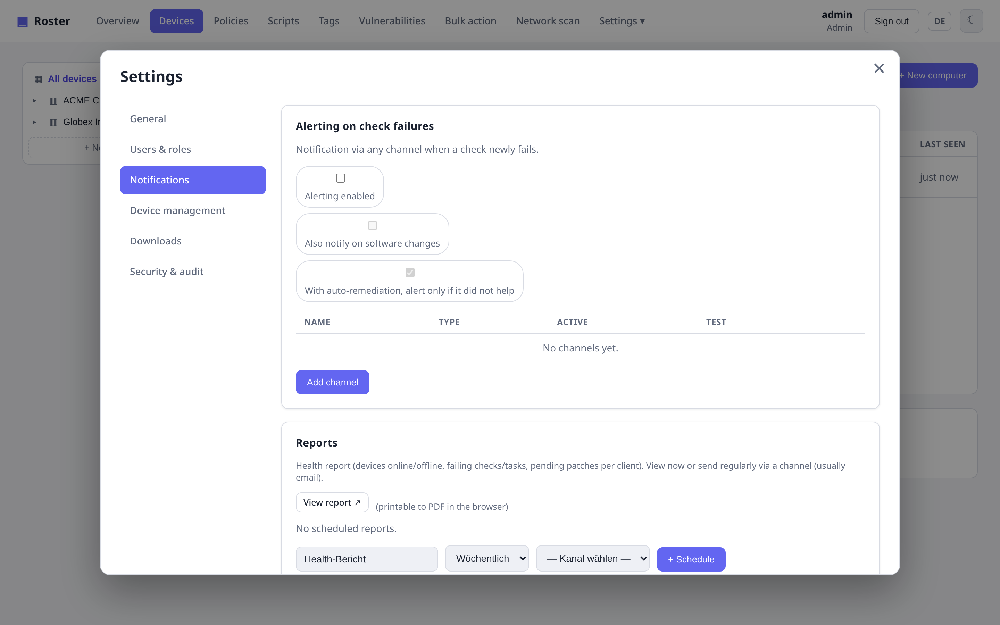

# Alerting & reports

## Alerting

Modular notification channels — **email, webhook, Pushover, Telegram, ntfy** — scoped to a
company/site/device with a severity filter. Roster sends when a check newly fails and again
on **recovery**, and honors **maintenance windows** so planned work doesn't page anyone.
Checks with [self-healing](checks-tasks.md#self-healing) stay quiet until the remediation
has run — only a failure that survives it is reported.

### Software-change alerts

Roster can notify you when installed software on a device changes. The global toggle
under *Settings → Alerts* is the **default**; a policy's **Notifications** section can
override it with *Yes* or *No* and, when enabled, restrict what is reported:

- **Change types** – installed, removed, updated (any combination).
- **Ignored programs** – one glob pattern per line, matched case-insensitively against
  the program name (e.g. `Microsoft Edge*`, `lib*`).

With several policies the one assigned to the **device** wins over the **site**, which wins
over the **company**; a policy set to *Default* stays transparent. The device's own
setting (*As policy / Notify / Don't notify* on the device page) has the final say over the
switch, while the filters still come from the winning policy.

{ .shadow }

## Reports

Scheduled **health reports** summarizing the fleet, delivered on a cron-like schedule.

## Audit log

Every changing action is recorded in an **audit log** (who, what, when, from where),
available to admins under **Settings → Security & audit**.
