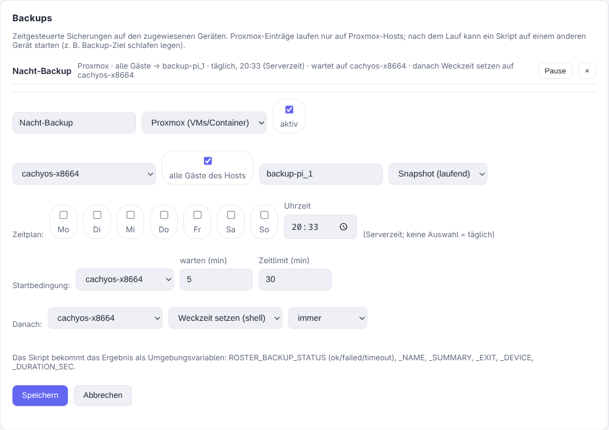

# Backups

Richtlinien haben einen Bereich **Backups**: zeitgesteuerte Backups, die auf den
zugewiesenen Geräten laufen, mit Startbedingung und Folgeaktion **auf einem anderen Gerät**.
Jeder Eintrag hat einen **Typ** – heute *Proxmox* (VMs und Container) und *Skript* (alles
andere, z. B. ein Windows-PC mit `wbadmin` oder eine Hersteller-CLI).

{ .shadow }

## Warum das kein Task ist

Tasks plant *der Agent*, und der kennt nur sich selbst. Backups plant **der Server** – und
genau das macht drei Dinge möglich:

- eine **Startbedingung**: erst loslegen, wenn ein anderes Gerät erreichbar ist,
- eine **Folgeaktion auf einem anderen Gerät** als dem, das das Backup ausgeführt hat,
- Zeitpläne, die einen Agent-Neustart überleben (der nächste Lauf eines Tasks steht nur im
  Speicher des Agents).

Zeiten gelten in der **zentralen Zeitzone** (Einstellungen → Allgemein → Zeitzone). Ist
keine gesetzt, gilt die Uhr des Servers – in einem Container meist UTC.

## Ein Eintrag

| Feld | Bedeutung |
| ----- | ------- |
| Typ | *Proxmox*: Gäste (alle oder aus dem Inventar des Hosts gewählt), Speicher, Modus. *Skript*: ein Skript aus der Bibliothek. |
| Ziel je Gast | Jeder Gast kann den Standard-Speicher überschreiben, sodass ein Eintrag Gast 107 nach `backup-pi_1` und Gast 110 nach `backup-pi_2` schreibt. Der Agent führt dann je Node **und** Ziel ein eigenes `vzdump` aus. Braucht Agent 0.16.0 – mit einem älteren schlägt der Lauf mit klarer Meldung fehl, statt stillschweigend den Standard-Speicher zu nehmen. |
| Behalte die letzten N | Aufbewahrung je Gast auf dem Ziel. Nach einem erfolgreichen Backup entfernt `vzdump` ältere Archive dieses Gasts (`--prune-backups keep-last=N`), bis N übrig sind. Leer = die Aufbewahrung des Speichers in Proxmox gilt, und ohne Einstellung dort behält Proxmox **alles** – so läuft ein Backup-Speicher voll. Braucht Agent 0.16.2; ein älterer Agent lässt den Lauf mit klarer Meldung fehlschlagen, statt stillschweigend alles zu behalten. |
| Zeitplan | Wochentage (keine = täglich) und eine Uhrzeit. Ein verpasster Lauf – Server war aus – wird bis zu 6 Stunden nachgeholt, nie später. |
| Startbedingung | Warten, bis ein Gerät online ist, bis zu N Minuten; danach gilt der Lauf als fehlgeschlagen. |
| Zeitlimit | Bricht einen Lauf ab, der länger dauert. |
| Danach | Skript + Gerät, ausgeführt *immer*, *nur bei Erfolg* oder *nur bei Fehler*. |

Proxmox-Einträge laufen nur auf Geräten, die eine Proxmox-Version melden. Die Richtlinie
einem ganzen Standort zuzuweisen startet also keine Backups auf jeder Workstation.

## Die Folgeaktion

Das Folgeskript läuft über den Agent auf dem gewählten Gerät und bekommt das Ergebnis als
Umgebungsvariablen:

| Variable | Beispiel |
| -------- | ------- |
| `ROSTER_BACKUP_STATUS` | `ok`, `failed`, `timeout` |
| `ROSTER_BACKUP_NAME` / `_ID` / `_RUN_ID` | der Eintrag und dieser Lauf |
| `ROSTER_BACKUP_EXIT` | Exit-Code |
| `ROSTER_BACKUP_SUMMARY` | z. B. `1 von 5 Gästen fehlgeschlagen – 102: device busy` |
| `ROSTER_BACKUP_DEVICE` | Host, der das Backup ausgeführt hat |
| `ROSTER_BACKUP_STARTED` / `_FINISHED` / `_DURATION_SEC` | Zeiten |

Zwei Details, die in der Praxis zählen:

- Mit *immer* läuft die Folgeaktion **auch dann, wenn das Backup fehlgeschlagen ist oder
  ins Zeitlimit lief**. Ein Backup-Ziel, das sich nach dem Lauf selbst abschaltet, darf nicht
  wach bleiben, nur weil ein Backup kaputt war.
- Speisen mehrere Backups dasselbe Folge-Gerät, löst nur der **letzte** beendete Lauf die
  Aktion aus – sonst würde der erste das Ziel schlafen legen, während ein anderes Backup noch
  schreibt.

## Beispiel: Backup-Ziel mit Weckzeit

Ein Raspberry Pi hält die NFS-Freigabe und wacht um 18:00 auf; die Proxmox-Jobs sind in PVE
deaktiviert, damit sie nie laufen, während er schläft.

1. Backup-Eintrag, Typ *Proxmox*, alle Gäste, Speicher `backup-pi_1`, täglich um 18:00.
2. Startbedingung: auf den Pi warten, bis zu 30 Minuten.
3. Danach: Skript *nächste Weckzeit setzen* auf dem Pi, ausgeführt *immer* – es schreibt
   `/sys/class/rtc/rtc0/wakealarm` und fährt den Pi herunter.

Der Pi braucht dafür einen Roster-Agent (64-Bit-OS; der Server liefert einen `arm64`-Agent
mit).

Berechne die Weckzeit mit expliziter Zeitzone, nicht mit der Systemzeit des Pi – ein
frisches Raspberry Pi OS steht oft auf `Europe/London`:

```sh
target=$(TZ=Europe/Berlin date -d "tomorrow 20:00" +%s)
echo 0 > /sys/class/rtc/rtc0/wakealarm
echo "$target" > /sys/class/rtc/rtc0/wakealarm
shutdown -h +1          # Verzögerung, damit Roster das Ergebnis noch einsammelt
```

Nicht sofort anhalten: Der Agent meldet das Skriptergebnis beim Checkin, den er direkt nach
dem Lauf auslöst – und eine Maschine, die schon aus ist, meldet nichts.

## Läufe

Jeder Lauf wird aufgezeichnet: Status, Start, Dauer, Zusammenfassung je Gast und das Ende
des vzdump-Protokolls. Die Geräteseite hat einen Tab **Backups** mit dem Verlauf und einem
Knopf *Jetzt starten* (braucht das Recht *Geräte bedienen*). Ein fehlgeschlagener Lauf oder
einer im Zeitlimit löst einen Alarm über die konfigurierten Kanäle aus, unter Beachtung von
Wartungsfenstern und Mindest-Schweregrad.

### Vollen Speicher aufräumen

`vzdump` räumt erst auf, **nachdem** es das neue Archiv geschrieben hat – das Ziel braucht
also kurz Platz für ein weiteres Backup je Gast. Ist ein Speicher bereits voll, scheitert der
nächste Lauf, bevor irgendetwas aufgeräumt wird. Für diesen Fall bietet der Tab **Backups**
des Proxmox-Hosts **Alte Sicherungen aufräumen** für jeden Eintrag an, bei dem *behalte die
letzten N* gesetzt ist:

- **prüfen** fragt Proxmox, was entfernt würde (`GET …/prunebackups`), und listet jedes
  Archiv als *behalten* / *würde entfernt* / *geschützt* – nichts wird angefasst.
- **aufräumen** entfernt die Archive (`DELETE …/prunebackups`, ein Aufruf je Gast und
  Speicher), wartet auf den Proxmox-Task und meldet das Ergebnis auf dieselbe Weise.

Geschützte Backups werden nie entfernt. Das Aufräumen verweigert sich, solange auf diesem
Host ein Backup läuft, und fasst ausschließlich Archive der Gäste des Eintrags auf deren
konfiguriertem Ziel an.

!!! note "Proxmox-Jobs und der Backup-Check"
    Roster startet `vzdump` mit eigener Auswahl, die Gäste stecken also in keinem PVE-**Job**.
    Die entstehenden Backups sind gewöhnliche Backups – sie erscheinen in Proxmox und zählen
    für [den Check `proxmox_backup`](proxmox.md#backup-check) –, aber dessen Option
    *Backup-Job verlangen* muss ausgeschaltet sein, da Proxmox sie aus den Job-Definitionen
    ableitet.

!!! warning "Reichweite des Richtlinien-Rechts"
    Wer Richtlinien bearbeiten darf, kann über eine Folgeaktion ein Skript auf einem
    **anderen** Gerät ausführen lassen. Das ist dieselbe Macht wie heute Skripte plus
    Richtlinien, überschreitet jetzt aber Gerätegrenzen.
