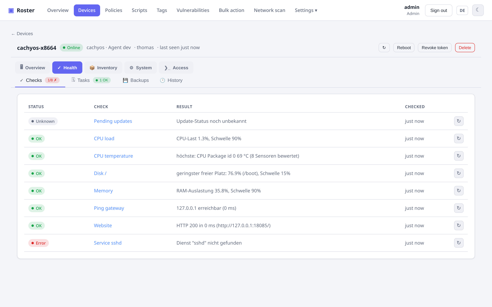
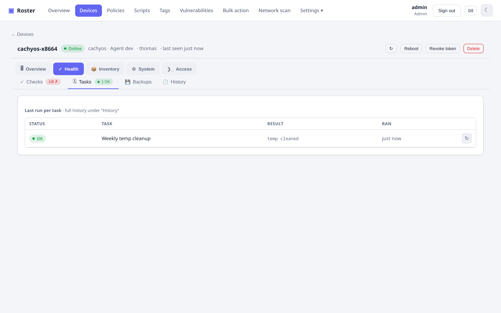
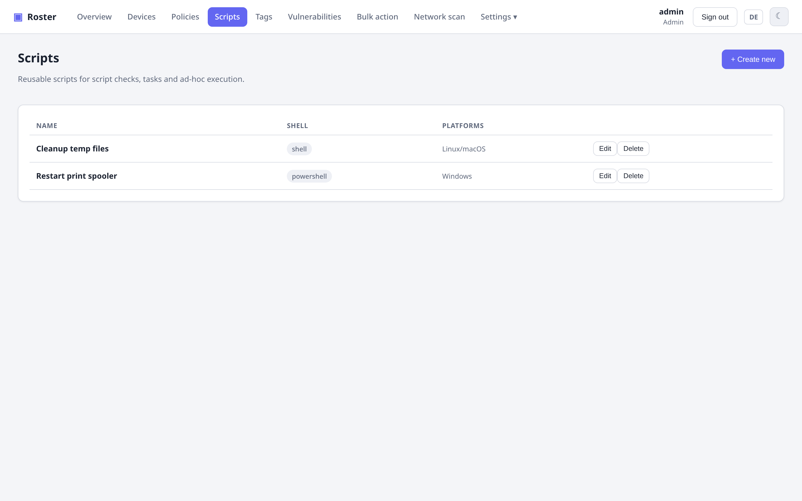

# Checks & Tasks

Richtlinien bündeln **Checks** (Monitoring), **Tasks** (geplante Automatisierung),
[Backups](backups.md) und [Benachrichtigungs-Einstellungen](alerting.md#software-anderungsalarme)
und werden einer Firma, einem Standort oder einem Gerät zugewiesen – mit Vererbung
(Gerät → Standort → Firma).

{ .shadow }

## Checks

Jeder Check hat seine eigene Frequenz, Schwere, Ausgabevergleich und Plattform-Zielgruppe:

{ .shadow }

- **Schwellwerte**: `disk`, `memory`, `cpu`, ausstehende `updates`.
- **Skript**: ein Shell-/PowerShell-Skript ausführen und das Ergebnis auswerten.
- **Netzwerk**: nativer `ping`, `tcp`-Port, `http`-Status.
- **Offene Ports**: Alarm, wenn ein Gerät einen öffentlichen Port freigibt, der nicht auf einer Allow-Liste steht.
- **Temperatur**: Warnung/Fehler, wenn ein Sensor zu heiß wird – standardmäßig an den Grenzen,
  die der Chip selbst meldet (kritisch bei `crit`, Warnung bei `max` oder 10 °C unter `crit`),
  optional mit eigenen °C-Schwellwerten und einem Sensorfilter wie `cpu` oder `nvme`.
- **Lüfter**: Fehler, wenn ein Lüfter stehen bleibt, sein Chip einen Alarm meldet oder er unter einer
  Mindestdrehzahl läuft (der des Chips oder deiner eigenen), optional gefiltert z. B. auf den CPU-Lüfter.
- **Proxmox-Backups**: jeder Gast auf einem PVE-Host hat ein aktuelles, erfolgreiches Backup und ist
  in einem Backup-Job enthalten – siehe [Proxmox VE](proxmox.md).

Fehlerhafte Checks erscheinen als Gesundheits-Badge in der Geräteliste und steuern **Alarme** und
**Selbstheilung**.

### Check-Verlauf

Klicke auf der Geräteseite auf den Namen eines Checks, um seinen Verlauf zu öffnen: den Messwert
(Disk %, Ping ms, Temperatur °C, HTTP-Status, Skript-Zahl, …) als Linie, darunter den Status
pro Zeitfenster als farbigen Streifen. Zeiträume von 1 Stunde bis 30 Tage; die Rohauflösung ist
das Checkin-Intervall des Agents (jeder Checkin ergibt einen Punkt), längere Zeiträume werden pro
Fenster gemittelt und zeigen den schlechtesten Status darin. Messwerte werden standardmäßig
10 Tage aufbewahrt (`ROSTER_CHECK_HISTORY_DAYS`).

{ .shadow }

## Tasks

Geplante Skripte mit einer Frequenz (Intervall / täglich / wöchentlich / …), mit dem letzten Lauf
pro Task plus vollständiger Lauf-Historie. Jeden Check oder Task kannst du außerdem mit dem
↻-Button bei Bedarf **erneut ausführen**.

{ .shadow }

### Zeitzone

Ein Task mit *täglich 02:00* läuft um 02:00 **in der Zeitzone, die unter Einstellungen →
Allgemein konfiguriert ist**. Der Server schickt diese Zone mit der Richtlinie mit und der Agent
plant darin – sonst würde jede Maschine ihre eigene Uhr verwenden und derselbe Zeitplan bedeutete
auf jeder einen anderen Moment (ein Raspberry Pi auf `Europe/London`, ein Container auf UTC, eine
Workstation auf Ortszeit).

Lass die Einstellung leer, um das alte Verhalten zu behalten: jedes Gerät nutzt seine eigene
Systemzeit. Agents älter als 0.16.0 ignorieren die Zone und verwenden immer ihre eigene Uhr. Eine
Änderung der Einstellung verschiebt bestehende Zeitpläne mit fester Uhrzeit einmalig – das ist
der Sinn der Sache, aber gut zu wissen, bevor du sie einschaltest. Backups verwenden dieselbe Zone;
siehe [Backups](backups.md).

!!! tip "Tasks oder Backups?"
    Tasks werden vom Agent geplant und laufen auf dem Gerät selbst. Geplante **Backups**
    haben ihren eigenen Bereich in einer Richtlinie – sie werden vom Server geplant, können
    auf ein anderes Gerät warten und darauf eine Folgeaktion auslösen. Siehe [Backups](backups.md).

## Selbstheilung

Automatische Remediation: ein Skript ausführen oder einen Dienst neu starten, **wenn ein Check
fehlschlägt** – damit sich häufige Probleme von selbst beheben, bevor jemand alarmiert wird.

Wörtlich genommen: ein Check mit Remediation alarmiert **nicht**, wenn er fehlschlägt. Der Alarm
wird **zurückgestellt**, bis die Remediation ihre Chance hatte:

- das Remediation-Skript ist durchgelaufen (oder nach einem Proxmox-Reboot sind 5 Minuten
  vergangen) **und** der Check hat erneut gemeldet – immer noch fehlerhaft → ein Alarm, markiert
  mit *Auto-Remediation hat nicht geholfen*;
- der Check ist wieder in Ordnung → gar nichts, nicht einmal eine *Erholt*-Meldung, denn der
  Fehler wurde nie angekündigt.

Eine Remediation, die wegen der 30-minütigen Abkühlphase übersprungen wird (flatternder Check),
alarmiert sofort wie bisher. Wenn das Skript nie fertig wird, geht der Alarm nach zwei Stunden
in jedem Fall raus.

Du willst lieber von jedem Fehler hören, auch von denen, die sich selbst heilen? Schalte
**Bei Auto-Remediation erst melden, wenn sie nicht geholfen hat** unter *Einstellungen →
Benachrichtigungen* aus – dann alarmiert ein fehlerhafter Check sofort und die Remediation läuft
parallel, wie vor 0.16.3.

## Skripte

Eine wiederverwendbare **Skriptbibliothek** (Shell / PowerShell, mit Plattform-Zielgruppe) treibt
Skript-Checks, Tasks, Selbstheilung und Ad-hoc-Aktionen „Skript ausführen" an.

{ .shadow }

!!! warning "Skript-Checks/-Tasks sind Remote-Code"
    Alles, was Skripte auf Endgeräten ausführt, ist mächtig. Vergib die Berechtigungen `Skripte` und
    `Geräte bedienen` bewusst – siehe
    **[Rollen & Berechtigungen](permissions.md)**.
