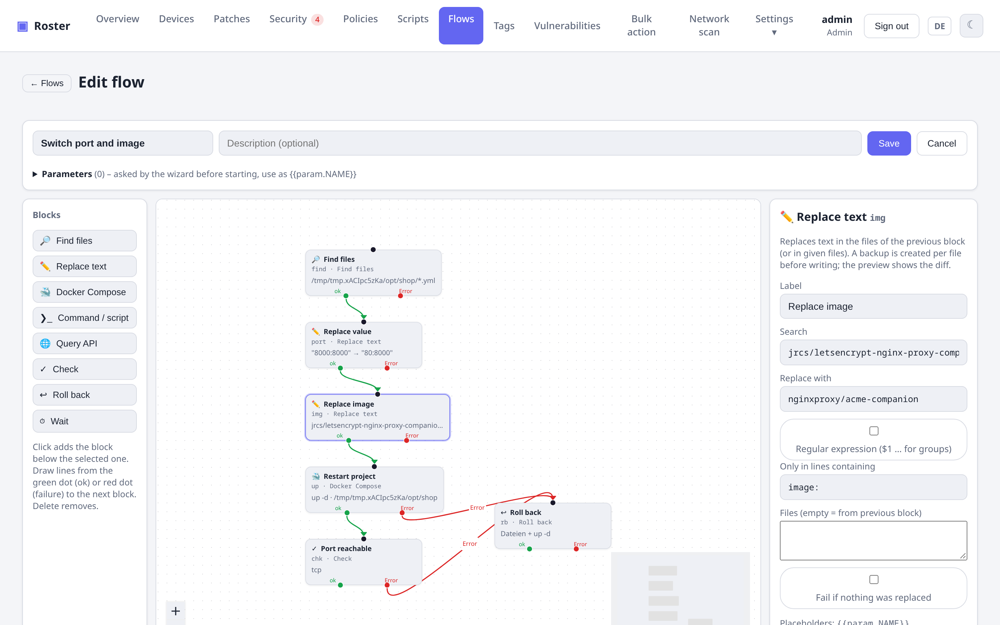
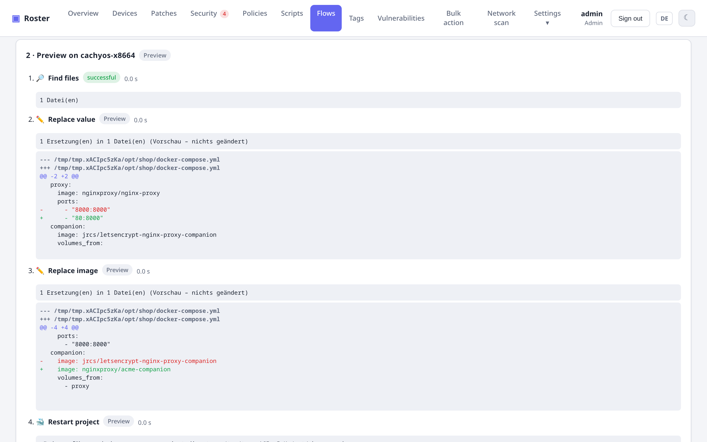

# Abläufe (Flow-Designer)

Wiederkehrende Änderungen auf vielen Servern – ein Image in Compose-Dateien tauschen, einen Port
von `8000` auf `80` umstellen, eine Version aus einer API in eine `.env` schreiben – baust du als
**Ablauf** aus Bausteinen, die du per Linie verbindest. Ausgeführt wird er vom Agent selbst
(ohne `sed`, `bash` oder Zusatzwerkzeuge), mit **Vorschau**, **Backup** und **Zurückrollen**.

{ .shadow }

## Editor

Unter **Abläufe** legst du einen neuen Ablauf an oder startest **aus einer Vorlage**. Links stehen
die Bausteine, in der Mitte die Zeichenfläche, rechts die Eigenschaften des ausgewählten
Bausteins. Jeder Baustein hat einen Eingang oben und zwei Ausgänge unten:

- **ok** (grün) – weiter, wenn der Baustein erfolgreich war,
- **Fehler** (rot) – Zweig für den Fehlerfall, z. B. auf *Zurückrollen*.

Ein Ablauf hat genau einen Startbaustein (ohne eingehende Linie) und darf keine Kreise
enthalten. Ist der Fehler-Ausgang eines Bausteins **nicht verbunden**, bricht der Ablauf dort ab
und stellt **automatisch** alle bis dahin geänderten Dateien wieder her.

**Parameter** (z. B. `FROM`, `TO`) fragt der Assistent vor dem Start ab; im Ablauf stehen sie als
`{{param.FROM}}`.

## Bausteine

| Baustein | Was er tut | In der Vorschau |
|---|---|---|
| **Dateien finden** | Pfade/Globs (eine je Zeile, optional „enthält …“) **oder** die Compose-Dateien aller Container mit einem Image (über die Compose-Labels; der Name genügt, z. B. `php-fpm-prod` für `registry…/docker/php-fpm-prod`, `*` als Platzhalter; ohne Tag = alle Tags; dazu die `.env`, falls das Image dort steht). Eigene Backups (`*.roster-bak-*`) werden nie gefunden. Keine Treffer = Gerät nicht betroffen, der Ablauf endet ohne Fehler. | läuft |
| **Text ersetzen** | Literal oder regulärer Ausdruck (`$1` …), optional nur in Zeilen mit einem Text (z. B. `image:`). Je Datei wird vorher ein Backup `<datei>.roster-bak-<lauf>` angelegt. Ohne Treffer endet der Ablauf hier ohne Fehler (Gerät schon umgestellt), außer mit „Weitermachen, auch wenn nichts ersetzt wurde“. | zeigt den Diff, ändert nichts |
| **Wert lesen** | Liest einen Wert aus YAML/JSON (Pfad wie `services.php-fpm.image`, `"a.b"` für Punkte im Namen, Zahl = Listenindex) oder einen Schlüssel aus einer `.env`. *Teil* schneidet aus einer Image-Angabe das Tag (`…:2.4.0` → `2.4.0`, ohne Tag `latest`) oder das Repository. Ergebnis: `{{steps.ID.value}}`. | läuft |
| **YAML ändern** | Ändert YAML gezielt, Kommentare, Anführungszeichen und Einrückung bleiben: `set pfad = wert`, `append pfad = eintrag` (nur wenn neu), `ensure pfad = wert` (nur wenn fehlt), `delete pfad [= listeneintrag]`. Fehlende Teile werden angelegt. `{a,b,c}` im Pfad gilt für mehrere Einträge, `{{value.repo}}`/`{{value.tag}}`/`{{value.suffix}}`/`{{value}}` im Wert stehen für den aktuellen Wert (`suffix` = Anhängsel wie `_tp` aus `2.4.0_tp`). Backup und Diff wie bei *Text ersetzen*; ohne Änderung endet der Ablauf. | zeigt den Diff |
| **Docker Compose** | `pull`, `up -d`, `restart`, `down` – für die gefundenen Projekte (nur betroffene Dienste) oder ein Verzeichnis; `docker compose` mit Rückfall auf `docker-compose`. | zeigt die Befehle |
| **Befehl / Skript** | Eigener Befehl oder ein Skript aus der Bibliothek; Exit ≠ 0 = Fehler. | wird nicht ausgeführt |
| **API abfragen** | HTTP-Anfrage mit Headern/Body; JSON-Pfad liefert einen Wert (`{{steps.api.value}}`). | nur GET/HEAD |
| **Prüfen** | Container läuft (ohne Namen: die betroffenen Compose-Dienste), HTTP-Status, TCP-Port, Datei enthält Text, Wert vergleichen – auch als Version (`2.10.0 > 2.9.1`, `v`-Präfix egal, `-rc` kleiner als die Endversion, Anhängsel wie `_tp` zählen nicht) – mit Wiederholungen. *Nicht erfüllt: Ablauf ohne Fehler beenden* macht daraus eine Bedingung („sonst nichts tun“). | Vergleiche und „Datei enthält“ laufen, Rest übersprungen |
| **Dateisystem** | `mkdir pfad [mode=0775] [owner=33:33]`, `chmod pfad 0775`, `chown pfad benutzer:gruppe`, `file pfad = "inhalt"` – jeweils nur, wenn nötig. Zurückrollen entfernt neu angelegte (leere) Verzeichnisse und Dateien und stellt Rechte/Besitzer wieder her. | zeigt die geplanten Schritte |
| **Befehl im Container** | `docker exec` in einem Compose-Dienst (im Projekt des vorigen *Dateien finden*) oder Container, optional Benutzer/Arbeitsverzeichnis – z. B. `bin/console cache:clear`. | zeigt Befehl und Container |
| **Datenbank sichern** | Dump aus MySQL/MariaDB, MongoDB oder PostgreSQL (Zugangsdaten aus der Container-Umgebung), gzip-komprimiert nach `/var/backups/roster`, die neuesten *N* bleiben. Pfad als `{{steps.ID.value}}`. Bleibt beim Zurückrollen erhalten. | prüft, ob das Dump-Programm vorhanden ist |
| **Docker aufräumen** | entfernt namenlose oder alle ungenutzten Images (älter als *N* Tage). Nicht rückgängig zu machen. | listet, was entfernt würde |
| **Benachrichtigen** | Meldung über die Alarm-Kanäle (auch im Wartungsfenster), Platzhalter erlaubt. | verschickt nichts |
| **Zurückrollen** | Nimmt alle Änderungen dieses Laufs zurück (Dateien, Verzeichnisse, Rechte), optional danach `up -d` für das ganze Compose-Projekt. | wird übersprungen |
| **Warten** | Wartet bis zu 10 Minuten. | wird übersprungen |

**Ausprobieren:** Beim Baustein *YAML ändern* öffnet *Ausprobieren …* ein Fenster mit drei Spalten:
links eine eingefügte YAML-Datei (z. B. eure Compose-Datei) und Werte für die Parameter, in der
Mitte die Operationen (Änderungen gehen direkt in den Baustein), rechts die Vorschau als Diff oder
vollständiges Ergebnis – samt Meldung je Operation. Gerechnet wird mit demselben Code wie im Agent;
nichts wird gespeichert oder ausgeführt.

**Nur ausführen, wenn …:** Jeder Baustein hat dieses optionale Feld. Steht dort z. B. `{{param.DB_SERVICE}}` und der Parameter ist leer, wird der Baustein übersprungen und der Ablauf geht über *ok* weiter; mit `!` davor läuft er nur, wenn der Wert leer ist. So lassen sich Schritte über Parameter an- und abschalten.

**Platzhalter:** `{{param.NAME}}`, `{{steps.ID.value}}`, `{{steps.ID.out}}` (Befehlsausgabe),
`{{steps.ID.json.pfad.0.feld}}`, `{{steps.ID.files}}` und die Gerätefelder `{{agent.feld}}`,
`{{client.feld}}`, `{{site.feld}}`.

## Ausführen: Vorschau → Testserver → Rollout

{ .shadow }

1. **Parameter und Vorschau-Server** wählen, *Vorschau starten*: der Agent dieses Servers führt den
   Ablauf im Trockenlauf aus und zeigt je Baustein, was passieren würde – samt Diff jeder Datei.
2. **Auf Testserver ausführen**: derselbe Server, diesmal echt (mit Backups).
3. **Ausrollen** auf eine Firma, einen Standort, einen Tag, alle Geräte oder – vom Container-Tab
   aus – die betroffenen Geräte. Die Tabelle zeigt den Stand je Gerät; Geräte ohne Treffer
   erscheinen als *nicht betroffen*.

Unter **Abläufe → Läufe** stehen frühere Läufe mit ihren Ergebnissen; einzelne Läufe lassen sich
löschen. **Kopieren** (in der Liste oder im Editor) legt einen Ablauf als Ausgangspunkt für eine
Variante an – im Editor auch mit noch ungespeicherten Änderungen.

## Abläufe austauschen (JSON)

Abläufe lassen sich als Datei im Austauschformat **roster-flow** (Version 1) weitergeben:
**Exportieren** in der Liste oder im Editor lädt `<name>.roster-flow.json` herunter,
**Importieren** in der Liste nimmt eine solche Datei (Upload oder Einfügen) entgegen, prüft sie
(*Prüfen* ändert nichts) und legt einen neuen Ablauf an – ein gleichnamiger bleibt unverändert,
der Import heißt dann „Name (Import)“.

- **Bibliotheks-Skripte** werden beim Export eingebettet (`script` + `shell`), denn ihre IDs gibt
  es auf anderen Servern nicht; ein Dokument mit `script_id` wird beim Import abgelehnt.
- **Positionen** (`x`, `y`) sind optional; ohne sie stapelt der Editor die Bausteine untereinander.
- Das **JSON-Schema** liegt unter
  [roster-rmm.dev/schemas/roster-flow-1.schema.json](https://roster-rmm.dev/schemas/roster-flow-1.schema.json).
  Mit `"$schema"` in der Datei prüfen und vervollständigen Editoren wie VS Code Bausteine und
  Einstellungen direkt beim Schreiben.
- Per API: `GET /api/v1/flows/{id}/export`, `POST /api/v1/flows/import` (mit `?dry_run=1` nur
  prüfen).

```json
{
  "$schema": "https://roster-rmm.dev/schemas/roster-flow-1.schema.json",
  "format": "roster-flow",
  "version": 1,
  "name": "Port 8000 auf 80 umstellen",
  "params": [{ "name": "DIR", "label": "Compose-Verzeichnis", "required": true }],
  "nodes": [
    { "id": "find", "type": "find_files", "config": { "mode": "paths", "paths": "{{param.DIR}}/docker-compose.yml" } },
    { "id": "repl", "type": "replace", "config": { "search": "\"8000:8000\"", "replace": "\"80:8000\"" } },
    { "id": "up", "type": "compose", "config": { "action": "up", "all_services": true } },
    { "id": "rb", "type": "rollback", "config": { "compose_up": true } }
  ],
  "edges": [
    { "from": "find", "port": "ok", "to": "repl" },
    { "from": "repl", "port": "ok", "to": "up" },
    { "from": "up", "port": "fail", "to": "rb" }
  ]
}
```

## Vorlagen

- **Compose: Version anheben, wenn älter** – liest das Image-Tag eines Dienstes (z. B. `php-fpm`), prüft „älter als 2.5.0“ und dann: Datenbank sichern (Parameter `DB_SERVICE`, leer = nein), Volume-Verzeichnis anlegen (`VOLUME_DIR`, leer = einfaches Docker-Volume), Images von `web`, `php-fpm`, `cron` auf 2.5.0 (Repository und `_tp` bleiben), Mount und Volume eintragen, `pull`, `up -d`, prüfen, Befehl im Container (`POST_CMD`, z. B. `bin/console cache:clear`), namenlose Images aufräumen, Erfolg melden. Bei Fehler: alles zurücknehmen, ganzes Projekt neu hochfahren, Fehler melden – die Datenbank-Sicherung bleibt. Sonst *nicht betroffen*. Kern ist dieser Baustein *YAML ändern*:

    ```
    set    services.{web,php-fpm,cron}.image = {{value.repo}}:2.5.0{{value.suffix}}
    append services.{php-fpm,cron}.volumes = shop_media:/var/www/media
    ensure volumes.shop_media = {}
    ```

    `{{value.suffix}}` behält Varianten wie `_tp`: aus `2.4.0_tp` wird `2.5.0_tp`.

    Ein Wert in Kurzform (`{…}` oder `[…]`) wird beim Anlegen als Block geschrieben – so entsteht ein
    Volume mit Treiber-Optionen in einer Zeile:

    ```
    ensure volumes.shop_media = {driver: local, driver_opts: {type: none, o: bind, device: /data/volumes/shop_media}}
    ```

    ergibt

    ```yaml
    volumes:
      shop_media:
        driver: local
        driver_opts:
          type: none
          o: bind
          device: /data/volumes/shop_media
    ```

- **Image in Compose ersetzen** – Compose-Dateien mit altem Image finden, in der `image:`-Zeile
  ersetzen, `pull`, `up -d`, kurz warten, prüfen; bei Fehler zurückrollen und alten Stand
  hochfahren. Unter **Sicherheit → Container** öffnet *Image ersetzen …* diese Vorlage mit dem
  Image und den betroffenen Geräten vorbelegt (z. B. `jrcs/letsencrypt-nginx-proxy-companion` →
  `nginxproxy/acme-companion`).
- **Wert in Datei ersetzen und Dienste neu starten** – z. B. Port `8000` → `80`, Projekt neu
  starten, Port prüfen.
- **API abfragen und Wert eintragen** – Wert per JSON-Pfad lesen und per regulärem Ausdruck in
  eine Datei schreiben.

!!! note "Rechte"
    Abläufe bearbeiten erfordert das Recht *Skript-Bibliothek*, ausführen *Geräte bedienen*.
    Jeder Start steht im Audit-Log. Der Agent führt Abläufe mit seinen Rechten aus (root bzw.
    SYSTEM) – Backups bleiben neben den Dateien liegen.
