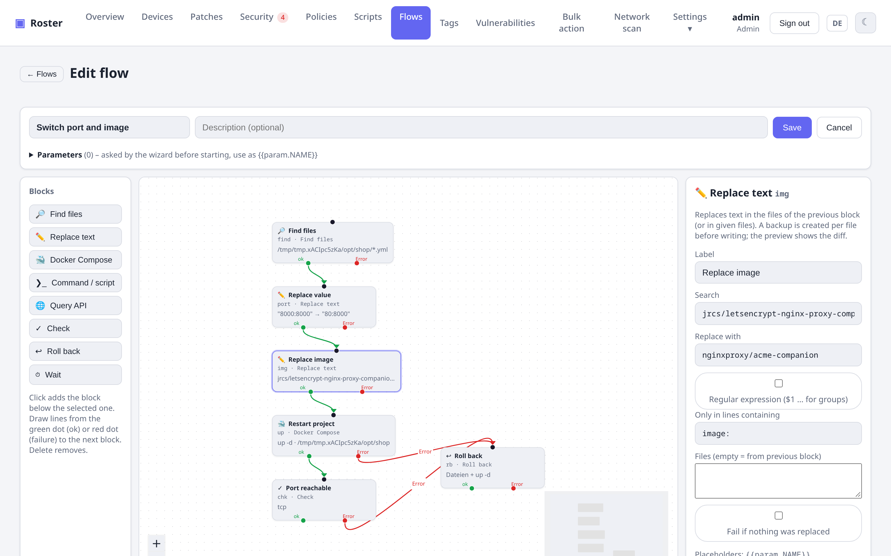
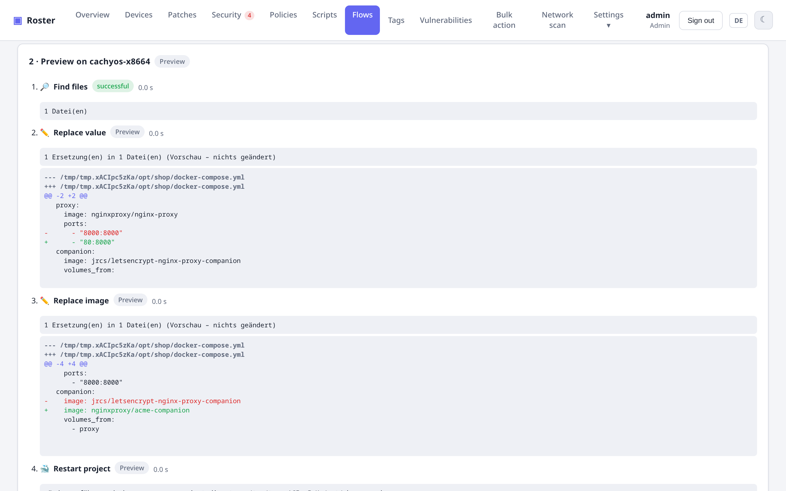

# Flows (flow designer)

Recurring changes on many servers – swapping an image in Compose files, changing a port from
`8000` to `80`, writing a version from an API into a `.env` – are built as a **flow** of blocks
connected by lines. The agent itself runs it (no `sed`, `bash` or extra tools), with a
**preview**, **backups** and **rollback**.

{ .shadow }

## Editor

Under **Flows** create a new flow or start **from a template**. Blocks are on the left, the canvas
in the middle, the properties of the selected block on the right. Every block has an input at the
top and two outputs at the bottom:

- **ok** (green) – continue when the block succeeded,
- **Error** (red) – branch for the failure case, e.g. to *Roll back*.

A flow has exactly one start block (no incoming line) and must not contain cycles. If a block's
error output is **not connected**, the flow stops there and **automatically** restores every file
changed so far.

**Parameters** (e.g. `FROM`, `TO`) are asked by the wizard before starting; inside the flow they
are `{{param.FROM}}`.

## Blocks

| Block | What it does | In the preview |
|---|---|---|
| **Find files** | Paths/globs (one per line, optional "contains …") **or** the Compose files of all containers with an image (via the Compose labels; no tag = all tags; plus the `.env` if the image is there). No matches = device not affected, the flow ends without error. | runs |
| **Replace text** | Literal or regular expression (`$1` …), optionally only in lines containing a text (e.g. `image:`). A backup `<file>.roster-bak-<run>` is written per file first. | shows the diff, changes nothing |
| **Docker Compose** | `pull`, `up -d`, `restart`, `down` – for the projects found (affected services only) or a directory; `docker compose` with fallback to `docker-compose`. | shows the commands |
| **Command / script** | Own command or a library script; exit ≠ 0 = failure. | not executed |
| **Query API** | HTTP request with headers/body; a JSON path yields a value (`{{steps.api.value}}`). | GET/HEAD only |
| **Check** | Container running (without a name: the affected Compose services), HTTP status, TCP port, file contains text, compare value – with retries. | skipped |
| **Roll back** | Restores every file changed in this run, optionally followed by `up -d`. | skipped |
| **Wait** | Waits up to 10 minutes. | skipped |

**Placeholders:** `{{param.NAME}}`, `{{steps.ID.value}}`, `{{steps.ID.out}}` (command output),
`{{steps.ID.json.path.0.field}}`, `{{steps.ID.files}}` and the device fields `{{agent.field}}`,
`{{client.field}}`, `{{site.field}}`.

## Running: preview → test server → rollout

{ .shadow }

1. Choose **parameters and a preview server**, *Start preview*: that server's agent runs the flow as
   a dry run and shows per block what would happen – including the diff of every file.
2. **Run on test server**: the same server, this time for real (with backups).
3. **Roll out** to a company, a site, a tag, all devices or – from the Containers tab – the affected
   devices. The table shows the state per device; devices without matches appear as *not affected*.

**Flows → Runs** lists earlier runs with their results.

## Templates

- **Replace image in Compose** – find Compose files with the old image, replace it in the `image:`
  line, `pull`, `up -d`, wait briefly, check; on failure roll back and bring the previous state up.
  Under **Security → Containers**, *Replace image …* opens this template with the image and the
  affected devices prefilled (e.g. `jrcs/letsencrypt-nginx-proxy-companion` →
  `nginxproxy/acme-companion`).
- **Replace value in file and restart services** – e.g. port `8000` → `80`, restart the project,
  check the port.
- **Query API and write value** – read a value by JSON path and write it into a file via regular
  expression.

!!! note "Permissions"
    Editing flows requires the *Script library* permission, running them *Operate devices*. Every
    start is in the audit log. The agent runs flows with its own privileges (root or SYSTEM) –
    backups stay next to the files.
