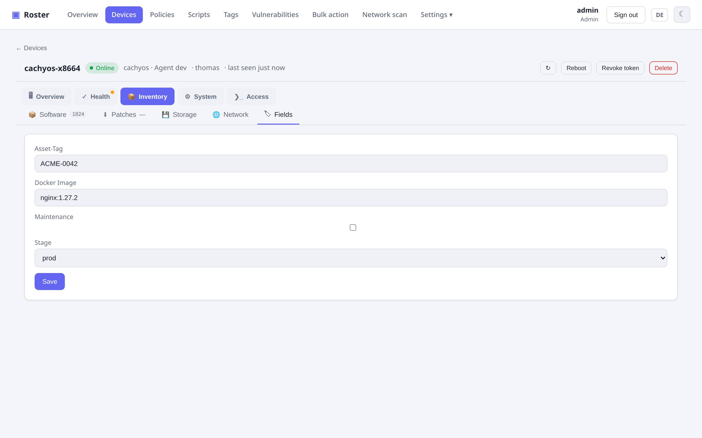

# Inventar

Jeder Agent meldet bei jedem Checkin ein vollständiges Hardware-/Software-Inventar – kein
manuelles Scannen nötig.

{ .shadow }

## Was erfasst wird

- **Hardware**: Hersteller, Modell, Seriennummer, CPU (Modell + Kerne), Arbeitsspeicher,
  Datenträger.
- **Betriebssystem**: Name, Version, angemeldete Benutzer, Uptime.
- **Netzwerk**: Schnittstellen mit IP- und MAC-Adressen; öffentliche IP.
- **Software**: installierte Anwendungen mit Versionen; Drucker.
- **Lauschende/offene Ports**: Der Agent meldet lauschende Sockets (Angriffsfläche), dazu
  eine Prüfung der externen Erreichbarkeit und ein Check-Typ für eine Port-Whitelist.
- **Temperaturen**: jeder Sensor, den das System bereitstellt (CPU-Package/-Kerne, Chipsatz,
  NVMe, GPU, Mainboard), mit den Warn- und Kritisch-Schwellen des Chips selbst – angezeigt
  auf der Geräteübersicht mit einem Status pro Sensor. Mehrere SSDs werden nach ihrem
  Kernel-Gerät benannt (`nvme0 Composite`, `nvme1 Composite`), wie in Proxmox; AMD-CPUs, die
  keine Grenzwerte melden, nutzen AMDs Tjmax von 95 °C (Warnung ab 85 °C).
- **Lüfter**: Drehzahl (U/min), PWM-Tastgrad und Alarm-Flag jedes Lüfters unter Linux
  (hwmon). Anschlüsse ohne angeschlossenen Lüfter werden ausgelassen; ein Lüfter, der sich
  zuvor gedreht hat und stoppt, wird als *steht* gemeldet.
- **Proxmox VE**: auf einem PVE-Host alle VMs/Container mit Ressourcen und Backup-Status –
  siehe [Proxmox VE](proxmox.md).

## Live-Auslastung & Verlauf

Hole bei Bedarf einen Live-Snapshot von CPU (pro Kern), RAM, Datenträger und Netzwerk – und
blättere durch gespeicherte **Zeitreihen** mit Diagrammen über 24 h / 7 d / 30 d. Geräte mit
Sensoren bekommen ein zweites Diagramm für die **heißeste CPU-Temperatur** (eigene °C-Achse,
Hover zeigt Wert und Zeitpunkt).

!!! note "Woher die Temperaturen kommen"
    Linux liest `/sys/class/hwmon` (inklusive der Schwellwerte jedes Chips), FreeBSD
    `sysctl`, macOS den SMC und Windows die WMI-Thermalzonen – die viele Windows-Boards leer
    lassen. Virtuelle Maschinen haben normalerweise gar keine Sensoren; der Abschnitt bleibt
    dann einfach ausgeblendet.

    Lüfter und Mainboard-Temperaturen brauchen unter Linux den Treiber für den
    Monitoring-Chip des Boards (z. B. `nct6775`, `it87`) – CPU- und NVMe-Sensoren
    funktionieren sofort, Board-Chips oft erst nach `modprobe nct6775` (oder einmaligem
    `sensors-detect`). Server mit BMC stellen Lüfter häufig nur über IPMI bereit. Viele
    Mini-PCs haben überhaupt keinen vom OS auslesbaren Lüfter – der Embedded Controller
    regelt ihn selbstständig; Roster zeigt dann keine Lüfter.

{ .shadow }

## Plattformübergreifende Agents

Agents laufen als Dienst unter **Windows, Linux und macOS** und **aktualisieren sich selbst**
vom Server. Sie arbeiten im Pull-Modell – nur ausgehende Verbindungen, kein eingehender Port
auf dem Client.

## Benutzerdefinierte Felder

Hänge **benutzerdefinierte Felder** im TRMM-Stil an eine Firma, einen Standort oder ein Gerät
und befülle sie über JSON-Collector-Tasks und Twig-ähnliche Platzhalter (z. B.
`{{ agent.domains | first }}`).

{ .shadow }

## Spalten der Liste wählen

Der Button **Spalten** über der Geräteliste öffnet eine Auswahl: Hake die eingebauten Spalten
an oder ab (Firma, Standort, Hersteller, Modell, Seriennummer, öffentliche IP, MAC, …
zusätzlich zu den Standardspalten) und ergänze **je eine Spalte pro benutzerdefiniertem
Feld** – ein Feld, das ein Check etwa mit einer Docker-Image-Version befüllt, erscheint direkt
in der Liste und aktualisiert sich mit ihr. Link-Felder werden als Links dargestellt, Listen
kommagetrennt, Checkboxen als ja/nein.

{ .shadow }

Der **Filter-Editor** (Button **Filter**) kennt dieselben benutzerdefinierten Felder: Wähle
eines als Feld der Bedingung und vergleiche es wie jede eingebaute Spalte – *enthält*, *=*,
*≠* für Text und Listen, *>*/*<* für Zahlen, ja/nein für Checkboxen, die definierten Optionen
für Auswahlfelder. Zwei zusätzliche Operatoren, **gesetzt** und **nicht gesetzt**, erfassen
Geräte, bei denen ein Collector-Task das Feld (noch) nicht geschrieben hat. So listet
*docker_version ≠ 1.27.2* jeden Host, der noch ein altes Image fährt, und du kannst diesen
Filter wie jeden anderen speichern.

Die Spaltenauswahl, deine **gespeicherten Filter** und die Spaltenauswahl des CSV-Exports
werden in deinem **Benutzerkonto** auf dem Server gespeichert, nicht im Browser – sie folgen
dir also, wenn du dich woanders anmeldest. Werte, die ältere Versionen im Browser abgelegt
haben, werden beim ersten Öffnen der Liste migriert.
