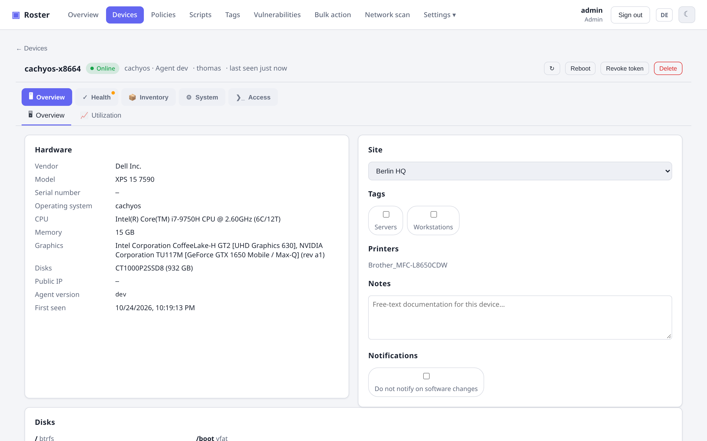
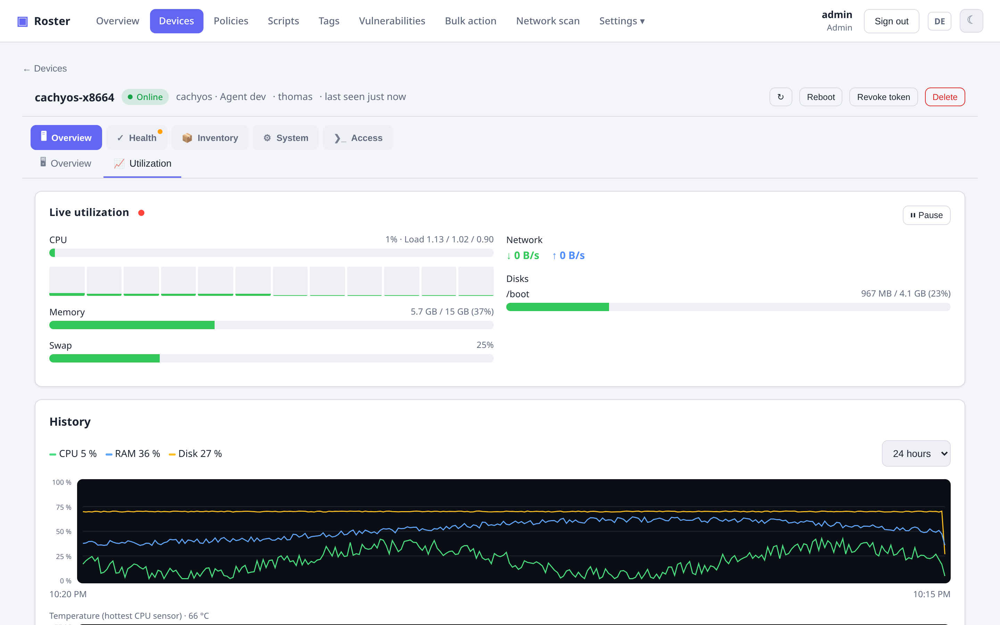

# Inventory

Every agent reports a full hardware/software inventory on each check-in — no manual
scanning required.

{ .shadow }

## What's collected

- **Hardware**: vendor, model, serial, CPU (model + cores), memory, disks.
- **Operating system**: name, version, logged-in users, uptime.
- **Network**: interfaces with IP and MAC addresses; public IP.
- **Software**: installed applications with versions; printers.
- **Listening/open ports**: the agent reports listening sockets (attack surface), with an
  external-reachability check and a ports-whitelist check type.
- **Temperatures**: every sensor the system exposes (CPU package/cores, chipset, NVMe,
  GPU, board) with the chip's own warning and critical thresholds — shown on the device
  overview with a status per sensor. Several SSDs are named after their kernel device
  (`nvme0 Composite`, `nvme1 Composite`) as in Proxmox; AMD CPUs, which report no limits,
  use AMD's Tjmax of 95 °C (warning from 85 °C).
- **Fans**: speed (RPM), PWM duty and alarm flag of every fan on Linux (hwmon). Headers
  with nothing connected are left out; a fan that has spun before and stops is reported
  as *stopped*.
- **Proxmox VE**: on a PVE host, all VMs/containers with resources and backup state —
  see [Proxmox VE](proxmox.md).

## Live utilization & history

On demand, pull a live snapshot of CPU (per core), RAM, disk and network — and browse
stored **time series** with 24 h / 7 d / 30 d charts. Devices with sensors get a second
chart for the **hottest CPU temperature** (own °C axis, hover for value and time).

!!! note "Where temperatures come from"
    Linux reads `/sys/class/hwmon` (including the thresholds of each chip), FreeBSD
    `sysctl`, macOS the SMC and Windows the WMI thermal zones — which many Windows boards
    leave empty. Virtual machines normally have no sensors at all; the section then simply
    stays hidden.

    Fans and board temperatures on Linux need the driver for the board's monitoring chip
    (e.g. `nct6775`, `it87`) — CPU and NVMe sensors work out of the box, board chips often
    only after `modprobe nct6775` (or running `sensors-detect` once). Servers with a BMC
    frequently expose fans only via IPMI. Many mini PCs have no OS-readable fan at all —
    the embedded controller regulates it on its own; Roster then shows no fans.

{ .shadow }

## Cross-platform agents

Agents run as a service on **Windows, Linux and macOS** and **auto-update** from the
server. They use a pull model — only outbound connections, no inbound port on the client.

## Custom fields

Attach TRMM-style **custom fields** to a company, site or device, and populate them with
JSON collector tasks and Twig-like placeholders (e.g. `{{ agent.domains | first }}`).

## Choosing the list columns

The **Columns** button above the device list opens a picker: tick or untick the built-in
columns (company, site, vendor, model, serial, public IP, MAC, … on top of the defaults)
and add **one column per custom field** — a field that a check fills with, say, a Docker
image version shows up right in the list and refreshes with it. Link fields render as
links, lists are joined with commas, checkboxes as yes/no.

The **filter builder** (Filter button) knows the same custom fields: pick one as the
condition's field and compare it like any built-in column — *contains*, *=*, *≠* for text and
lists, *>*/*<* for numbers, yes/no for checkboxes, the defined options for selections. Two
extra operators, **set** and **not set**, catch devices where a collector task has (not yet)
written the field. So *docker_version ≠ 1.27.2* lists every host still running an old
image, and you can save that filter like any other.

The column choice, your **saved filters** and the CSV export's column selection are stored
in your **user account** on the server, not in the browser, so they follow you when you
sign in somewhere else. Values that older versions kept in the browser are migrated the
first time you open the list.
