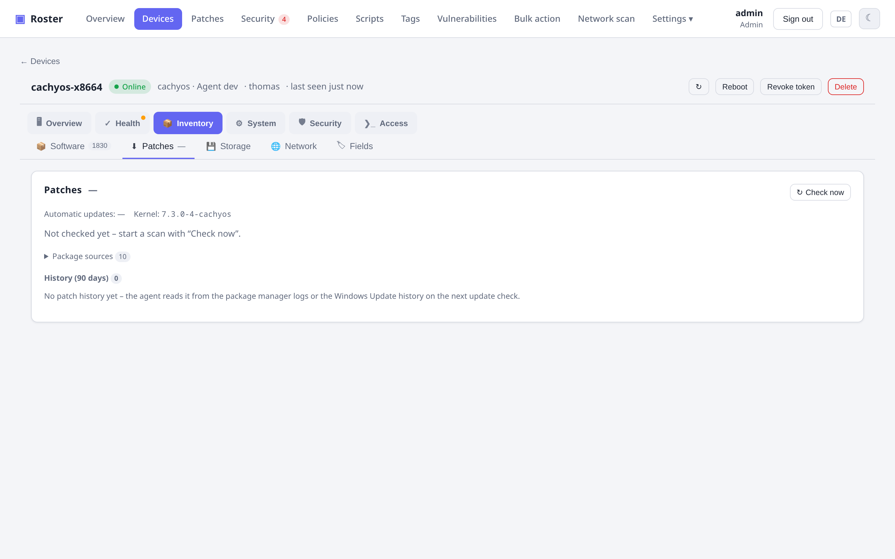
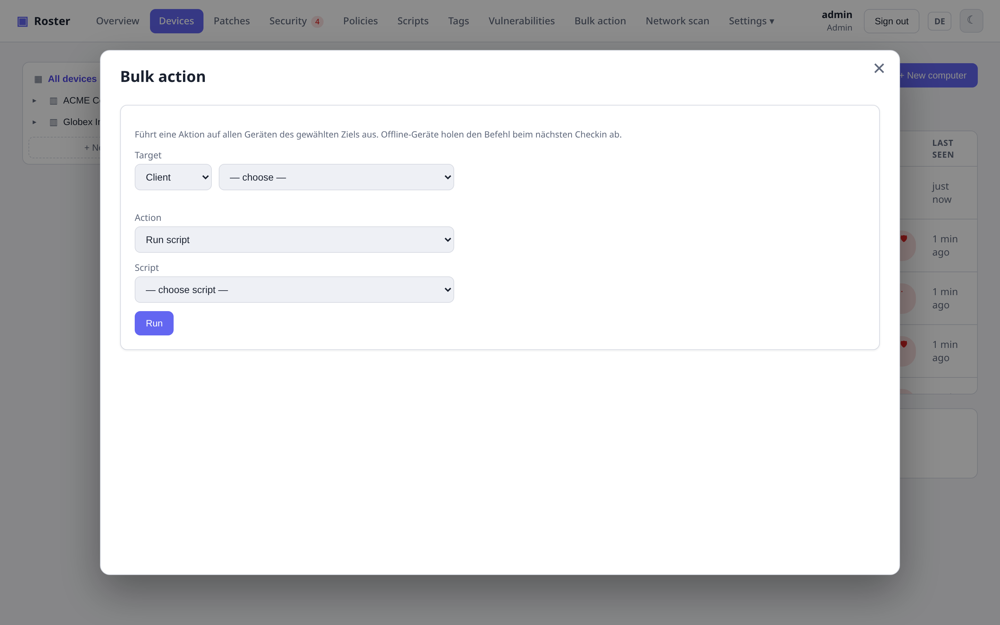
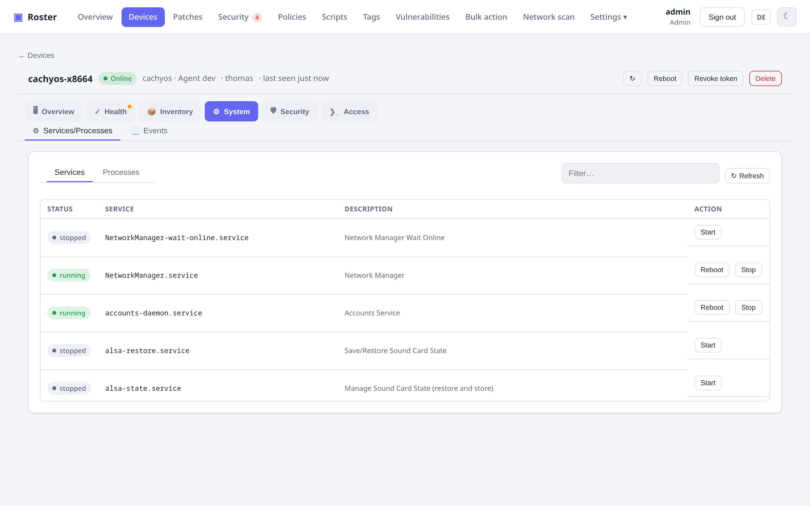
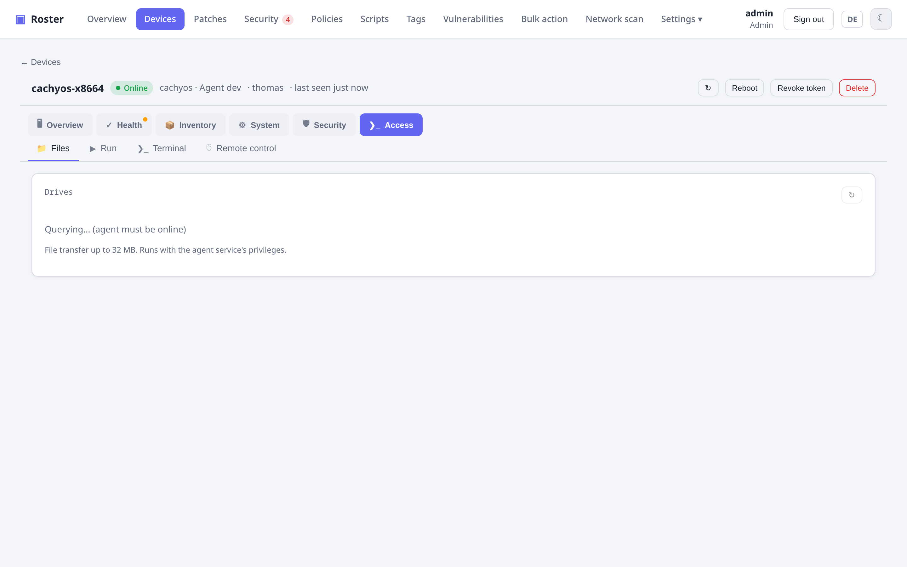
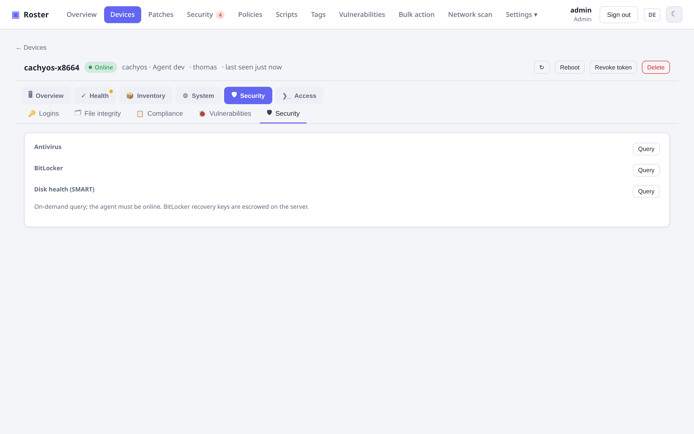

# Patch-Verwaltung & Software

## Patch-Verwaltung

Nach verfügbaren OS-Updates suchen, sie **freigeben** und installieren – mit wählbarer Strategie
unter Linux (`apt upgrade` vs. `dist-upgrade`) und optionalem Neustart danach.

{ .shadow }

## Flotten-Patchsicht & Sicherheits-Updates

Die Seite **Patches** listet ausstehende Updates der ganzen Flotte nach Gerät gruppiert –
**Sicherheits-Updates** zuerst. Der Agent ordnet sie je Paketmanager zu: apt-Suiten mit
`-security`, dnf-Security-Advisories (`dnf updateinfo --security`), Windows-Update-Kategorien
*Security Updates* / *Critical Updates* bzw. ein MSRC-Schweregrad sowie macOS-Updates mit
*Security* im Namen. Jede Zeile zeigt installierte und neue Version sowie die Quelle (Suite,
Repo, KB).

Nach Firma, Standort, „nur Sicherheit“ oder „nur genehmigte“ filtern, Zeilen oder ganze Geräte
markieren und **genehmigen**, **Genehmigung aufheben** oder **installieren** (genehmigte /
Sicherheit / genehmigte Sicherheit / alle, mit apt-Strategie). Derselbe Umfang steht in der
Sammelaktion und in der Leiste der Geräteliste („Sicherheits-Updates“) zur Verfügung. Kopfkacheln
zeigen Geräte mit Sicherheits-Updates, den Anteil geprüfter Geräte ohne solche und nie geprüfte
Geräte.

## Patch-Verlauf

Der Agent liest installierte, aktualisierte und entfernte Pakete aus den Paketmanager-Logs
(`/var/log/apt/history.log` inkl. rotierter Dateien, `dnf.rpm.log`, `yum.log`, `pacman.log`), der
Windows-Update-Historie und `softwareupdate --history` unter macOS – bei jedem Update-Check und
direkt nach jeder Installation. Der Tab **Verlauf** zeigt eine Flotten-Zeitleiste (Filter nach
Zeitraum, Aktion, Firma); jedes Gerät hat seinen 90-Tage-Verlauf im Patches-Tab. Einträge bleiben
ein Jahr erhalten, der Health-Bericht zählt die in den letzten 7 Tagen installierten Patches.

## Pakete & Repositories

Der Tab **Pakete** fasst die installierte Software aller Geräte nach Paket und Version zusammen –
so sieht man Versionsstreuung oder eine verwundbare Version, die noch irgendwo läuft. Aufklappen
zeigt die Geräte je Version.

Der Tab **Repositories** listet alle Paketquellen, die die Agenten melden: apt (`sources.list`,
`sources.list.d`, deb822-`.sources`), dnf/yum- und zypper-`.repo`-Dateien, `pacman.conf`, apk,
winget-Quellen und Homebrew-Taps. Quellen, deren Host nicht zur Distribution gehört, sind als
**Fremd-Repo** markiert; Filter zeigen deaktivierte Quellen und solche ohne Signaturprüfung. Je
Gerät zeigt der Patches-Tab außerdem den **Status automatischer Updates** (unattended-upgrades,
dnf-automatic, Windows Update, macOS) und den **laufenden vs. installierten Kernel** – ein neuerer
installierter Kernel heißt Neustart fällig, was auch der Reboot-Check jetzt erkennt (ebenso
`needs-restarting` auf RHEL-Systemen).

## OS-Lebenszyklus (Support-Ende)

Der Server gleicht die OS-Version jedes Geräts mit **[endoflife.date](https://endoflife.date)** ab
(einmal täglich abgerufen, serverseitig gecacht): Ubuntu, Debian, RHEL-Familie, Fedora, Alpine,
openSUSE/SLES, Amazon und Oracle Linux, FreeBSD, macOS, Windows-Client (inkl. Enterprise-/LTSC-
Zyklen) und Windows Server, dazu Proxmox VE auf PVE-Hosts. Rolling-Release-Systeme werden
übersprungen. Der Tab **Lebenszyklus**, ein Badge „Support-Ende“ am Gerät, Listen-Spalte, Filter
und Smart-Group-Feld `eol_status` sowie eine Übersichts-Kachel zeigen den Stand; naht das Support-
Ende (Vorwarnzeit einstellbar, Standard 90 Tage) oder ist es erreicht, gibt es einmalig einen
Alarm. Vorwarnzeit, Alarm-Schalter und „Jetzt neu bewerten“ stehen unter Einstellungen →
Benachrichtigungen. Hinweis: Das ist neben OSV.dev der einzige ausgehende Abruf; beide lassen sich
an der Firewall unterbinden, wenn unerwünscht.

## Softwareverteilung

Pflege einen Katalog verteilbarer Pakete (winget / choco / apt / dnf / brew) und rolle eines davon
in einer Aktion auf ein **Gerät, eine Firma, einen Standort oder ein Tag** aus.

## Sammelaktionen

Ein Skript ausführen, einen Update-Scan/-Install anstoßen oder Software installieren – **über eine
ganze Firma, einen Standort oder ein Tag** auf einmal.

{ .shadow }

### Auf einer handverlesenen Auswahl

Die Geräteliste hat eine **Checkbox pro Zeile** (Kopfzeilen-Checkbox = alles, was gerade angezeigt
wird). Sobald etwas angehakt ist, bietet eine Leiste **Neustart**, **Updates prüfen** und **Updates
durchführen** für genau diese Geräte an. Kombiniert mit den Filtern wird eine typische Routinearbeit
zu drei Klicks:

1. Dropdown **Fehlerhafter Check…** (oder eine Bedingung *Check → fehlerhaft* im Filter-Builder,
   oder `?filter=check:<id>` in der URL) → nur Geräte, bei denen z. B. **Neustart ausstehend** fehlschlägt.
2. Kopfzeilen-Checkbox → alle ausgewählt.
3. **Neustart** → bestätigen → auf jedem Gerät eingereiht; Offline-Geräte holen es sich beim nächsten Checkin.

Nur verwaltete, nicht widerrufene Geräte lassen sich anhaken, und der Server prüft die Auswahl
erneut gegen deinen Datenbereich.

Dieselbe Leiste hat einen Button **Export (CSV)**. In einem Dialog wählst du die Spalten –
Hostname, Status, Firma, Standort, OS, Hersteller/Modell/Seriennummer, CPU, RAM, IPs, MACs,
angemeldete Benutzer, Agent-Version, Anzahl Updates/Checks/Tasks/CVEs, zuletzt gesehen – plus
**eine Spalte pro benutzerdefiniertem Feld**, das auf mindestens einem der angehakten Geräte
gesetzt ist (Listen mit Kommas verbunden, Checkboxen als ja/nein). Deine Spaltenauswahl wird im
Browser gemerkt. Die Datei ist eine semikolon-getrennte UTF-8-CSV, die Excel direkt öffnet.

## Tags & Smart Groups

Freie **Tags** plus **regelbasierte Smart Groups** – dynamische Mitgliedschaft über Ausdrücke wie
`OS contains windows AND updates > 0`.

## Dateien, Dienste & Prozesse

Von der Detailseite eines Geräts kannst du sein Dateisystem durchsuchen und Dateien übertragen
(≤ 32 MB), **Dienste** auflisten und starten/stoppen/neu starten, **Prozesse** beenden und einen
TreeSize-ähnlichen Live-**Speicher-Explorer** mit Kreisdiagramm ausführen.

{ .shadow }

{ .shadow }

## Sicherheits-Collectors

Antivirus-/Defender-Status, **BitLocker** (mit Hinterlegung des Wiederherstellungsschlüssels),
**SMART**-Festplattenzustand und ein Viewer für Windows-Ereignisprotokoll / journald.

{ .shadow }
