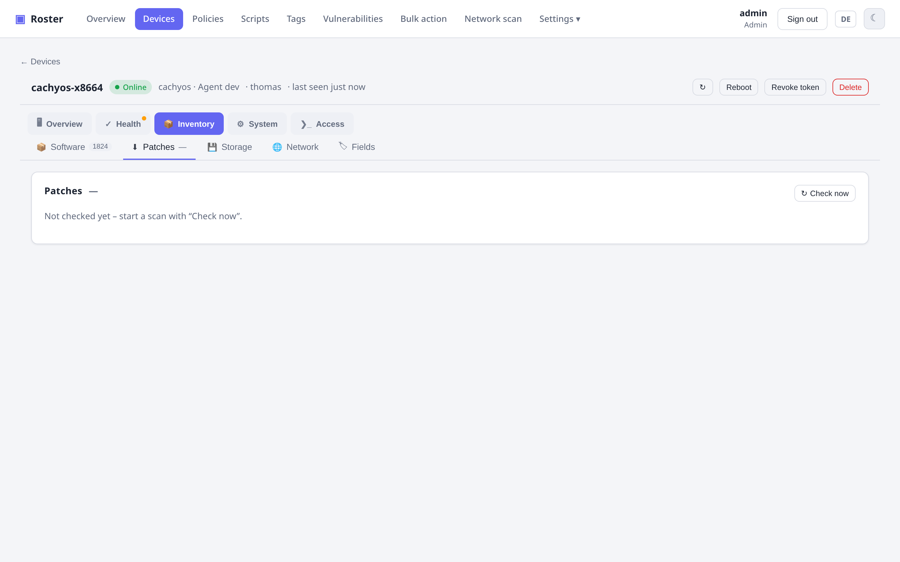
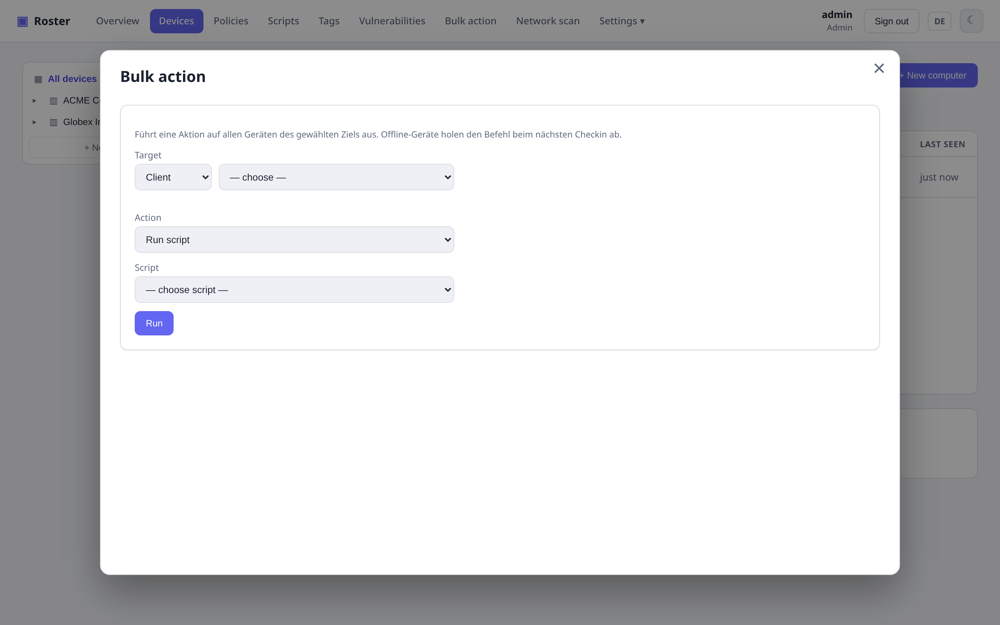
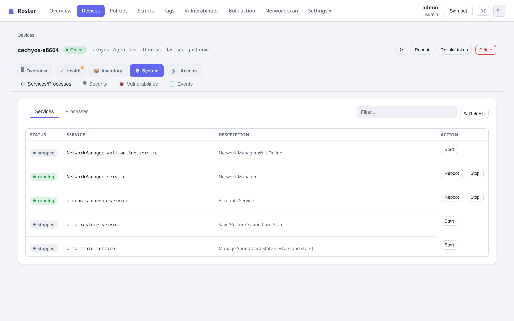
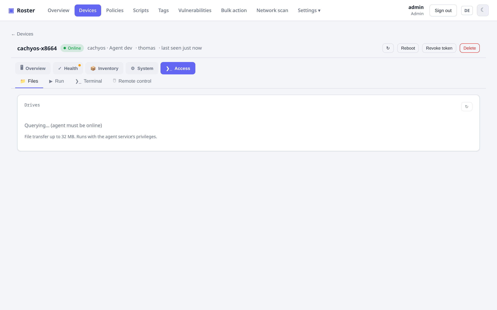
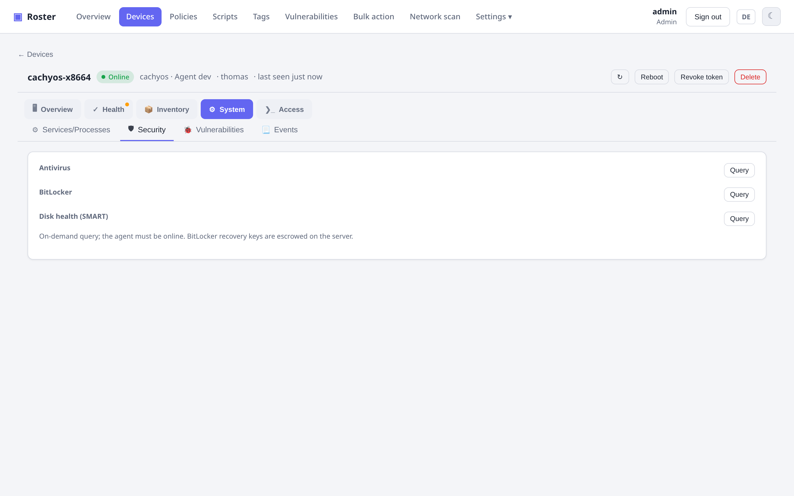

# Patch-Verwaltung & Software

## Patch-Verwaltung

Nach verfügbaren OS-Updates suchen, sie **freigeben** und installieren – mit wählbarer Strategie
unter Linux (`apt upgrade` vs. `dist-upgrade`) und optionalem Neustart danach.

{ .shadow }

## Softwareverteilung

Pflege einen Katalog verteilbarer Pakete (winget / choco / apt / dnf / brew) und rolle eines davon
in einer Aktion auf ein **Gerät, eine Firma, einen Standort oder ein Tag** aus.

## Sammelaktionen

Ein Skript ausführen, einen Update-Scan/-Install anstoßen oder Software installieren – **über eine
ganze Firma, einen Standort oder ein Tag** auf einmal.

{ .shadow }

### Auf einer handverlesenen Auswahl

Die Geräteliste hat eine **Checkbox pro Zeile** (Kopfzeilen-Checkbox = alles, was gerade angezeigt
wird). Sobald etwas angehakt ist, bietet eine Leiste **Neustart**, **Updates prüfen** und **Updates
durchführen** für genau diese Geräte an. Kombiniert mit den Filtern wird eine typische Routinearbeit
zu drei Klicks:

1. Dropdown **Fehlerhafter Check…** (oder eine Bedingung *Check → fehlerhaft* im Filter-Builder,
   oder `?filter=check:<id>` in der URL) → nur Geräte, bei denen z. B. **Neustart ausstehend** fehlschlägt.
2. Kopfzeilen-Checkbox → alle ausgewählt.
3. **Neustart** → bestätigen → auf jedem Gerät eingereiht; Offline-Geräte holen es sich beim nächsten Checkin.

Nur verwaltete, nicht widerrufene Geräte lassen sich anhaken, und der Server prüft die Auswahl
erneut gegen deinen Datenbereich.

Dieselbe Leiste hat einen Button **Export (CSV)**. In einem Dialog wählst du die Spalten –
Hostname, Status, Firma, Standort, OS, Hersteller/Modell/Seriennummer, CPU, RAM, IPs, MACs,
angemeldete Benutzer, Agent-Version, Anzahl Updates/Checks/Tasks/CVEs, zuletzt gesehen – plus
**eine Spalte pro benutzerdefiniertem Feld**, das auf mindestens einem der angehakten Geräte
gesetzt ist (Listen mit Kommas verbunden, Checkboxen als ja/nein). Deine Spaltenauswahl wird im
Browser gemerkt. Die Datei ist eine semikolon-getrennte UTF-8-CSV, die Excel direkt öffnet.

## Tags & Smart Groups

Freie **Tags** plus **regelbasierte Smart Groups** – dynamische Mitgliedschaft über Ausdrücke wie
`OS contains windows AND updates > 0`.

## Dateien, Dienste & Prozesse

Von der Detailseite eines Geräts kannst du sein Dateisystem durchsuchen und Dateien übertragen
(≤ 32 MB), **Dienste** auflisten und starten/stoppen/neu starten, **Prozesse** beenden und einen
TreeSize-ähnlichen Live-**Speicher-Explorer** mit Kreisdiagramm ausführen.

{ .shadow }

{ .shadow }

## Sicherheits-Collectors

Antivirus-/Defender-Status, **BitLocker** (mit Hinterlegung des Wiederherstellungsschlüssels),
**SMART**-Festplattenzustand und ein Viewer für Windows-Ereignisprotokoll / journald.

{ .shadow }
