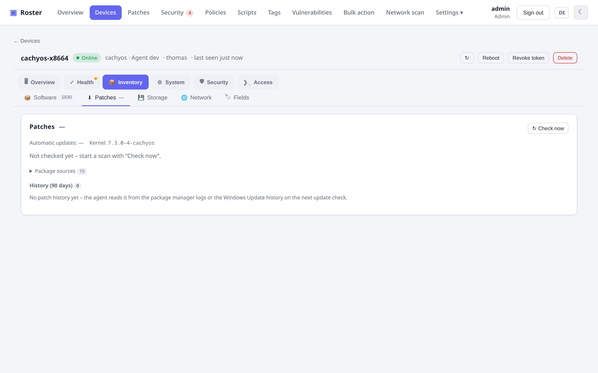
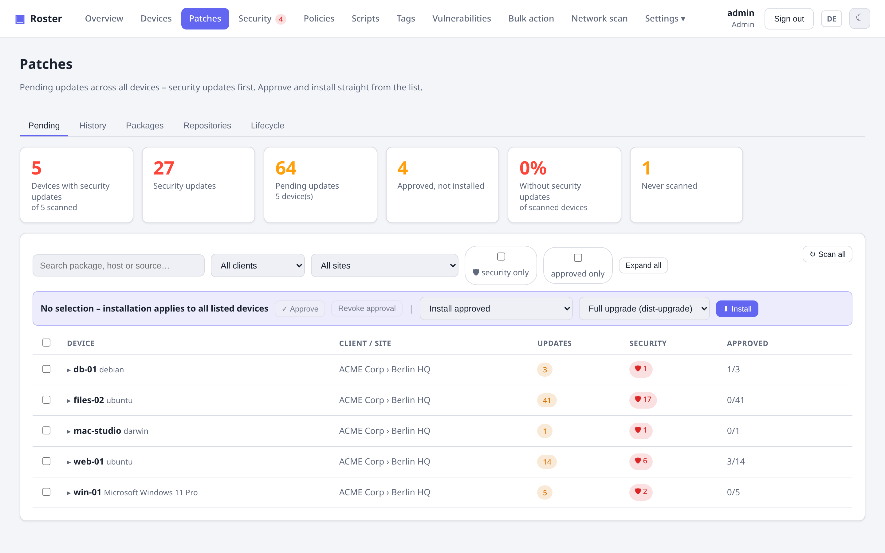
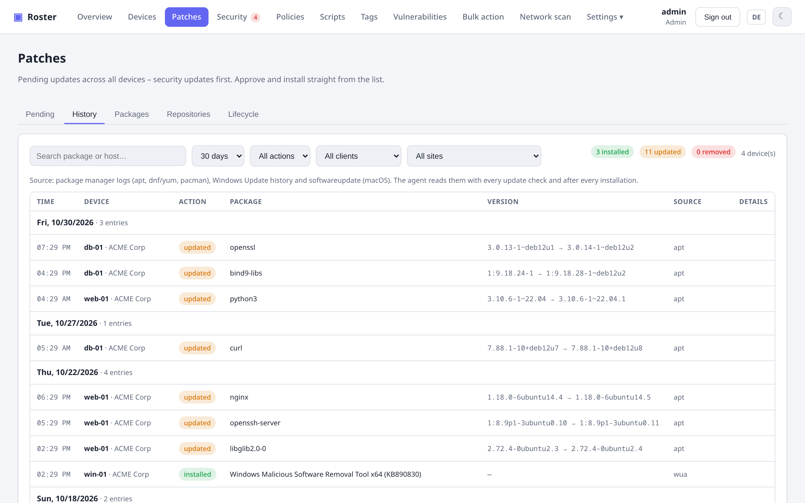
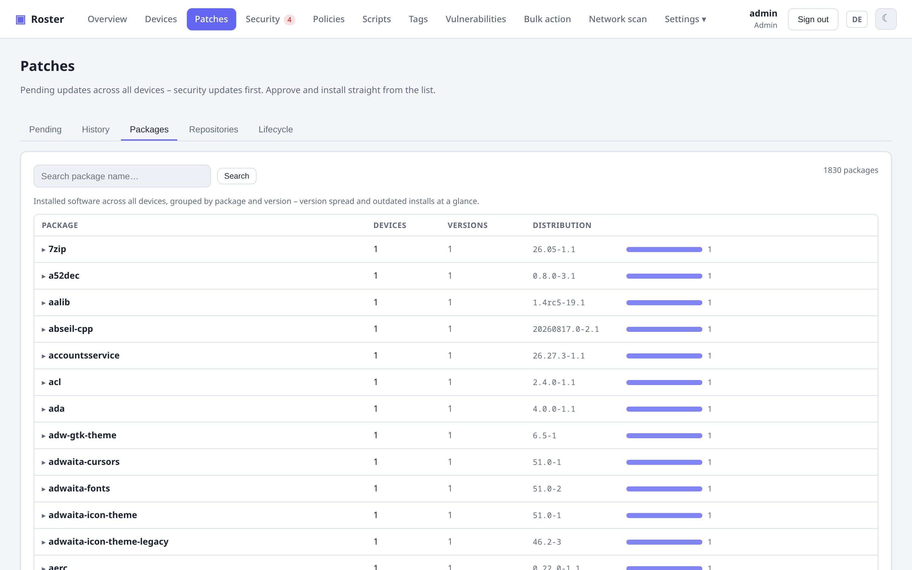
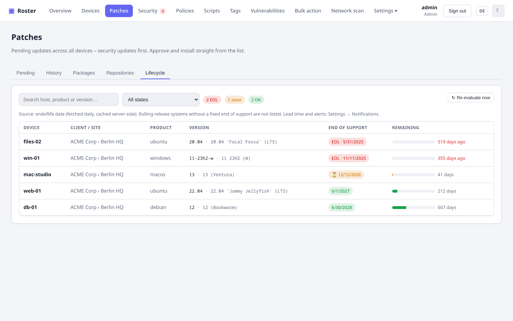
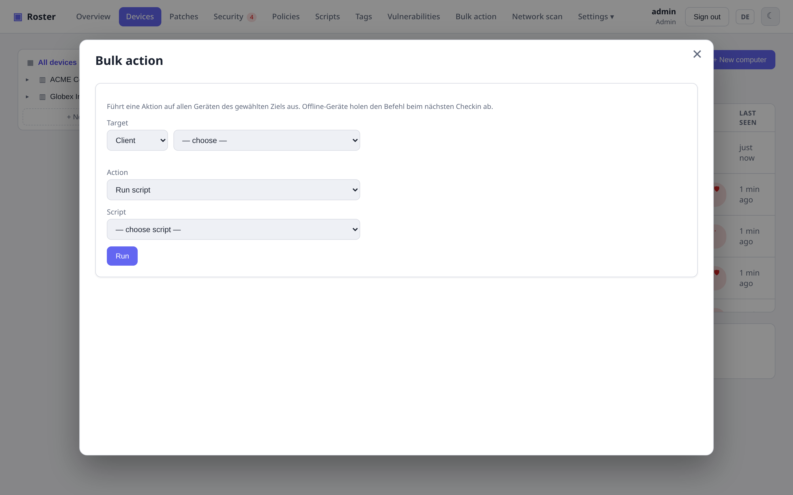
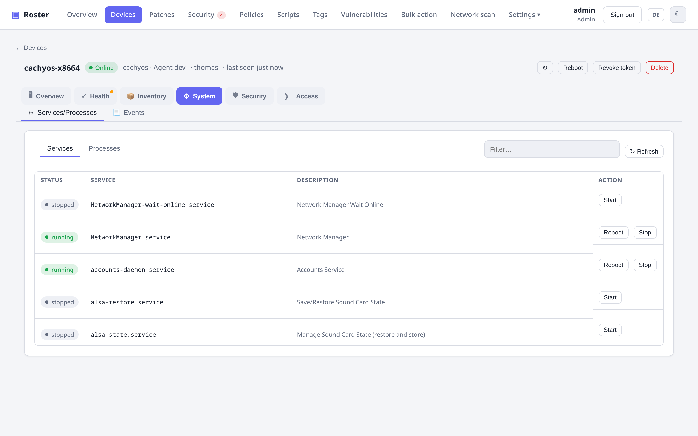
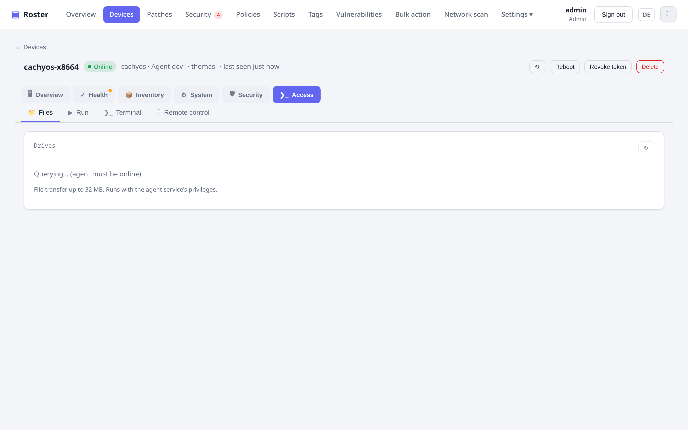
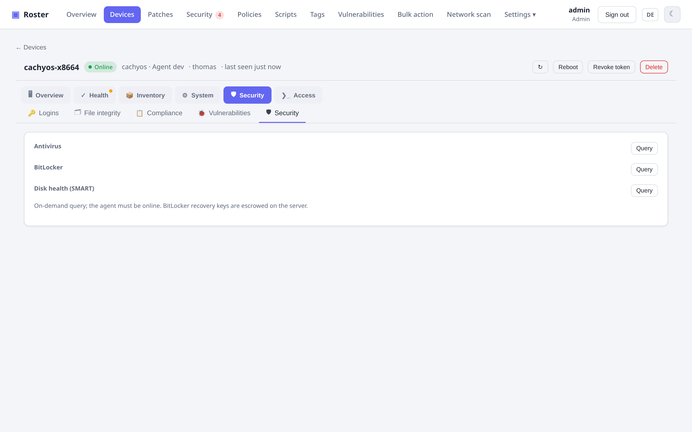

# Patching & software

## Patch management

Scan for available OS updates, **approve** them, and install — with a selectable strategy
on Linux (`apt upgrade` vs `dist-upgrade`) and an optional reboot afterwards.

{ .shadow }

## Fleet patch view & security updates

{ .shadow }

The **Patches** page lists pending updates across the whole fleet, grouped by device, with
**security updates** first. The agent classifies them per package manager: apt suites that
contain `-security`, dnf security advisories (`dnf updateinfo --security`), Windows Update
categories *Security Updates* / *Critical Updates* or an MSRC severity, and macOS updates
labelled *Security*. Each row shows the installed and the new version and the source
(suite, repo, KB).

Filter by company, site, "security only" or "approved only", tick rows or whole devices and
**approve**, **revoke** or **install** them (approved / security / approved security / all,
with the apt strategy). The same scope selector is available in bulk actions and the device
list bar ("Security updates"). Summary tiles show devices with security updates, the share
of scanned devices without any, and devices never scanned.

!!! tip "Ubuntu phased updates"
    Ubuntu rolls out `-updates` packages in phases. Until the rollout quota is reached, apt defers
    them – even with `dist-upgrade` ("deferred due to phasing"). The agent detects this via
    `apt-get -s dist-upgrade` and marks those packages with the badge **deferred (phasing)**. The
    option **Install phased updates now** (on the device, in the bulk action and on the Patches
    page) sets `APT::Get::Always-Include-Phased-Updates=true` and includes them. Security updates
    from `-security` are never phased.

## Patch history

{ .shadow }

The agent reads what was installed, upgraded or removed from the package manager logs
(`/var/log/apt/history.log` incl. rotated files, `dnf.rpm.log`, `yum.log`, `pacman.log`), the
Windows Update history and `softwareupdate --history` on macOS – with every update check
and right after each installation. The **History** tab shows a fleet-wide timeline (period,
action, company filters); each device has its 90-day history in the Patches tab. Entries are
kept for one year and the health report counts patches installed in the last 7 days.

## Packages & repositories

{ .shadow }

The **Packages** tab aggregates installed software across all devices by package and
version – useful to spot version spread or a vulnerable version that is still around.
Expand a package to see the devices per version.

The **Repositories** tab lists every package source the agents report: apt
(`sources.list`, `sources.list.d`, deb822 `.sources`), dnf/yum and zypper `.repo` files,
`pacman.conf`, apk, winget sources and Homebrew taps. Sources whose host does not belong to
the distribution are flagged as **third-party**; filters show disabled sources and sources
without signature checking. Per device the Patches tab also shows the **automatic-update
status** (unattended-upgrades, dnf-automatic, Windows Update, macOS) and the **running vs.
installed kernel** – a newer installed kernel means a reboot is due, which the reboot check
now also detects (as does `needs-restarting` on RHEL-family systems).

## OS lifecycle (end of support)

{ .shadow }

The server matches each device's OS version against **[endoflife.date](https://endoflife.date)**
(fetched once a day, cached server-side): Ubuntu, Debian, the RHEL family, Fedora, Alpine,
openSUSE/SLES, Amazon and Oracle Linux, FreeBSD, macOS, Windows client (including
Enterprise/LTSC cycles) and Windows Server, plus Proxmox VE on PVE hosts. Rolling-release
systems are skipped. The **Lifecycle** tab, an "End of support" badge on the device, a list
column, filter and smart-group field `eol_status` and a dashboard tile show the status;
when the end of support is approaching (lead time configurable, default 90 days) or reached,
an alert is sent once. Settings → Notifications holds the lead time, the alert switch and
"Re-evaluate now". Note: this is the only outbound call besides OSV.dev; both can be
blocked at the firewall if you do not want them.

## Software distribution

Maintain a catalog of deployable packages (winget / choco / apt / dnf / brew) and roll one
out to a **device, company, site or tag** in one action.

## Bulk actions

Run a script, trigger an update scan/install, or install software **across a whole company,
site or tag** at once.

{ .shadow }

### On a hand-picked selection

The device list has a **checkbox per row** (header checkbox = everything currently shown).
As soon as something is ticked, a bar offers **Reboot**, **Check updates** and **Install
updates** for exactly those devices. Combine it with the filters and a typical chore
becomes three clicks:

1. **Failing check…** dropdown (or a *Check → failing* condition in the filter builder,
   or `?filter=check:<id>` in the URL) → only devices where e.g. **Reboot pending** fails.
2. Header checkbox → all of them selected.
3. **Reboot** → confirm → queued on every device; offline ones pick it up at their next check-in.

Only managed, non-revoked devices can be ticked, and the server re-checks the selection
against your data scope.

The same bar has an **Export (CSV)** button. A dialog lets you pick the columns —
hostname, status, company, site, OS, vendor/model/serial, CPU, RAM, IPs, MACs, logged-in
users, agent version, update/check/task/CVE counts, last seen — plus **one column per
custom field** that is set on at least one of the ticked devices (lists joined with
commas, checkboxes as yes/no). Your column choice is remembered in the browser. The file
is a semicolon-separated, UTF-8 CSV that Excel opens directly.

## Tags & smart groups

Free-form **tags** plus **rule-based smart groups** — dynamic membership from expressions
like `OS contains windows AND updates > 0`.

## Files, services & processes

From a device's detail page you can browse its filesystem and transfer files (up to 4 GB, see below),
list and start/stop/restart **services**, kill **processes**, and run a TreeSize-style live
**storage explorer** with a pie chart.

!!! note "Large files"
    With agent 0.29.0 or newer the file browser talks to the agent **directly through the
    tunnel**: the server passes uploads and downloads straight through – no temporary file, no
    queued command per file, the browser's own download shows the progress. Every upload and
    download is written to the **audit log** with path and size (also those from the native
    viewer's file manager).

    For older agents transfers take the previous way and are streamed: the server keeps the file only as a temporary file next to its
    database (`file-transfers/`, deleted right after pick-up or after 30 minutes) and needs that
    much free disk space plus 1 GB reserve – not RAM. The agent writes to a temporary file in the
    target folder and renames it only once complete, so an aborted transfer never leaves a half
    file. Agents older than 0.27.0 only accept up to 32 MB. Behind a reverse proxy, allow large
    request bodies (nginx: `client_max_body_size 4g;`).

{ .shadow }

{ .shadow }

## Security collectors

Antivirus / Defender status, **BitLocker** (with recovery-key escrow), **SMART** disk
health, and a Windows Event Log / journald viewer.

{ .shadow }
