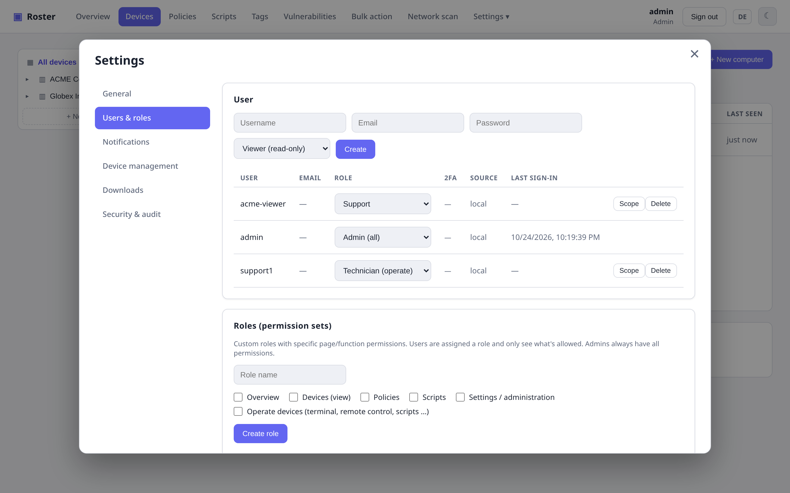

# Rollen & Berechtigungen

Roster hat ein zweistufiges Zugriffsmodell, damit du jedem Benutzer genau das geben kannst,
was er braucht – und nicht mehr:

1. **Berechtigungen** – *welche Seiten/Funktionen* ein Benutzer nutzen darf.
2. **Datenbereich** – *welche Firmen/Standorte* ein Benutzer sehen darf.

Beides wird **serverseitig** durchgesetzt, nicht nur in der Oberfläche ausgeblendet: Ein
eingeschränkter Benutzer, der einen API-Endpunkt direkt aufruft, bekommt `403`.

## Eingebaute Rollen

Jeder Benutzer hat eine von drei eingebauten Rollen:

| Rolle | Sieht | Darf Geräte bedienen | Verwalten |
| --- | --- | --- | --- |
| **Viewer** | Übersicht, Geräte | — | — |
| **Techniker** | Übersicht, Geräte | ✔ | — |
| **Administrator** | Alles | ✔ | ✔ (immer voller Zugriff) |

## Eigene Rollen (Rechte-Sets)

Für alles dazwischen legst du unter **Einstellungen → Benutzer & Rollen** eine **eigene
Rolle** an und hakst genau die Rechte an, die sie gewähren soll:

- `Übersicht`, `Geräte (ansehen)`, `Richtlinien`, `Skripte`, `Einstellungen/Verwaltung`
- `Geräte bedienen` (Terminal, Fernsteuerung, Skripte ausführen, Neustart, …)

Die Rolle weist du einem Benutzer über das Rollen-Dropdown zu. Beispiel: eine Rolle
*Auditor* mit nur *Übersicht* + *Geräte (ansehen)* – nur lesen, kein Bedienen, keine
Einstellungen.

{ .shadow }

!!! note "Admin-Verwaltung bleibt Admins vorbehalten"
    Benutzer-, Rollen- und Enrollment-Token-Verwaltung sind immer echten Admins vorbehalten –
    eine eigene Rolle kann nie das Recht vergeben, Admins anzulegen. Du kannst außerdem weder
    deine eigene Admin-Rolle entfernen noch den letzten verbleibenden Admin löschen.

## Datenbereich je Benutzer

Unabhängig von den Berechtigungen kannst du einen **Benutzer auf bestimmte Firmen oder
Standorte begrenzen**. Klicke bei einem Benutzer auf **Bereich** und hake die Firmen
(ganze Firma) und/oder einzelne Standorte an, die er sehen darf:

{ .shadow }

Ein so begrenzter Benutzer sieht dann nur noch die **Geräte, Zähler der Übersicht,
Suchergebnisse und den Firmenbaum** seiner zugewiesenen Firmen/Standorte – alles andere ist
ausgeblendet, und jeder Versuch, ein Gerät außerhalb seines Bereichs zu öffnen, wird mit
`403` abgewiesen. Nicht zugeordnete Geräte sind für begrenzte Benutzer unsichtbar.

- **Nichts ausgewählt = sieht alles** (die Vorgabe, unverändertes Verhalten).
- **Admins werden nie begrenzt** – sie sehen immer die gesamte Flotte.

## Wie es zusammenspielt

```text
Benutzer ──> eingebaute Rolle (Viewer/Techniker/Admin)
         └─> optionale eigene Rolle  → effektive Seiten-/Funktionsrechte
         └─> optionaler Datenbereich → sichtbare Firmen/Standorte
```

Bestehende Benutzer sind standardmäßig unbeschränkt. Das Einschalten ändert also nichts,
bis du ausdrücklich eine eigene Rolle oder einen Bereich zuweist.

!!! warning "Richtlinien reichen auf andere Geräte"
    Die [Backup](backups.md)-Einträge einer Richtlinie können ein Folgeskript auf einem
    **anderen** Gerät ausführen als dem, das gesichert wird. Wer Richtlinien bearbeiten
    darf, kann damit also Skripte geräteübergreifend ausführen.
