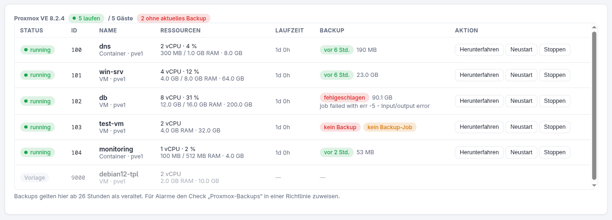
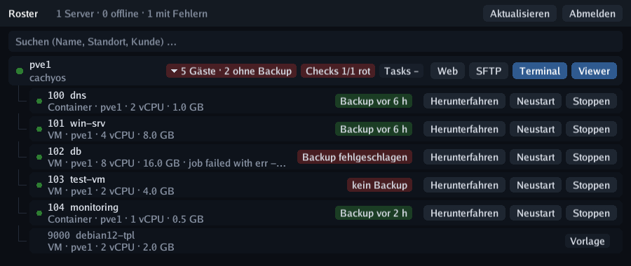

# Proxmox VE

Installiere den Roster-Agent auf einem **Proxmox-VE-Host**, und das Gerät bekommt einen Tab
**Proxmox**: alle VMs und Container des Clusters, ihre Ressourcen, **Starten / Herunterfahren
/ Neustart / Stoppen** und der **Backup-Stand** jedes Gasts – dazu ein Check-Typ, der rot
wird, wenn Backups fehlen, veraltet oder fehlgeschlagen sind.

{ .shadow }

## So funktioniert es

Der Agent erkennt PVE am Vorhandensein von `pvesh`, der lokalen API-CLI jedes Nodes. Er
läuft als root, deshalb ist **kein API-Token nötig**, und der Roster-Server spricht nie
direkt mit der Proxmox-API – alles läuft über den normalen Checkin- und Befehlskanal des
Agents. `pvesh` arbeitet clusterweit: **ein Agent auf einem Node reicht** für den ganzen
Cluster.

| Was | Quelle |
| ---- | ------ |
| Gäste (VMs + Container, Status, CPU/RAM/Platte, Uptime) | `/cluster/resources?type=vm` – frisch bei jedem Checkin |
| Letztes Backup je Gast (Zeit, Größe, Speicher, Anzahl) | Inhalt jedes Speichers mit `backup`-Content (lokal, NFS, **PBS** …) |
| Ergebnis des letzten Backup-Laufs je Gast | vzdump-Tasks; Job-Läufe werden aus ihrem Task-Log geparst (`Finished` / `failed - …`) |
| Gast in keinem Backup-Job | `/cluster/backup-info/not-backed-up` (PVE ≥ 7.1) |
| Backup-fähige Speicher (Name, Node, shared) | `/cluster/resources?type=storage`, alles mit `backup`-Content – das füllt das Ziel-Dropdown im Backup-Formular |

Die Gästeliste wird bei jedem Checkin geholt, damit der Status direkt nach einer Aktion
stimmt. Backup-Informationen ändern sich selten und werden **10 Minuten** zwischengespeichert;
geparste Task-Logs ändern sich nie und werden je Task gemerkt.

!!! note "Bestehende Proxmox-API-Integration"
    Die API-Token-Integration unter *Einstellungen → Proxmox* (Gast-Neustart als
    Check-Remediation) funktioniert unabhängig davon weiter. Die agentbasierte Ansicht
    braucht überhaupt keine Konfiguration.

## Gäste steuern

Mit dem Recht *Geräte bedienen* hat jeder Gast:

- **Starten** (gestoppte Gäste)
- **Herunterfahren** – sauberes Herunterfahren per ACPI / Container-Shutdown
- **Neustart** und **Stoppen** (hartes Ausschalten) – beide fragen nach Bestätigung

Die Aktion läuft als PVE-Task auf dem Host; Ergebnis und neuer Zustand kommen mit dem direkt
folgenden Checkin. Jede Aktion landet im Audit-Log.

## Backups aus Roster starten

Roster kann Backups nicht nur beobachten, sondern auch **ausführen**: Der Bereich
[Backups](backups.md) einer Richtlinie plant `vzdump` für die gewählten Gäste, wartet, bis
das Backup-Ziel erreichbar ist, und kann danach ein Skript auf einem anderen Gerät ausführen.
Jeder Gast kann **seinen eigenen Ziel-Speicher** haben, sodass ein Eintrag mit einem Zeitplan
zwei verschiedene Backup-Platten versorgt; der Agent setzt dann je Node und Ziel ein eigenes
`vzdump` ab.

## Backup-Check

Füge einer Richtlinie den Check-Typ **Proxmox-Backups** hinzu und weise sie dem PVE-Host zu:

| Option | Vorgabe | Bedeutung |
| ------ | ------- | ------- |
| max. Alter (h) | 26 | das letzte Backup darf höchstens so alt sein (täglicher Job + Puffer) |
| Nur VMIDs | alle | kommagetrennte Liste der zu prüfenden Gäste |
| VMIDs ausnehmen | — | Gäste, die übersprungen werden |
| gestoppte mitprüfen | an | auch ausgeschaltete Gäste brauchen ein aktuelles Backup |
| Backup-Job verlangen | an | schlägt fehl, wenn ein Gast in keinem Backup-Job steckt |

Templates werden nie geprüft. Der Check schlägt fehl, wenn ein ausgewählter Gast **kein
Backup**, ein **veraltetes**, einen **fehlgeschlagenen letzten Lauf** oder (optional) **keinen
Backup-Job** hat, und nennt die Betroffenen in seiner Ausgabe, z. B.
`2 von 5 Gästen ohne aktuelles Backup: 102 db (letzter Lauf fehlgeschlagen: … Input/output error), 103 test-vm (kein Backup)`.
Von dort speist er wie jeder andere Check Alarmierung, das Gesundheits-Badge des Geräts und
das rote Badge in der Taskleisten-App.

## In der Taskleisten-App

Proxmox-Hosts bekommen in der Taskleisten-App eine Pille **„5 Gäste“** – rot mit der Zahl der
Gäste ohne aktuelles Backup. Ein Klick darauf klappt die Gäste darunter auf, mit Backup-Badge
und Knöpfen Starten / Herunterfahren / Neustart / Stoppen (Neustart und Stoppen brauchen einen
zweiten Klick zur Bestätigung). Wer eine VMID oder einen Gastnamen ins Suchfeld tippt, sieht
passende Gäste direkt.

{ .shadow }
