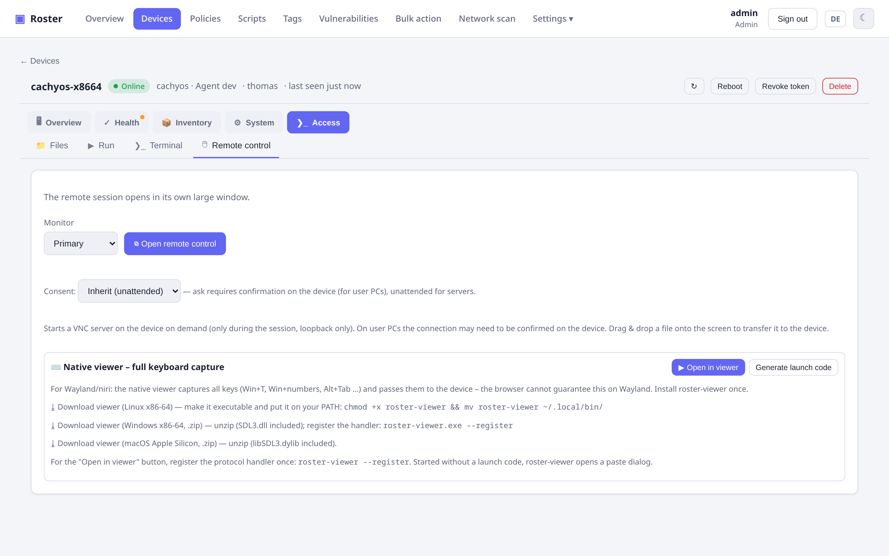

# Fernsteuerung & Terminal

Roster bringt **eingebaute Fernsteuerung und ein interaktives Terminal** mit – keine
VNC-Software von Dritten, kein zweiter Daemon. Alles läuft über denselben **On-demand-Tunnel**:
der Agent parkt einen leichtgewichtigen Long-Poll, und eine Sitzung wird erst aufgebaut, wenn du
eine startest.

{ .shadow }

## Fernsteuerung

Der Agent *ist* der VNC-Server (ein eingebauter RFB-Server), es gibt also nichts zusätzlich zu
installieren. Bildschirm, Maus und Tastatur werden durch den Tunnel weitergereicht. Funktionen:

- Abdeckung von **Anmeldebildschirm / UAC / Sperrbildschirm** unter Windows (der Capture-Helper
  folgt dem Eingabe-Desktop).
- **Zwischenablage-Sync**, **Monitorauswahl**, **Dateiübertragung per Drag-&-Drop** auf den
  entfernten Desktop.
- **Live-Auflösungswechsel** (RFB `DesktopSize`) – die Auflösung ändern ohne schwarzen Bildschirm,
  plus ein **Gasttreiber-Installer** per Klick für VMs (Proxmox / VirtIO / SPICE), bei denen die
  Auflösung ausgegraut ist.

### Zwei Wege zum Verbinden

=== "Browser (noVNC)"

    Klicke auf **Fernsteuerung öffnen** und es läuft direkt in deinem Browser. Unter Windows/Chromium
    aktiviert der Vollbildmodus die Keyboard Lock API, damit Systemtasten das Gerät erreichen.

=== "Nativer Viewer (empfohlen unter Linux/Wayland)"

    Ein mitgelieferter `roster-viewer` (SDL3, **cgo-frei**, Downloads für Linux/Windows/macOS ohne
    Toolchain) fängt **alle** Tasten per `keyboard-shortcuts-inhibit` ab – einschließlich Win+T,
    Win+Ziffern und Alt+Tab, die der Browser unter Wayland nicht abgreifen kann. Er hat eine
    schwebende Toolbar im AnyDesk-Stil mit **echtem Strg+Alt+Entf** (SendSAS), Sperren der lokalen
    Eingabe, Bildschirmnachricht und einer Qualitätsauswahl. Starte ihn mit einem Klick über einen
    `roster://`-Link oder füge den Startcode in seinen Verbindungsdialog ein. Pakete für jede
    Plattform, die der Server mitführt, sind unter **Einstellungen → Downloads** gelistet
    (Linux x86-64/ARM64, Windows; der macOS-Build hängt am GitHub-Release).

## Remote-Terminal

Eine interaktive Shell über einen On-demand-WebSocket, mit ausklinkbarem Fenster. Unter Windows
kannst du als SYSTEM oder als angemeldeter Benutzer arbeiten.

{ .shadow }

## Zustimmung (beaufsichtigt vs. unbeaufsichtigt)

Remote-Sitzungen können eine **Zustimmung am Gerät** verlangen (eine Abfrage, die der Benutzer
bestätigen muss) oder **unbeaufsichtigt** laufen – konfigurierbar pro Firma/Standort/Gerät, sodass
Benutzer-PCs nachfragen können, während Server unbeaufsichtigt verbunden werden.

## Sicherheit

- Der VNC-Server bindet nur an `127.0.0.1` und läuft **nur während einer Sitzung** – niemals im
  LAN exponiert.
- Der Zugriff unterliegt demselben RBAC wie der Rest der App (Berechtigung `Geräte bedienen`)
  und wird protokolliert.
