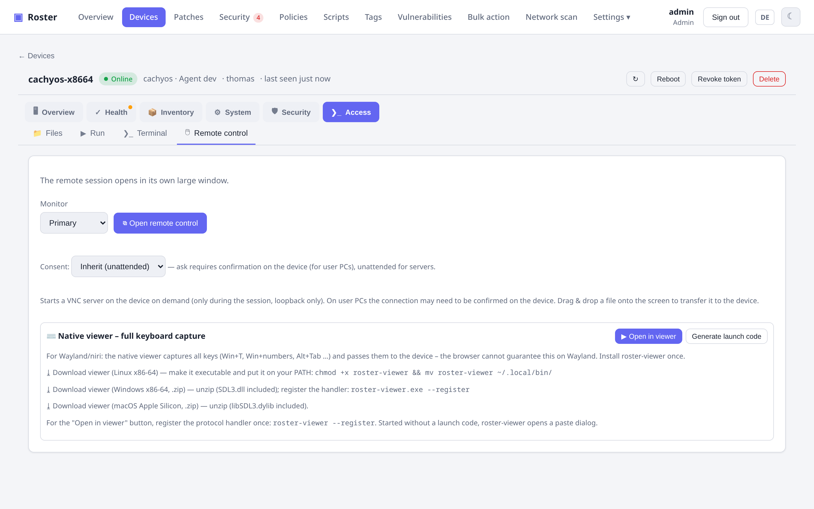
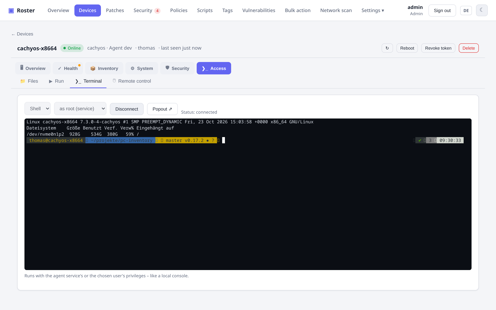

# Remote desktop & terminal

Roster has **built-in remote control and an interactive terminal** — no third-party VNC
software, no second daemon. Everything runs over the same **on-demand tunnel**: the agent
parks a lightweight long-poll, and a session is spun up only when you start one.

{ .shadow }

## Remote desktop

The agent *is* the VNC server (a built-in RFB server), so there is nothing extra to
install. Screen, mouse and keyboard are relayed through the tunnel. Features:

- **Login screen / UAC / lock screen** coverage on Windows (the capture helper follows the
  input desktop).
- **Clipboard sync**, **monitor selection**, **drag-&-drop file transfer** onto the remote
  desktop.
- **Live resolution switching** (RFB `DesktopSize`) — change the resolution without a black
  screen, plus a one-click **guest-driver installer** for VMs (Proxmox / VirtIO / SPICE)
  where the resolution is greyed out.

### Linux (Wayland and X11)

On Linux the agent finds the graphical session of the logged-in user itself – it runs as a
service and doesn't know that user's display, so it reads it from the user's processes. Nothing
needs to be installed (no wayvnc, no x11vnc).

| Desktop | Picture | Mouse / keyboard |
|---|---|---|
| **Wayland with wlroots** – labwc (default on Raspberry Pi OS), Wayfire, Sway, niri, Hyprland | `wlr-screencopy` (incl. pointer) | compositor's virtual pointer/keyboard |
| **X11** – Xorg, e.g. Raspberry Pi OS "X11", XFCE, MATE, Cinnamon | X server directly (pointer via XFixes) | XTEST |
| GNOME / KDE on Wayland | not supported yet – the viewer shows a notice | – |

If nobody is logged in, the viewer shows "No graphical session" and switches to the desktop on
its own as soon as someone logs in. Characters the X11 keyboard layout lacks are mapped to a
spare key on the fly. With several screens the first one is shown; monitor selection is not
available on Linux yet.

**Clipboard:** text is synced in both directions – on X11 via the regular clipboard
(Ctrl+C/Ctrl+V), on Wayland via the compositor's data-control protocol (offered by labwc, Sway,
Wayfire, niri, Hyprland). Text pasted from the browser stays on the device's clipboard only while
the remote session is open – afterwards it disappears like with any closed program.
As usual with VNC, only Latin-1 characters are transferred (umlauts yes, e.g. "€" or emoji no).

### Two ways to connect

=== "Browser (noVNC)"

    Click **Open remote control** and it runs right in your browser. On Windows/Chromium,
    fullscreen enables the Keyboard Lock API so system keys reach the device.

=== "Native viewer (recommended on Linux/Wayland)"

    A bundled `roster-viewer` (SDL3, **cgo-free**, downloads for Linux/Windows/macOS with
    no toolchain) captures **all** keys via `keyboard-shortcuts-inhibit` — including Win+T,
    Win+numbers and Alt+Tab that the browser cannot grab on Wayland. It has a floating
    AnyDesk-style toolbar with **real Ctrl+Alt+Del** (SendSAS), block-local-input,
    on-screen message and a quality selector. Launch it with one click via a `roster://`
    link, or paste the launch code into its connect dialog. Packages for every platform the server
    carries are listed under **Settings → Downloads** (Linux x86-64/ARM64, Windows; the
    macOS build is attached to the GitHub release). The window title shows the viewer's version
    ("· Viewer 0.28.0"; also `roster-viewer --version`); if the server is newer, the title says
    "Update … available".

### File manager in the native viewer (F9)

**F9** opens a two-pane file manager over the remote screen – left your computer, right the
device. Since 0.29.0 it uses a **direct file channel through the tunnel**: one connection for
all files, streamed without an intermediate stop on the server (locally measured: 300 small
files in 0.1 s, 1 GB in about a second – before, every file was a queued command taking
several seconds).

| Key / mouse | Action |
|---|---|
| `Space` / `Insert` | mark entry and move down |
| `Ctrl`+click / `Shift`+click | mark single entry / range |
| `Ctrl`+`A` | mark all (again: none) |
| `F5` | copy marked entries (or the current one) to the other side – files and whole folders |
| `F7` / `F8` | new folder / delete (marked entries) |
| `Esc` | abort a running transfer, otherwise close |

- **Progress** in the footer: files, bytes, speed and remaining time, with a progress bar.
- **Existing files:** if some files already exist on the target, the viewer asks once for the
  whole transfer: **overwrite**, **skip if same size** (otherwise overwrite) or **skip all**.
- **Resume:** files in transfer are written as `<name>.roster-part` and renamed only when
  complete. After an abort or a dropped connection, `F5` again continues partial files where
  they stopped; short connection drops are resumed automatically (up to three times).
- Agents before 0.29.0 fall back to the old, slow way (one queued command per file).
- Every upload, download, delete and new folder lands in the **audit log** with user and path –
  the server passes the data through and reads along the requests. Folders and multi-selections
  produce **one summary entry** instead of one per file, e.g. "Uploaded (viewer): project/ →
  /srv/www – 300 file(s), 1.2 GB, 4 folders, 1 resumed".

## Remote terminal

An interactive shell over an on-demand WebSocket, with a pop-out window. On Windows you can
run as SYSTEM or as the logged-in user.

{ .shadow }

## Consent (attended vs unattended)

Remote sessions can require **consent at the device** (a prompt the user must accept) or run
**unattended** — configurable per company/site/device, so user PCs can prompt while servers
connect unattended.

## Security

- The VNC server binds to `127.0.0.1` only and runs **only during a session** — never
  exposed on the LAN.
- Access is gated by the same RBAC as the rest of the app (`Operate devices` permission)
  and is audited.
