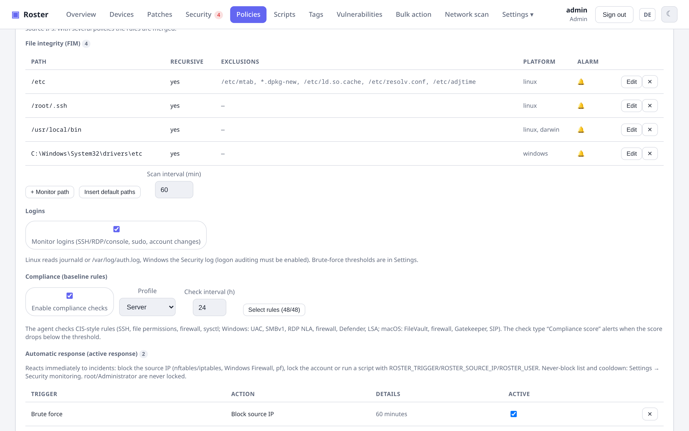
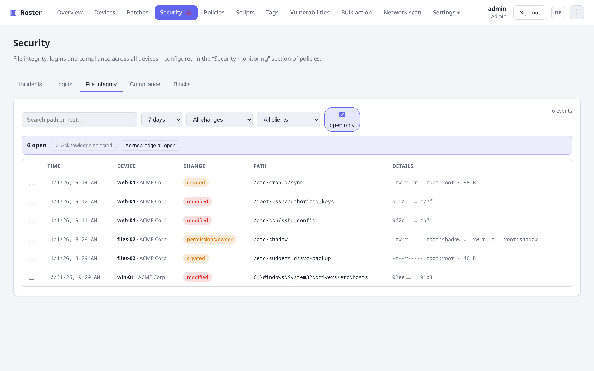
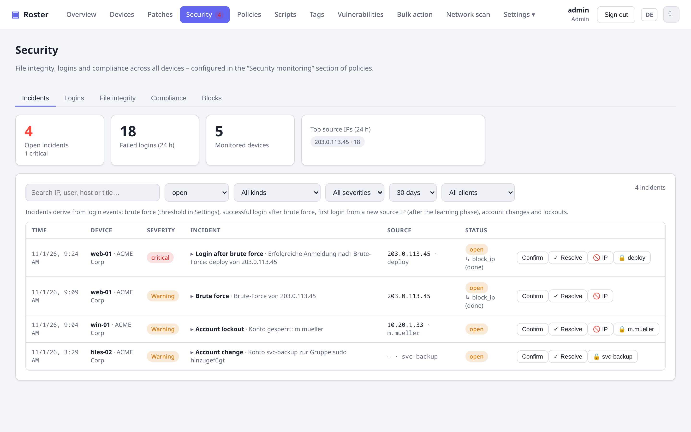
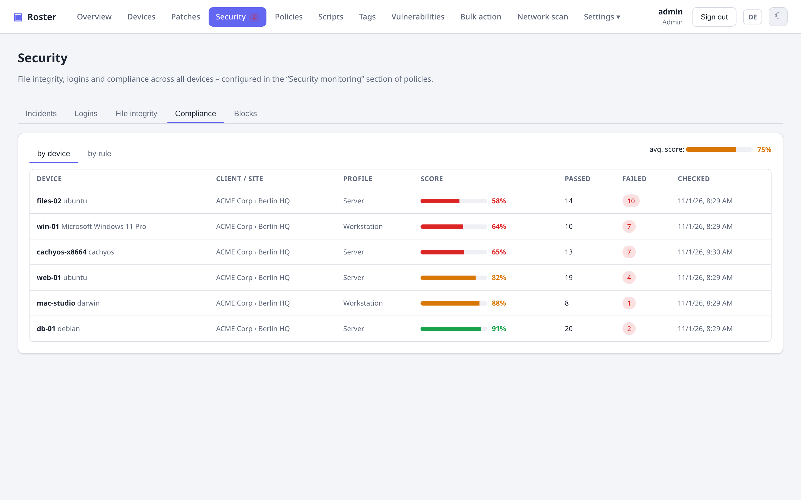

# Sicherheitsüberwachung

Roster ergänzt hostbasierte Sicherheitsüberwachung im Stil von Wazuh: Datei-Integrität,
Anmeldungs-Überwachung mit Vorfallserkennung, CIS-artige Compliance-Prüfung und automatische
Reaktionen. Konfiguriert wird alles im Bereich **Sicherheitsüberwachung** einer Richtlinie,
angezeigt auf der Seite **Sicherheit** und in der Tab-Gruppe „Sicherheit“ des Geräts.

!!! note "Voraussetzungen"
    Der Agent muss als **root** (Linux/macOS) bzw. **LocalSystem** (Windows) laufen – die
    Installationsskripte tun das; eine alte systemd-Unit mit `DynamicUser=yes` kann weder
    `/var/log/auth.log` und `/etc/shadow` lesen noch nftables bedienen. Die Anmeldungs-
    Überwachung unter Windows braucht aktivierte Anmeldeüberwachung (Erfolg/Fehler), auf Servern
    der Standard.

{ .shadow }

## Datei-Integrität (FIM)

{ .shadow }

Einer Richtlinie **überwachte Pfade** hinzufügen: Datei, Verzeichnis (optional rekursiv) oder
Glob wie `/home/*/.ssh/authorized_keys`, mit Ausschluss-Globs (`*.log`, `cache/`), optionaler
Plattform-Einschränkung und Alarm-Schalter. *Standardpfade einfügen* ergänzt die üblichen
Verdächtigen je Plattform (`/etc`, `/usr/local/bin`, `~/.ssh`, cron-Spools; Windows
`drivers\etc`, geplante Aufgaben, Autostart-Ordner; macOS LaunchDaemons/LaunchAgents).

Der Agent hält eine Baseline (SHA-256, Rechte, Besitzer, Änderungszeit) in seinem Zustands-
verzeichnis (`/var/lib/roster/fim-baseline.json`, `C:\ProgramData\Roster\fim-baseline.json`).
Der erste Lauf legt nur die Baseline an; danach meldet jeder Scan (Intervall je Richtlinie,
Standard 60 min) **neue**, **geänderte**, **gelöschte** Dateien und **Rechte-/Besitzerwechsel**.
Änderungen an Regeln mit Alarm-Schalter werden je Checkin gebündelt gemeldet und erzeugen einen
Vorfall `fim_change`. Dateien über 256 MB werden nur nach Größe und Änderungszeit verglichen; ein
Scan ist auf 50 000 Einträge begrenzt.

Geräte-Tab **Datei-Integrität**: Ereignisliste mit Bestätigen, *Jetzt prüfen* und *Baseline neu
setzen*. Sicherheitsseite, Tab **Datei-Integrität**: flottenweite Liste mit Filtern.

## Anmeldungs-Überwachung & Vorfälle

{ .shadow }

Mit **Anmeldungen überwachen** liest der Agent neue Ereignisse inkrementell:

| Plattform | Quelle | Ereignisse |
|---|---|---|
| Linux | journald (Cursor) oder `/var/log/auth.log` / `secure` (Offset) | sshd fehlgeschlagen/akzeptiert/unbekannter Benutzer, sudo, su, useradd/userdel/usermod/gpasswd/passwd, Konsolen-Login |
| Windows | Sicherheits-, System- und PowerShell/Operational-Protokoll (RecordId-Cursor je Protokoll) | 4624/4625 (Anmeldetypen 2/3/7/10/11), 4740 Sperre, 4720/4726 Benutzer angelegt/gelöscht, 4722/4725/4767, 4728/4732/4756 Gruppenmitgliedschaft, 4723/4724 Passwort; 7045 Dienst installiert, 4698/4702 geplante Aufgabe, 1102 Protokoll gelöscht, 4688 verdächtiger Prozess, 4104 verdächtiges PowerShell (siehe unten) |
| macOS | Unified Log (`log show`) | sshd, sudo, su, login |

### Log-Quellen: nginx, SFTP-/FTP-Container, eigene Muster

Neben dem Anmeldeprotokoll des Systems kann eine Richtlinie **Log-Quellen** enthalten, die der
Agent jede Minute inkrementell liest: eine **Datei** (Glob erlaubt, z. B.
`/var/log/nginx/*access.log`) oder die Ausgabe eines **Docker-Containers** (exakter Name oder
Muster wie `*sftp*`; der Agent liest das json-file-Protokoll direkt, sonst `docker logs --since`).
Jede Quelle hat ein Format:

| Format | Erzeugt |
|---|---|
| Web-Zugriffsprotokoll (nginx, Apache, Traefik – Combined Log, auch mit vorangestelltem `$host`; nginx-proxy-Ausgabe mit forego-Präfix wird ausgepackt) | `401` → Fehlversuch; Scanner-Pfade (`wp-login.php`, `/.env`, `phpmyadmin`, `xmlrpc.php`, `../`, `cmd=`, `${jndi`, `/proc/self` …), SQL-Injektion in Pfad/Query (`union select`, `' or 1=1`, `sleep(`, `information_schema` …, auch URL-kodiert; POST-Bodies stehen nicht im Zugriffsprotokoll – dafür WAF-Meldungen im Fehlerprotokoll oder ein Anwendungsprotokoll nutzen), versteckte Dateien (`/.git`, `/.terraform`), Zugangsdaten-/Konfigurationsdateien, `400`/`444` und andere kaputte Anfragen, `404` oder Reverse-Proxy-`503` auf `.php/.sql/.bak/.zip/.tfvars/.pem …`, fehlgeschlagene Anfragen an die nackte Server-IP statt des Domainnamens → **verdächtige Anfrage** |
| Web-Fehlerprotokoll (nginx, Apache) | `password mismatch`, `authentication failure`, `user … not found` → Fehlversuch; `access forbidden by rule`, `client denied`, `Invalid URI`, ModSecurity, Rate-Limit, fehlende Scanner-Dateien → verdächtige Anfrage |
| sshd (SSH-/SFTP-Server oder -Container) | dieselben Ereignisse wie der sshd des Hosts: fehlgeschlagene/akzeptierte Anmeldungen, unbekannte Benutzer |
| FTP (vsftpd, proftpd, pure-ftpd) | fehlgeschlagene/erfolgreiche Anmeldungen, unbekannte Benutzer |
| Mail (Postfix SASL, Dovecot, Exim) | fehlgeschlagene/erfolgreiche IMAP-/POP3-/SMTP-Anmeldungen |
| eigenes Muster | regulärer Ausdruck mit `(?P<ip>…)` und optional `(?P<user>…)`; jeder Treffer zählt als Fehlversuch oder verdächtige Anfrage |

Die Ereignisse tragen den Namen der Quelle als Dienst (z. B. `web`, `sftp`, `mail`), sodass der
Tab **Anmeldungen**, die Vorfallstexte und die Sperren zeigen, wo ein Angreifer aufgefallen ist.
Vorlagen füllen das Formular für die üblichen Fälle: Webserver-Zugriffs-/Fehlerprotokoll als
Datei oder im Docker-Container, SSH-/SFTP-Container, FTP-Server, Mailserver, eigenes Muster.

**Testen** (neben jeder Quelle und im Formular, auch vor dem Speichern) lässt den Agent eines
wählbaren Geräts die letzten Zeilen der Quelle lesen und mit dem Format parsen: gefundene
Dateien bzw. Container, gelesene Zeilen, Treffer und eine Stichprobe der erkannten Ereignisse.
Passt kein Container, zeigt das Ergebnis die Namen der laufenden Container. Der Lesezeiger des
Agents bleibt dabei unberührt, Treffer werden nicht als Ereignisse gespeichert.

Ob eine Quelle auf einem Gerät tatsächlich gelesen wird, steht am Gerät im Tab **Anmeldungen**
unter **Überwachung auf diesem Gerät**: welche Richtlinie sie beisteuert, wie viele Dateien
oder Container der Agent gefunden hat, wie viele Ereignisse seit Agent-Start kamen, wann der
letzte Treffer war und ein etwaiger Fehler (fehlende Datei, kein passender Container, fehlende
Rechte). Dort steht auch, ob Anmeldungs-Überwachung, Datei-Integrität und Compliance wirken.

Daraus leitet der Server **Vorfälle** ab:

- **Brute-Force** – N Fehlversuche von einer Quell-IP im Zeitfenster (Standard 10 in 10 min)
  **oder** N Versuche mit nicht existierenden Benutzernamen innerhalb von 24 Stunden (Standard 5,
  0 = aus). Die zweite Regel fängt verteilte, langsame Angriffe, die den Schwellwert je Fenster von
  einer IP aus nie erreichen.
- **Angriffsmuster** – N verdächtige Anfragen von einer Quell-IP im Zeitfenster (Standard 20),
  z. B. ein Web-Scanner, der WordPress- und phpMyAdmin-Pfade auf nginx durchprobiert.
- **Anmeldung nach Brute-Force** – erfolgreiche Anmeldung von einer IP, die gerade Brute-Force
  gefahren hat (kritisch).
- **Neue Quell-IP** – erste erfolgreiche Anmeldung eines Benutzers von unbekannter Adresse, nach
  einer Lernphase (Standard 7 Tage Überwachung); private Adressen lassen sich ausnehmen.
- **Kontoänderung** – Benutzer angelegt/gelöscht, Gruppenmitgliedschaft geändert (Admin-Gruppen wie
  sudo/wheel/Administratoren als Warnung), Passwort geändert.
- **Kontosperre** – Konto gesperrt.

Warnungen und kritische Vorfälle laufen über die normalen Alarmkanäle (Wartungsfenster und
Mindest-Schweregrad je Kanal gelten). Welche Arten gemeldet werden, legt die Richtlinie im Tab
**Benachrichtigungen** fest (*Sicherheitsvorfälle melden*: eine Checkbox je Art); *nicht melden,
wenn die Quell-IP automatisch gesperrt wurde* hält die Kanäle ruhig, wenn Active Response oder
die automatische Sperre den Angreifer schon erledigt hat. Auf der Seite Sicherheit werden die
Vorfälle unabhängig davon immer gespeichert. Der Tab **Vorfälle** listet sie mit Bestätigen/Erledigen,
Filtern, den häufigsten Quell-IPs, den **Herkunftsländern** der Fehlversuche und verdächtigen Anfragen und den Ländern
der zuletzt gesperrten IPs; **Anmeldungen** zeigt die Rohereignisse. Quell-IPs tragen überall
eine Länderflagge, und der Tab Vorfälle lässt sich nach Land filtern (auch per Klick auf ein
Land in der Kachel). Die Zuordnung kommt aus einer in den Server eingebetteten
IP-zu-Land-Datenbank ([ip-location-db](https://github.com/sapics/ip-location-db),
Public Domain) – ohne externen Dienst; sie wird mit jedem Release erneuert. Für die Übersicht
gibt es die Kennzahlen **Gesperrte IPs nach Land (30 Tage)** und **Angriffsquellen nach Land
(7 Tage)** als Balken-, Ring- oder Verlaufsdiagramm (siehe [Dashboard](dashboard.md)). Schwellwerte,
Lernphase und Nie-sperren-Liste stehen unter Einstellungen → **Sicherheitsüberwachung**.

### Windows-Ereignisse jenseits der Anmeldung

Neben dem Sicherheitsprotokoll liest der Windows-Agent das **System**-Protokoll (7045 Dienst
installiert) und **Microsoft-Windows-PowerShell/Operational** (4104 Skriptblock), jeweils mit
eigenem Cursor, und wertet 4698/4702 (geplante Aufgabe angelegt/geändert), 1102 (Sicherheitsprotokoll
gelöscht) und 4688 (Prozessstart) aus. 4688 und 4104 verlassen den Agent nur bei verdächtigen Mustern:
certutil-/bitsadmin-Downloads, kodiertes oder verstecktes PowerShell, Download-Cradles
(`IEX (New-Object Net.WebClient)…`), AMSI-/Defender-Manipulation, mimikatz/procdump/psexec,
`vssadmin delete shadows`, `wevtutil cl`, `schtasks /create`, `net user … /add`, Office-Programme,
die Shells starten. Vorfälle: **Persistenz** (Dienst/Aufgabe, Warnung), **Protokoll gelöscht**
(kritisch), **Verdächtiger Prozess** (Warnung).

!!! note "Voraussetzungen in der Überwachungsrichtlinie"
    4688 braucht die Unterkategorie *Prozesserstellung* (Erfolg) plus *Befehlszeile in
    Prozesserstellungsereignisse einschließen*; 4698 braucht *Andere Objektzugriffsereignisse*; 4104
    braucht *Skriptblockprotokollierung aktivieren*. Die Compliance-Regeln `audit_process_creation`
    und `powershell_logging` prüfen genau das. Ein fehlendes PowerShell/Operational-Protokoll
    (Server 2012 ohne WMF 5) wird übersprungen.

### Weitere Log-Quellen: HAProxy, Traefik, MySQL, Firewall-Drops, Journal, Docker-Ereignisse

| Format / Typ | Erzeugt |
|---|---|
| HAProxy (HTTP-Log) | dieselbe Bewertung wie das Web-Zugriffsprotokoll; vom Proxy abgewiesene Anfragen (`PR`-Flags, `<BADREQ>`) → verdächtige Anfrage |
| Traefik (JSON oder Common Log) | dieselbe Bewertung wie das Web-Zugriffsprotokoll |
| MySQL/MariaDB-Fehlerprotokoll | `Access denied for user`, `Host … is not allowed` → Fehlversuch; abgebrochene Verbindungen vor der Autorisierung → verdächtige Anfrage |
| Firewall-Drops (iptables/nft/ufw-Kernel-Log, Windows `pfirewall.log`) | je verworfenem eingehendem Paket ein `fw_drop`-Ereignis (`tcp/22`); N verschiedene Zielports einer IP im Brute-Force-Fenster (Standard 10) → Vorfall **Portscan**, automatische Sperre wie bei Brute-Force |
| Quelltyp **systemd-Journal** | Ziel `kernel` (nft/iptables `log prefix`, ufw) oder eine `SYSLOG_IDENTIFIER`-Kennung; Cursor wie beim Anmeldeprotokoll |
| Quelltyp **Docker-Ereignisse** | `docker events` seit dem letzten Lauf: `exec` im Container → Vorfall **Befehl im Container**; Start/Stop/Die/OOM erscheinen als Ereignisse |

## Bedrohungsdaten

Der Server lädt täglich fünf öffentliche Blocklisten – **Spamhaus DROP**, **blocklist.de**,
**Feodo Tracker**, **CINS Army** und die **Tor-Exit-Node-Liste** –, speichert sie in der Datenbank
zwischen und hält sie als Index im Speicher. Quell-IPs von Vorfällen, Anmeldungen und Sperren werden
mit dem Listennamen markiert (⚠-Badge), beide Listen lassen sich auf *nur gelistete IPs* filtern.
Eine gelistete IP erzeugt beim ersten Fehlversuch, Scan-Treffer oder Firewall-Drop den Vorfall
**Bekannte Angriffsquelle** und wird sofort auf allen überwachten Geräten gesperrt – unabhängig von
Schwellwerten und vom allgemeinen Flottensperren-Schalter; Nie-sperren-Liste und private Adressen
bleiben ausgenommen. Der Tab Sicherheit → **Bedrohungsdaten** zeigt Stand, Einträge und Fehler je
Feed, aktualisiert auf Wunsch und schlägt einzelne IPs nach. Einstellungen → Sicherheitsüberwachung
schaltet Abgleich, Sofortsperre und die einzelnen Feeds; die Funktion ist standardmäßig an (fünf
ausgehende HTTPS-Abrufe am Tag).

## Registry-Überwachung (Windows)

Regeln der Datei-Integritätsprüfung nehmen Registry-Pfade an: `HKLM\SOFTWARE\…`, `HKU\*\…` (alle
geladenen Benutzerprofile – `HKCU` wird darauf abgebildet, weil der Agent als SYSTEM läuft) oder
`HKCR\…`. Schlüssel zählen wie Verzeichnisse, Werte wie Dateien (Hash über Typ und Daten), neue oder
entfernte Unterschlüssel werden gemeldet – ein neuer Dienst unter `Services` oder ein neuer
Run-Eintrag erscheint als **angelegt**. *Registry-Standardpfade (Windows) einfügen* ergänzt 18
Persistenz-Orte: Run/RunOnce (Maschine, WOW6432Node, je Benutzer), Winlogon, Image File Execution
Options, AppInit_DLLs, Dienste, LSA, Session Manager, Browser Helper Objects, Aufgaben-Cache,
UAC-Richtlinien, Terminal Server, Defender-Ausnahmen.

## Verursacher von Dateiänderungen (Who-Data)

Mit dem Richtlinienschalter *Verursacher von Dateiänderungen ermitteln* tragen die
Integritätsereignisse **Benutzer und Prozess** (Spalte „Wer“, auch in Benachrichtigungen). Linux: Der
Agent pflegt auditd-Watch-Regeln (`-w <Pfad> -p wa -k roster_fim`) für die überwachten Pfade und liest
nach jedem Scan neue Einträge mit `ausearch --checkpoint` – Paket `auditd` nötig; eine gesperrte
Audit-Konfiguration wird einmal gemeldet. Windows: Der Agent setzt Erfolgs-SACLs (Jeder:
Schreiben/Löschen/Rechte) auf die überwachten Dateien und Verzeichnisse, schaltet die
Überwachungs-Unterkategorie *Dateisystem* ein und ordnet die Ereignisse 4663/4660 den geänderten
Pfaden zu.

## Systemzustand überwachen

*Systemzustand überwachen* nimmt stündlich einen Schnappschuss und vergleicht ihn mit der Baseline:
lauschende Ports (ohne PIDs), Kernelmodule, Cron-Einträge, UID-0- und Administratorkonten,
aktivierte systemd-Units/Timer (Linux); Administratoren (`net localgroup`), Autostart-Dienste (WMI)
und geplante Aufgaben (`schtasks`) unter Windows; Admin-Gruppe und launchd-Jobs unter macOS. Jede
Änderung wird zum Vorfall **Systemänderung** mit einer Liste `+ neu, - weg`; ein neues UID-0- oder
Administratorkonto ist kritisch. Der erste Lauf nach dem Einschalten nimmt nur die Baseline auf.

## Rootkit- und Malware-Prüfung

*Rootkit-/Malware-Prüfung* läuft unter Linux einmal täglich: versteckte Prozesse (antworten auf
`kill(pid,0)`, fehlen aber in `/proc`), ein gefülltes `/etc/ld.so.preload`, versteckte Kernelmodule,
Schnittstellen im Promiscuous-Modus, ausführbare, setuid- und ELF-Dateien in `/tmp`, `/var/tmp`,
`/dev/shm`, reguläre Dateien in `/dev` und bekannte Rootkit-Pfade (Reptile, Diamorphine, Jynx, BEURK).
Befunde sind kritische Vorfälle **Rootkit-Hinweis**; *Rootkit-Prüfung jetzt* im Geräte-Tab
Datei-Integrität startet sie sofort. Zusätzlich werden Dateien, die laut Integritätsprüfung neu oder
geändert sind, an ClamAV (`clamdscan` oder `clamscan`, Linux) bzw. Defender (`MpCmdRun`, Windows)
übergeben, falls vorhanden – ein Fund ist der kritische Vorfall **Malware**. Windows und macOS haben
keinen eigenen Rootkit-Scan (Defender/XProtect decken das ab).

## Container-Sicherheit

Auf Hosts mit Docker prüft der Agent zusätzlich den Inhalt der Container – ohne Zusatzwerkzeuge
wie Docker Scout oder Trivy, die eine Registry-Anmeldung oder eine eigene Datenbank bräuchten:

- **Image-Schwachstellen.** Je Image eines laufenden Containers liest der Agent einmal täglich per
  `docker exec` die os-release und die Paketliste (`apk`, `dpkg`, `rpm`) und meldet sie dem
  Server. Der gleicht sie mit dem passenden Ökosystem (Alpine 3.x, Debian 12, Ubuntu 24.04,
  Rocky/Alma) gegen OSV.dev ab. Treffer erscheinen im Geräte-Tab **Docker** je Image (Basis-OS,
  Paketzahl, Trefferzahlen), im Tab **Schwachstellen** und in der Flottenansicht *Schwachstellen*
  unter *Container-Images*. Pakete wie `openssh-server`, `vsftpd` oder `telnetd` werden als
  **Dienst** am Image markiert. Images ohne Shell (distroless/scratch) sind nicht prüfbar und
  werden so angezeigt. *Images neu scannen* liest sofort neu.
- **Datenbank-Bestand.** In MongoDB-, MySQL/MariaDB- und PostgreSQL-Containern listet der Agent
  bei jedem Checkin die Datenbanken mit ihrer Collection-/Tabellenzahl – per `docker exec` mit
  den Zugangsdaten aus der Container-Umgebung (`MONGO_INITDB_ROOT_*`, `MARIADB_ROOT_PASSWORD`
  bzw. `MYSQL_ROOT_PASSWORD`, `POSTGRES_USER`); Passwörter verlassen den Container nicht. Der
  Server vergleicht den Bestand mit dem vorigen Checkin: eine neue, gelöschte oder geleerte
  Datenbank wird zum Vorfall **Datenbank-Abweichung** (kritisch bei gelöschten Daten, Namen wie
  `README_TO_RECOVER`/`WARNING` oder „Daten weg, Hinweis-Datenbank da“ – dem Muster der
  Datenbank-Erpressung). Engine-eigene Datenbanken (`admin`, `config`, `local`, `postgres`) zählen
  nicht. Fehlen passende Zugangsdaten, zeigt der Docker-Tab das an; es gibt dann keinen Vergleich.
- **Docker-Checks.** Der Check-Typ *Docker* kennt zusätzlich *Datenbanken im Container*
  (Erwartungsliste je Container, failing bei fremder oder fehlender Datenbank) und *Kein Image
  älter als N Tage* (laufende Container mit altem Image – ein zwei Jahre altes SFTP-Image fällt
  so auf).

## MITRE ATT&CK und Schweregrad je Art

Jeder Vorfall trägt seine ATT&CK-Techniken (z. B. T1110 Brute Force, T1543.003 Windows Service,
T1070.001 Clear Windows Event Logs, T1014 Rootkit) als Links in die ATT&CK-Matrix, der Tab Vorfälle
filtert nach Technik. Einstellungen → Sicherheitsüberwachung → *Schweregrad je Vorfallsart*
überschreibt den Standard; **Info** unterdrückt die Benachrichtigung, die automatische Reaktion läuft
trotzdem. Alle Arten kommen aus einem Katalog (`GET /security/kinds`), der auch die Auswahl in
Benachrichtigungen und Active Response der Richtlinie speist.

!!! note "Richtlinien mit ausdrücklicher Alarmliste"
    Eine Richtlinie, deren Liste *Sicherheitsvorfälle melden* ausdrücklich gespeichert wurde, behält
    diese Liste – neue Arten (Portscan, Bekannte Angriffsquelle, Persistenz, Protokoll gelöscht,
    Verdächtiger Prozess, Systemänderung, Rootkit-Hinweis, Malware, Befehl im Container) werden erst
    nach dem Bearbeiten gemeldet; Richtlinien mit „alle Arten“ melden sie sofort.

## Compliance-Prüfung (Baseline)

{ .shadow }

**Compliance** in einer Richtlinie aktivieren – mit Profil (*Server* oder *Arbeitsplatz*),
Intervall (Standard 24 h) und optionaler Regelauswahl. Der Agent wertet einen CIS-artigen Katalog
aus und meldet bestanden/fehlgeschlagen/n/a samt Befund; der **Score** ist bestanden / (bestanden
+ fehlgeschlagen) · 100.

Regelfamilien: Linux – SSH-Härtung (Root-Login, Passwort-Anmeldung, MaxAuthTries, X11, schwache
Chiffren), Rechte von `/etc/shadow` und `/etc/passwd`, leere Passwörter, weitere UID 0, sudo
`NOPASSWD: ALL`, Passwortalter, aktive Firewall, auditd, NTP, SELinux/AppArmor, ASLR, IP-Forwarding,
ICMP-Redirects, SYN-Cookies, weltweit beschreibbare Dateien in `/etc`, telnet/rsh-Dienste, Core-
Dumps. Windows – UAC, SMBv1, RDP-NLA / RDP aus, Gast- und Administratorkonto, Firewall-Profile,
Defender-Echtzeitschutz, BitLocker-Systemlaufwerk, AutoPlay, LLMNR, Kennwortlänge, Sperrschwelle,
PowerShell 2.0, WDigest, LSA-Schutz. macOS – FileVault, Firewall und Tarnmodus, Gatekeeper, SIP,
Bildschirmschoner-Passwort, Gast, Remote Login. Alle Plattformen – automatische Updates aktiv, kein
Neustart ausstehend. Jede Regel bringt eine Empfehlung mit.

Seit 0.19 umfasst der Katalog 106 Regeln: zusätzlich Linux – SSH-Leerlauf/Grace/leere
Passwörter/rhosts/Sessions/LogLevel, pam_pwquality und pam_faillock, Passwortalterung und umask,
Cron-Rechte und cron.allow, Logdatei-Rechte, Sticky-Bit, Mount-Optionen von `/tmp` und `/dev/shm`,
Home-Rechte, weitere sysctl-Schlüssel, persistentes journald, unnötige Dateisystemmodule; Windows –
Kennwortchronik/-alter, Sperrdauer, anonyme Aufzählung, SMB-Signierung, nur NTLMv2, RDP-Leerlauf,
Bildschirmsperre, Firewall-Protokoll, Remoteregistrierung, Druckwarteschlange, WinRM, NetBIOS,
Defender Cloud/PUA, UAC sicherer Desktop, SEHOP, DEP, Skriptblock-Protokollierung,
Überwachungsrichtlinien, Protokollgrößen, zwischengespeicherte Anmeldungen, Autologon (alle
PowerShell-3-tauglich). Jede Regel trägt **Framework-Referenzen** (CIS-Abschnitt, PCI DSS,
ISO 27001) als Badges, mit Rahmenwerk-Filter in Geräte-, Flotten- und Richtlinienansicht.

Ergebnisse stehen im Geräte-Tab **Compliance** und auf der Sicherheitsseite (nach Gerät und nach
Regel, mit den fehlgeschlagenen Geräten je Regel). Der Check-Typ **Compliance-Score** (Mindest-
Score, optional Fehler bei jeder Regel mit Schwere „hoch“) hängt das Ergebnis an Alarme und
Self-Healing.

## Active Response

Eine Richtlinie kann automatisch auf Vorfälle reagieren:

| Auslöser | Aktionen |
|---|---|
| Brute-Force, Anmeldung nach Brute-Force, neue Quell-IP, Angriffsmuster | Quell-IP sperren, Skript ausführen |
| Anmeldung nach Brute-Force, Kontoänderung, Kontosperre, neue Quell-IP | Konto sperren, Skript ausführen |
| Datei-Änderung, Systemänderung, Rootkit-Hinweis, Malware, Befehl im Container, Datenbank-Abweichung | Skript ausführen |
| Bekannte Angriffsquelle, Portscan | Quell-IP sperren, Skript ausführen |
| Persistenz, Verdächtiger Prozess | Konto sperren, Skript ausführen |

- **IP sperren** – Linux: nftables-Sets `inet roster blocked4/6` (Einzeladressen) und `net4/6`
  (Netze) mit Timeout, verworfen im **input- und forward-Hook**, damit auch Verkehr zu
  Docker-Containern mit veröffentlichten Ports gesperrt ist (iptables-Fallback: `INPUT`, `FORWARD`
  und `DOCKER-USER`, Ablauf im Agent); Windows: eingehende Firewall-Regel `Roster-Block <ip>`;
  macOS: pf-Tabelle `roster_block` (`table <roster_block> persist` und
  `block in quick from <roster_block>` in `/etc/pf.conf` eintragen). Dauer in Minuten, 0 = dauerhaft.
  Ziel kann eine einzelne IP oder ein Netz in CIDR-Schreibweise sein.
- **Konto sperren** – `usermod -L`, `Disable-LocalUser`, `pwpolicy -disableuser`. root und
  Administrator werden nie gesperrt.
- **Skript ausführen** – ein Bibliotheks-Skript mit `ROSTER_TRIGGER`, `ROSTER_SOURCE_IP`,
  `ROSTER_USER`, `ROSTER_DEVICE`, `ROSTER_INCIDENT` und `ROSTER_TITLE` in der Umgebung.

!!! warning "Private Adressen werden nie automatisch gesperrt"
    Quell-IPs aus privaten Bereichen (10/8, 172.16/12, 192.168/16, 100.64/10, fd00::/7) nimmt die
    automatische Sperre aus – typischerweise steckt ein Reverse-Proxy oder Docker-Netz dahinter,
    und die Sperre würde den eigenen Dienst treffen. Lesen Sie bei einem Proxy-Aufbau das Protokoll
    des **Proxys** (z. B. Container `nginx-proxy`), nicht das des Backends. Der Tab **Sperren** hat
    eine Suche nach IP, Gerät, Grund und Ersteller, einen Status-Filter und je Sperre den Knopf
    *überall*, der eine IP auf allen Geräten freigibt.

### Automatische Sperre ohne Richtlinien-Regel

Bei vielen Servern sind die Regeln je Richtlinie optional: Einstellungen →
**Sicherheitsüberwachung** → *Automatische Sperre* sperrt die Quell-IP jedes Brute-Force-,
Anmeldung-nach-Brute-Force- und Angriffsmuster-Vorfalls auf dem meldenden Gerät, mit
einstellbarer Dauer (eine Stunde bis dauerhaft). Eine eigene Active-Response-Regel der Richtlinie
für denselben Auslöser hat Vorrang. Zwei Optionen erweitern die Wirkung:

- **Flotten-Sperre** – die Adresse wird auf allen Geräten gesperrt, deren Richtlinie Anmeldungen
  überwacht oder Log-Quellen liest, nicht nur dort, wo sie aufgefallen ist. Geräte, die sie schon
  sperren, werden übersprungen.
- **Netzbereichs-Sperre** – sind auf dem Gerät innerhalb von 24 Stunden mindestens N verschiedene
  auffällige IPs aus demselben IPv4-`/24` aufgetaucht (Standard aus), wird statt der einzelnen
  Adresse das ganze Netz gesperrt. Ein Netz, das eine Nie-sperren-Adresse enthält, wird nie als
  Ganzes gesperrt.

Im Tab **Vorfälle** lassen sich außerdem viele Vorfälle auf einmal auswählen und alle Quell-IPs
mit einem Klick sperren (Dauer und Flotten-Option wie oben); die Vorfälle werden dabei bestätigt.

Schranken: die **Nie-sperren-Liste** (IPs/CIDRs) und ein **Cooldown** je Gerät und Aktion unter
Einstellungen → Sicherheitsüberwachung; Loopback und die Adresse des Roster-Servers sind immer
geschützt. Jede Reaktion landet im Audit-Log und wird mit Ergebnis am Vorfall angezeigt. Der Tab
**Sperren** listet alle Sperren (Status, Ablauf, Aufheben) und erlaubt das manuelle Sperren
einer IP oder eines Netzes (Gerät, IP oder CIDR, Dauer von einer Stunde bis dauerhaft, Grund,
wahlweise auf allen überwachten Geräten); Vorfälle bieten *IP sperren*
mit derselben Dauer-Auswahl und *Konto sperren*. Eine bereits gesperrte IP wird nicht doppelt
angelegt, sondern mit der neuen Dauer erneuert – so lässt sich eine befristete Sperre an Ort
und Stelle dauerhaft machen.

!!! tip "Sperrdauer und Datenmenge"
    Mit Flottensperre entsteht je gesperrter Adresse ein Sperreintrag und ein Befehl **pro Gerät**. Bei kurzer
    Sperrdauer (z. B. 60 min) werden dieselben Angreifer stündlich neu gesperrt – bei tausenden Vorfällen am Tag
    sind das hunderttausende Zeilen. Empfehlung: Sperrdauer 24 h oder länger. Aufbewahrung: rohe Anmelde-/
    Log-Ereignisse 30 Tage, beendete Sperren 14 Tage, erledigte Sperrbefehle 2 Tage, Vorfälle ein Jahr.
