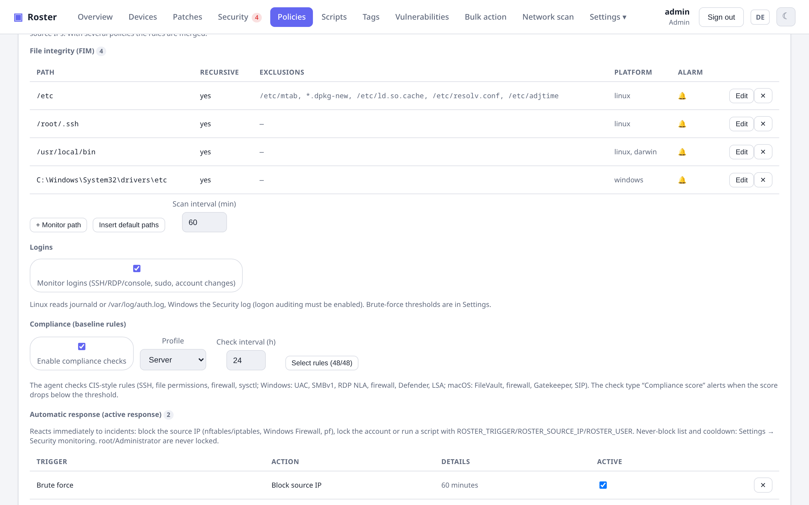
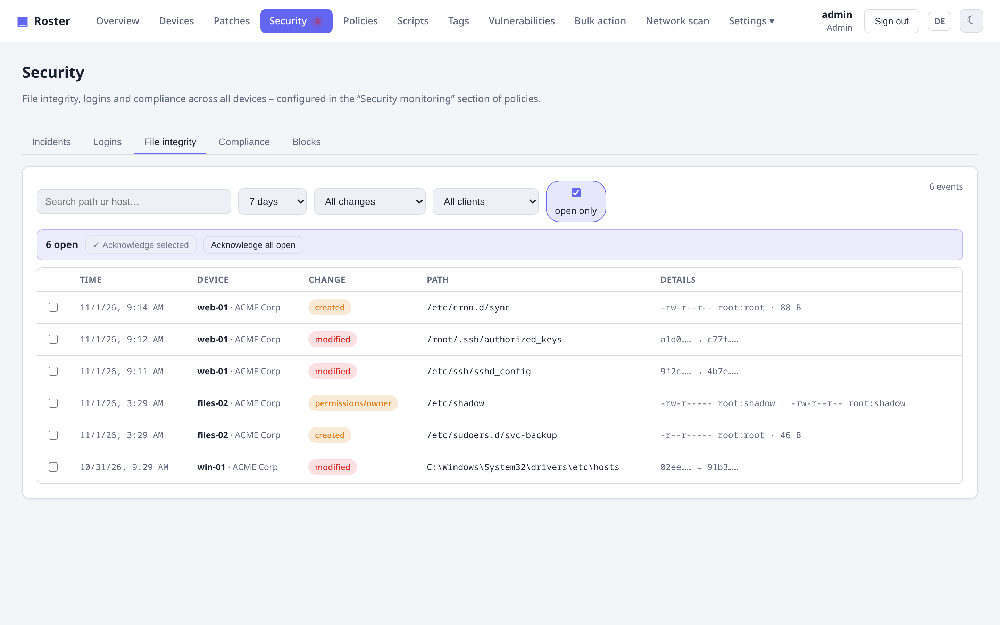
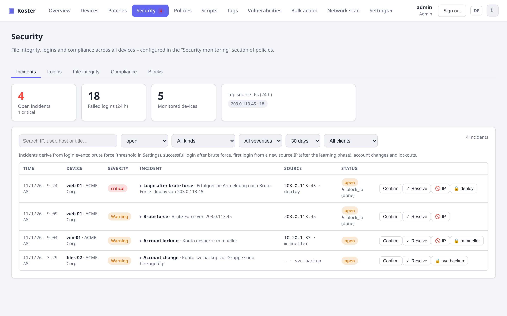
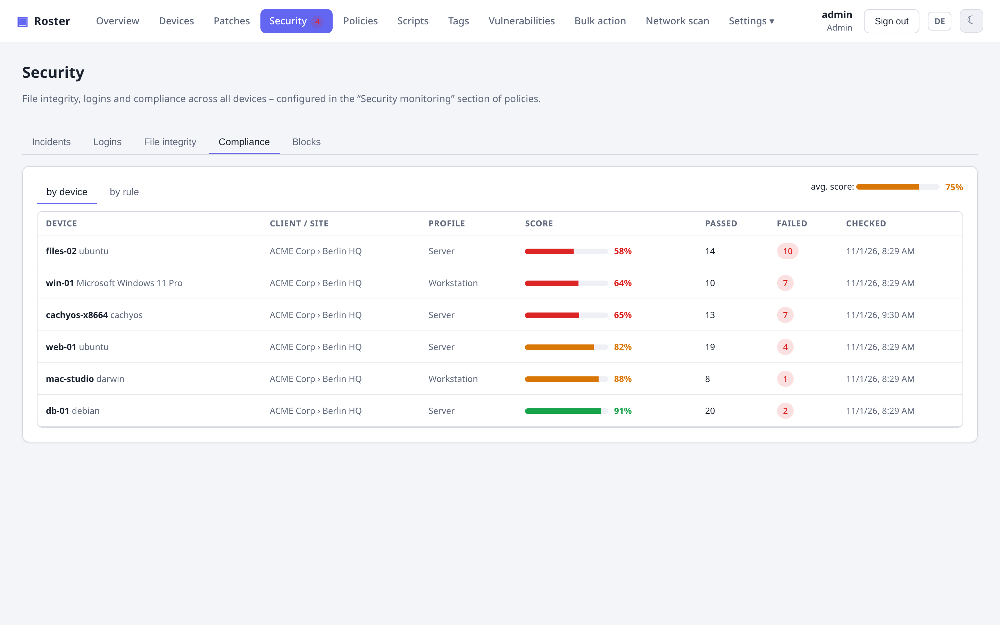

# Security monitoring

Roster adds host-based security monitoring in the spirit of Wazuh: file integrity, login
monitoring with incident detection, CIS-style compliance checks and automatic responses. All
of it is configured in the **Security monitoring** section of a policy and shown on the
**Security** page and in the device's "Security" tab group.

!!! note "Prerequisites"
    The agent must run as **root** (Linux/macOS) or **LocalSystem** (Windows) – the install
    scripts do that; a legacy systemd unit with `DynamicUser=yes` cannot read `/var/log/auth.log`,
    `/etc/shadow` or manage nftables. Login monitoring on Windows needs logon auditing
    (success/failure) enabled, which is the default on servers.

{ .shadow }

## File integrity (FIM)

{ .shadow }

Add **monitored paths** to a policy: a file, a directory (optionally recursive) or a glob such
as `/home/*/.ssh/authorized_keys`, with exclusion globs (`*.log`, `cache/`), an optional platform
restriction and an "alert" switch. *Insert default paths* adds the usual suspects per platform
(`/etc`, `/usr/local/bin`, `~/.ssh`, cron spools; Windows `drivers\etc`, scheduled tasks,
Startup folder; macOS LaunchDaemons/LaunchAgents).

The agent keeps a baseline (SHA-256, permissions, owner, mtime) in its state directory
(`/var/lib/roster/fim-baseline.json`, `C:\ProgramData\Roster\fim-baseline.json`). The first
run only creates the baseline; afterwards every scan (interval per policy, default 60 min)
reports **created**, **modified**, **deleted** and **permission/owner** changes. Changes of
rules with the alert switch are sent as one bundled alert per check-in and create a
`fim_change` incident. Files larger than 256 MB are compared by size and mtime only; a scan is
capped at 50 000 entries.

Device tab **File integrity**: event list with acknowledge, *Scan now* and *Reset baseline*.
Security page tab **File integrity**: fleet-wide list with filters.

## Login monitoring & incidents

{ .shadow }

With **Monitor logins** enabled the agent reads new events incrementally:

| Platform | Source | Events |
|---|---|---|
| Linux | journald (cursor) or `/var/log/auth.log` / `secure` (offset) | sshd failed/accepted/invalid user, sudo, su, useradd/userdel/usermod/gpasswd/passwd, console login |
| Windows | Security, System and PowerShell/Operational logs (RecordId cursor per log) | 4624/4625 (logon types 2/3/7/10/11), 4740 lockout, 4720/4726 user created/deleted, 4722/4725/4767, 4728/4732/4756 group membership, 4723/4724 password; 7045 service installed, 4698/4702 scheduled task, 1102 audit log cleared, 4688 suspicious process, 4104 suspicious PowerShell (see below) |
| macOS | unified log (`log show`) | sshd, sudo, su, login |

### Log sources: nginx, SFTP and FTP containers, custom patterns

Besides the system's own authentication log a policy can list **log sources** the agent reads
incrementally every minute: a **file** (globs allowed, e.g. `/var/log/nginx/*access.log`) or the
output of a **Docker container** (exact name or pattern such as `*sftp*`; the agent reads the
json-file log directly and falls back to `docker logs --since`). Each source has a format:

| Format | Produces |
|---|---|
| Web access log (nginx, Apache, Traefik – combined log, also with a leading `$host`; nginx-proxy output with forego prefix is unwrapped) | `401` → failed login; scanner paths (`wp-login.php`, `/.env`, `phpmyadmin`, `xmlrpc.php`, `../`, `cmd=`, `${jndi`, `/proc/self` …), SQL injection in path/query (`union select`, `' or 1=1`, `sleep(`, `information_schema` …, URL-encoded too; POST bodies are not in access logs – use WAF denials in the error log or an application log for those), hidden files (`/.git`, `/.terraform`), credential/config files, `400`/`444` and other malformed requests, `404` or reverse-proxy `503` on `.php/.sql/.bak/.zip/.tfvars/.pem …`, failed requests to the bare server IP instead of the domain name → **suspicious request** |
| Web error log (nginx, Apache) | `password mismatch`, `authentication failure`, `user … not found` → failed login; `access forbidden by rule`, `client denied`, `Invalid URI`, ModSecurity denials, rate limiting, missing scanner files → suspicious request |
| sshd (SSH/SFTP servers or containers) | the same events as the host's sshd: failed/accepted logins, invalid users |
| FTP (vsftpd, proftpd, pure-ftpd) | failed/successful logins, unknown users |
| Mail (Postfix SASL, Dovecot, Exim) | failed/successful IMAP/POP3/SMTP logins |
| custom pattern | a regular expression with `(?P<ip>…)` and optionally `(?P<user>…)`; each match counts as a failed login or a suspicious request |

Events carry the source's name as service (e.g. `web`, `sftp`, `mail`), so the **Logins** tab,
the incident texts and the blocks show where an attacker was seen. Templates fill the form for
the common cases: web server access/error log as a file or in a Docker container, SSH/SFTP
container, FTP server, mail server, custom pattern.

**Test** (next to each source and in the form, even before saving) makes the agent of a device
of your choice read the last lines of the source and parse them with the format: files or
containers found, lines read, hits and a sample of the recognised events. If no container
matches, the result lists the names of the running containers. The agent's read cursor is not
touched and hits are not stored as events.

Whether a source is actually being read on a device is shown on the device in the **Logins**
tab under **Monitoring on this device**: the policy that contributes it, how many files or
containers the agent found, how many events arrived since the agent started, when the last hit
was and any error (missing file, no matching container, missing permissions). The same card
shows whether login monitoring, file integrity and compliance are in effect.

The server derives **incidents** from these events:

- **Brute force** – N failed logins from one source IP within the window (default 10 in 10 min),
  **or** N attempts with non-existent user names within 24 hours (default 5, 0 = off). The second
  rule catches distributed, slow attacks that never reach the per-window threshold from one IP.
- **Attack pattern** – N suspicious requests from one source IP within the window (default 20),
  e.g. a web scanner walking through WordPress and phpMyAdmin paths on nginx.
- **Login after brute force** – a successful login from an IP that just brute-forced (critical).
- **New source IP** – a user's first successful login from an unknown address, after a learning
  phase (default 7 days of monitoring); private addresses can be ignored.
- **Account change** – user created/deleted, group membership changed (admin groups such as
  sudo/wheel/Administrators as warning), password changed.
- **Lockout** – account locked out.

Warnings and critical incidents go through the normal alert channels (maintenance windows
and per-channel severity apply). Which kinds are sent is a per-policy choice in the
**Notifications** tab (*Report security incidents*: one checkbox per kind), and *do not report
when the source IP was blocked automatically* keeps the channels quiet when active response or
automatic blocking already handled the attacker. Incidents are always recorded on the Security
page regardless of these switches. The **Incidents** tab lists them with acknowledge/resolve,
filters, the top source IPs, the **countries of origin** of failed attempts and suspicious requests and the
countries of recently blocked IPs; **Logins** shows the raw events. Source IPs carry a country
flag everywhere, and the Incidents tab can be filtered by country (also by clicking a country
in the tile). The mapping comes from an IP-to-country database embedded in the server
([ip-location-db](https://github.com/sapics/ip-location-db), public domain) – no external
service; it is refreshed with every release. For the overview there are the metrics **Blocked
IPs by country (30 days)** and **Attack sources by country (7 days)** as bar, donut or history
charts (see [Dashboard](dashboard.md)). Thresholds, the learning
phase and the never-block list live in Settings → **Security monitoring**.

### Windows events beyond logons

Besides the Security log the Windows agent reads the **System** log (7045 service installed) and
**Microsoft-Windows-PowerShell/Operational** (4104 script block), each with its own cursor, and
evaluates 4698/4702 (scheduled task created/changed), 1102 (audit log cleared) and 4688 (process
creation). 4688 and 4104 only leave the agent when they match suspicious patterns: certutil/bitsadmin
downloads, encoded or hidden PowerShell, download cradles (`IEX (New-Object Net.WebClient)…`),
AMSI/Defender tampering, mimikatz/procdump/psexec, `vssadmin delete shadows`, `wevtutil cl`,
`schtasks /create`, `net user … /add`, Office programs spawning shells. Incidents: **Persistence**
(service/task, warning), **Audit log cleared** (critical), **Suspicious process** (warning).

!!! note "Audit policy prerequisites"
    4688 needs the subcategory *Process Creation* (success) plus *Include command line in process
    creation events*; 4698 needs *Other Object Access Events*; 4104 needs *Turn on PowerShell Script
    Block Logging*. The compliance rules `audit_process_creation` and `powershell_logging` check
    exactly that. A missing PowerShell/Operational log (Server 2012 without WMF 5) is skipped.

### More log sources: HAProxy, Traefik, MySQL, firewall drops, journal, Docker events

| Format / type | Produces |
|---|---|
| HAProxy (HTTP log) | same classification as the web access log; requests rejected by the proxy (`PR` flags, `<BADREQ>`) → suspicious request |
| Traefik (JSON or common log) | same classification as the web access log |
| MySQL/MariaDB error log | `Access denied for user`, `Host … is not allowed` → failed login; aborted connections before authorisation → suspicious request |
| Firewall drops (iptables/nft/ufw kernel log, Windows `pfirewall.log`) | one `fw_drop` event per dropped inbound packet (`tcp/22`); N distinct target ports from one IP within the brute-force window (default 10) → incident **Port scan**, auto-blocked like brute force |
| Source type **systemd journal** | target `kernel` (nft/iptables `log prefix`, ufw) or a `SYSLOG_IDENTIFIER`; cursor-based like the auth log |
| Source type **Docker events** | `docker events` since the last run: `exec` in a container → incident **Command in container**; start/stop/die/oom are listed as events |

## Threat intelligence

The server fetches five public block lists daily – **Spamhaus DROP**, **blocklist.de**, **Feodo
Tracker**, **CINS Army** and the **Tor exit node list** – caches them in the database and keeps
them as an in-memory index. Source IPs of incidents, login events and blocks are flagged with the
list name (⚠ badge), and both lists can be filtered to *listed IPs only*. A listed IP raises the
incident **Known attack source** on its first failed login, suspicious request or firewall drop
and is blocked on all monitored devices right away – regardless of thresholds and of the general
fleet-block switch; the never-block list and private addresses stay exempt. The tab Security →
**Threat intelligence** shows each feed's state, entry count and errors, refreshes on demand and
looks up single IPs. Settings → Security monitoring switches the match, the immediate block and
the individual feeds; the feature is on by default (five outbound HTTPS requests a day).

## Registry monitoring (Windows)

File integrity rules accept registry paths: `HKLM\SOFTWARE\…`, `HKU\*\…` (all loaded user
profiles – `HKCU` is mapped to that because the agent runs as SYSTEM) or `HKCR\…`. Keys count like
directories, values like files (hash over type and data), and new or removed sub-keys are reported,
so a new service under `Services` or a new Run entry shows up as **created**. *Insert registry
defaults (Windows)* adds 18 persistence locations: Run/RunOnce (machine, WOW6432Node, per user),
Winlogon, Image File Execution Options, AppInit_DLLs, Services, LSA, Session Manager, Browser
Helper Objects, scheduled-task cache, UAC policies, Terminal Server, Defender exclusions.

## Who changed the file (who-data)

With the policy switch *Identify who changed files* the file-integrity events carry **user and
process** (column "Who", also in notifications). Linux: the agent maintains auditd watch rules
(`-w <path> -p wa -k roster_fim`) for the monitored paths and reads new records with
`ausearch --checkpoint` after every scan – package `auditd` required; a locked audit
configuration is reported once. Windows: the agent sets success SACLs (Everyone: write/delete/
permissions) on the monitored files and directories, enables the *File System* audit subcategory
and correlates events 4663/4660 with the changed paths.

## System-state monitoring

*Monitor system state* takes an hourly snapshot and compares it with the baseline: listening
ports (without PIDs), kernel modules, cron entries, UID-0 and administrator accounts, enabled
systemd units/timers (Linux); administrators (`net localgroup`), auto-start services (WMI) and
scheduled tasks (`schtasks`) on Windows; admin group and launchd jobs on macOS. Every change
becomes the incident **System change** with a `+ new, - gone` list; a new UID-0 or administrator
account is critical. The first run after enabling only records the baseline.

## Rootkit and malware check

*Rootkit/malware check* runs once a day on Linux: hidden processes (answer to `kill(pid,0)` but
missing in `/proc`), a non-empty `/etc/ld.so.preload`, hidden kernel modules, interfaces in
promiscuous mode, executables, setuid files and ELF binaries in `/tmp`, `/var/tmp`, `/dev/shm`,
regular files in `/dev` and known rootkit paths (Reptile, Diamorphine, Jynx, BEURK). Findings are
critical **Rootkit indicator** incidents; *Rootkit check now* on the device's file-integrity tab
runs it immediately. In addition, files created or modified according to file integrity
monitoring are handed to ClamAV (`clamdscan` or `clamscan`, Linux) or Defender (`MpCmdRun`,
Windows) if present – a hit is the critical incident **Malware**. Windows and macOS have no
rootkit scan of their own (Defender/XProtect cover that).

## MITRE ATT&CK and severity per kind

Every incident carries its ATT&CK techniques (e.g. T1110 Brute Force, T1543.003 Windows Service,
T1070.001 Clear Windows Event Logs, T1014 Rootkit) as links into the ATT&CK matrix, and the
Incidents tab filters by technique. Settings → Security monitoring → *Severity per incident kind*
overrides the default severity; **Info** suppresses the notification while the automatic
response still runs. All kinds come from one catalog (`GET /security/kinds`) that also drives the
policy's notification and active-response choices.

!!! note "Policies with an explicit alert list"
    A policy whose *Report security incidents* list was saved explicitly keeps that list – new kinds
    (Port scan, Known attack source, Persistence, Audit log cleared, Suspicious process, System
    change, Rootkit indicator, Malware, Command in container) are reported only after editing it;
    policies set to "all kinds" report them right away.

## Compliance (baseline) checks

{ .shadow }

Enable **Compliance** in a policy with a profile (*server* or *workstation*), an interval
(default 24 h) and an optional rule selection. The agent evaluates a CIS-style catalog and
reports pass/fail/n/a with evidence; the **score** is passed / (passed + failed) · 100.

Rule families: Linux – SSH hardening (root login, password auth, MaxAuthTries, X11, weak
ciphers), `/etc/shadow` and `/etc/passwd` permissions, empty passwords, extra UID 0, sudo
`NOPASSWD: ALL`, password aging, firewall active, auditd, NTP, SELinux/AppArmor, ASLR, IP
forwarding, ICMP redirects, SYN cookies, world-writable files in `/etc`, telnet/rsh services,
core dumps, plus (0.19) SSH idle/grace/empty passwords/rhosts/sessions/log level, pam_pwquality and
pam_faillock, password ageing and umask, cron permissions and cron.allow, log permissions, sticky
bit, `/tmp` and `/dev/shm` mount options, home permissions, further sysctl keys, persistent journald,
unused filesystem modules. Windows – UAC, SMBv1, RDP NLA / RDP disabled, guest and built-in
Administrator, firewall profiles, Defender real-time, BitLocker system drive, AutoPlay, LLMNR,
password length, lockout threshold, PowerShell 2.0, WDigest, LSA protection, plus (0.19) password
history/age, lockout duration, anonymous enumeration, SMB signing, NTLMv2 only, RDP idle timeout,
screen lock, firewall logging, Remote Registry, Print Spooler, WinRM, NetBIOS, Defender cloud/PUA,
UAC secure desktop, SEHOP, DEP, script block logging, audit policies, event log sizes, cached
logons, autologon (all PowerShell-3-safe). macOS – FileVault, firewall and stealth mode,
Gatekeeper, SIP, screen-saver password, guest, remote login. All platforms – automatic updates
enabled, no reboot pending. 106 rules in total; each carries a remediation hint and **framework
references** (CIS section, PCI DSS, ISO 27001) shown as badges, with a framework filter on the
device, fleet and policy views.

Results appear in the device tab **Compliance** and on the Security page (by device and by
rule, with the failing devices per rule). The check type **Compliance score** (minimum score,
optionally fail on any high-severity rule) plugs the result into alerting and self-healing.

## Active response

A policy can react to incidents automatically:

| Trigger | Actions |
|---|---|
| Brute force, login after brute force, new source IP, attack pattern | block source IP, run script |
| Login after brute force, account change, lockout, new source IP | lock account, run script |
| File change, system change, rootkit indicator, malware, command in container | run script |
| Known attack source, port scan | block source IP, run script |
| Persistence, suspicious process | lock account, run script |

- **Block IP** – Linux: nftables sets `inet roster blocked4/6` (single addresses) and `net4/6`
  (networks) with a timeout, dropped in the **input and forward** hooks so that traffic to Docker
  containers with published ports is blocked as well (iptables fallback: `INPUT`, `FORWARD` and
  `DOCKER-USER`, expiry handled by the agent); Windows: inbound firewall rule `Roster-Block <ip>`;
  macOS: pf table `roster_block` (add `table <roster_block> persist` and
  `block in quick from <roster_block>` to `/etc/pf.conf`). Duration in minutes, 0 = permanent.
  A target can be a single IP or a network in CIDR notation.
- **Lock account** – `usermod -L`, `Disable-LocalUser`, `pwpolicy -disableuser`. root and
  Administrator are never locked.
- **Run script** – a library script with `ROSTER_TRIGGER`, `ROSTER_SOURCE_IP`, `ROSTER_USER`,
  `ROSTER_DEVICE`, `ROSTER_INCIDENT` and `ROSTER_TITLE` in the environment.

!!! warning "Private addresses are never blocked automatically"
    Source IPs from private ranges (10/8, 172.16/12, 192.168/16, 100.64/10, fd00::/7) are excluded
    from automatic blocking – usually a reverse proxy or Docker network is behind them and the
    block would hit your own service. With a proxy setup read the **proxy's** log (e.g. the
    `nginx-proxy` container), not the backend's. The **Blocks** tab has a search by IP, device,
    reason and creator, a status filter and an *everywhere* button per block that releases an IP
    on all devices.

### Automatic blocking without policy rules

For fleets with many servers the per-policy rules are optional: Settings → **Security
monitoring** → *Automatic blocking* blocks the source IP of every brute force, login after brute
force and attack pattern on the device that reported it, with a configurable duration (one hour
to permanent). A policy's own active-response rule for the same trigger takes precedence. Two
options widen the effect:

- **Fleet blocking** – the address is blocked on every device whose policy monitors logins or
  reads log sources, not only where it was seen. Devices that already block it are skipped.
- **Subnet blocking** – if at least N different suspicious IPs from the same IPv4 `/24` showed up
  on the device within 24 hours (default off), the whole network is blocked instead of the single
  address. A network that contains a never-block address is never blocked as a whole.

In the **Incidents** tab you can also select many incidents at once and block all their source
IPs with one click (duration and fleet option as above); the incidents are acknowledged in the
same step.

Safeguards: the **never-block list** (IPs/CIDRs) and a **cooldown** per device and action in
Settings → Security monitoring; loopback and the Roster server address are always protected.
Every reaction is written to the audit log and shown at the incident with its result. The
**Blocks** tab lists all blocks (status, expiry, release) and lets you block an IP or a network
by hand (device, IP or CIDR, duration from one hour to permanent, reason, optionally on all
monitored devices); incidents offer *Block IP* with the
same duration choice and *Lock account*. Blocking an IP that is already blocked does not create
a duplicate: the existing block is renewed with the new duration, so a temporary block can be
made permanent in place.

!!! tip "Block duration and data volume"
    With fleet blocking every blocked address creates one block row and one command **per device**. A short
    block duration (e.g. 60 min) re-blocks the same attackers every hour – with thousands of incidents a day
    that is hundreds of thousands of rows. Recommendation: 24 h or longer. Retention: raw login/log events
    30 days, finished blocks 14 days, finished block commands 2 days, incidents one year.
