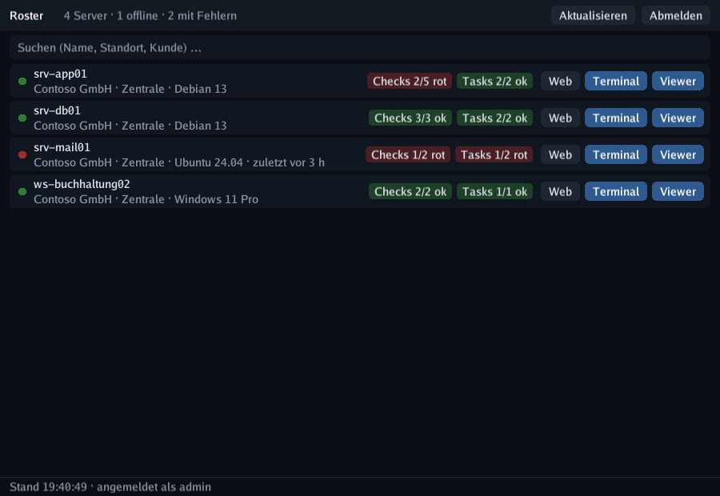
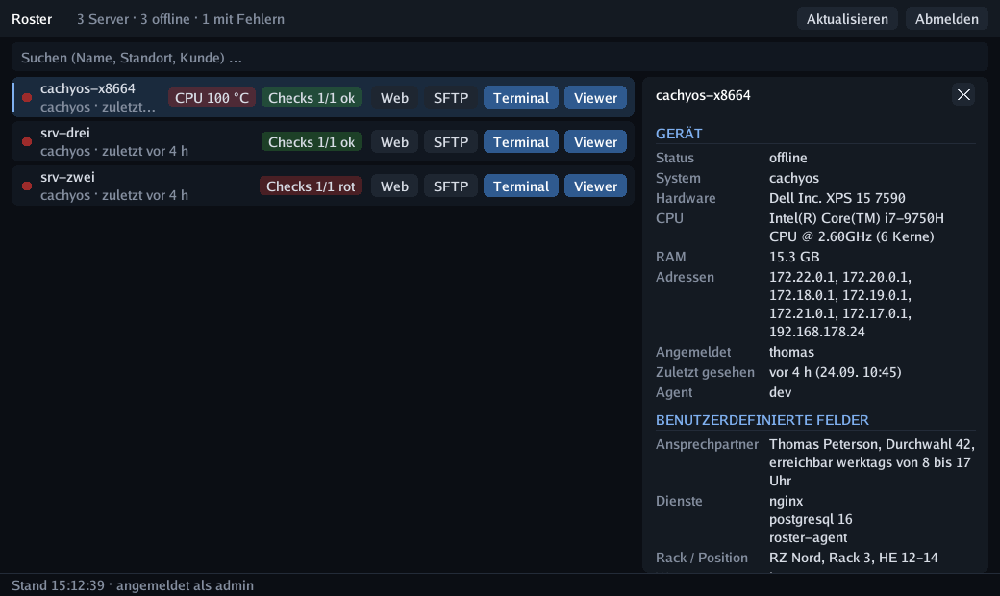

# Taskleisten-App

`roster-tray` bringt deine Flotte auf einen Klick: ein **Symbol in der Taskleiste** plus ein
kompaktes Fenster, das jeden Server mit seinem **Check**- und **Task**-Ergebnis auflistet und
je Zeile ein **Terminal** oder den **Viewer der Fernsteuerung** öffnet.

{ .shadow }

Wie der Viewer ist sie ein **cgo-freies** Go-Binary, das über purego mit SDL3 zeichnet –
keine Laufzeitumgebung zu installieren, Cross-Builds für Linux/Windows/macOS ohne Toolchain.

## Was sie zeigt

- **Statuspunkt** je Gerät – online, offline oder nicht verwaltet.
- **Checks**-Badge – grün `Checks 4/4 ok`, rot `Checks 1/4 rot`, sobald einer fehlschlägt.
- **Tasks**-Badge – dasselbe Prinzip, basierend auf dem letzten Lauf jedes Tasks.
- Firma / Standort / OS, und wie lange ein Offline-Gerät schon still ist.
- **Temperatur**-Badge – die heißeste CPU in neutralem Grau; liegt ein Sensor in seinem
  Warn- oder Kritisch-Bereich, stattdessen dieser Sensor in Amber oder Rot (z. B.
  `NVMe 86 °C`). Ein rotes **Lüfter**-Badge erscheint nur, wenn ein Lüfter stehen bleibt,
  einen Alarm meldet oder zu langsam läuft.
- Das Tray-Symbol selbst wird **rot**, wenn irgendetwas fehlschlägt, und **amber**, wenn ein
  Gerät offline geht, mit einer Zusammenfassung im Tooltip – ein Blick in die Taskleiste
  genügt.

## Gerätedetails

Ein **Klick auf eine Zeile** öffnet neben der Liste ein Panel mit allem, wofür du sonst die
Web-UI aufmachen würdest: System, Hardware, Adressen, angemeldete Benutzer, letzter Kontakt,
Tags – und vor allem die **benutzerdefinierten Felder** des Geräts (Listen und Checkboxen
lesbar dargestellt), gefolgt von den aktuellen **Check-Ergebnissen**, Platten und Notizen.
Das Panel aktualisiert sich mit jedem Listen-Poll; `Esc` oder das ✕ schließt es, ein zweiter
Klick auf dieselbe Zeile ebenfalls.

{ .shadow }

Proxmox-Hosts lassen sich aufklappen und zeigen ihre VMs und Container mit Backup-Badge und
Start-/Stopp-Knöpfen – siehe [Proxmox VE](proxmox.md#in-der-taskleisten-app).

Tippe einfach los, um nach Name, Standort, Firma oder OS zu filtern, nach VMID / Gastname und
nach den Werten der **benutzerdefinierten Felder** des Geräts (eine AnyDesk-ID, ein Tag in
einem Listenfeld, …); `F5` (oder das Tray-Menü) aktualisiert, und die Liste pollt von selbst
alle 30 s (`refresh_sec`).

## Terminal- und Viewer-Knöpfe

| Knopf | Was passiert |
| ------ | ------------ |
| **Terminal** | Öffnet deinen normalen Terminal-Emulator (kitty, foot, alacritty, GNOME Terminal, Konsole, Windows Terminal …) mit `roster-tray --term <device>`, das stdin/stdout durch denselben On-demand-Terminal-Tunnel leitet wie die Web-UI. Scrollback, Kopieren & Einfügen und Farben bleiben erhalten – die App bringt keinen eigenen Terminal-Emulator mit. |
| **Viewer** | Fordert eine Fernsteuerungs-Sitzung an und startet den nativen `roster-viewer` mit dem fertigen Startcode – derselbe Weg wie der Knopf *Im Viewer öffnen* im Browser, nur ohne Umweg. |
| **Neustart** | Stellt einen Neustart des Geräts in die Warteschlange – klicken, dann innerhalb von vier Sekunden mit dem roten *Sicher?* bestätigen, wie bei den Proxmox-Gast-Knöpfen. |
| **SFTP** | Übergibt `sftp://user@host/` an das registrierte Programm deines Desktops (Nautilus/Dolphin binden es über GVFS/KIO ein) oder fällt auf den ersten gefundenen installierten Client zurück – FileZilla, Dolphin, Nautilus, Nemo, Thunar, Krusader, Konqueror, gftp; WinSCP unter Windows. |
| **Web** | Öffnet die Geräteseite in deinem Browser (ein Doppelklick auf die Zeile tut dasselbe). |

!!! warning "SFTP geht direkt zum Gerät, nicht durch den Tunnel"
    Terminal und Viewer werden über den Roster-Server vermittelt und erreichen so ein Gerät
    hinter NAT oder einer Firewall. **SFTP nicht**: Das ist eine gewöhnliche SSH-Verbindung
    von deinem Arbeitsplatz aus, das Gerät braucht also einen SSH-Server und muss von dort
    erreichbar sein, wo du sitzt. Der Knopf erscheint nur, wenn Roster eine Adresse für das
    Gerät kennt – die erste echte IPv4 aus dem Inventar (Loopback, Link-local und
    `docker*`/`br-*`/`veth*`/`virbr*`-Schnittstellen werden übersprungen), sonst der
    Hostname, sonst die öffentliche IP. Geräte aus dem Netzwerk-Scan bekommen den Knopf
    auch, selbst ohne Agent.

    Den Anmeldenamen setzt du mit `sftp_user`; ein bestimmtes Programm erzwingst du mit
    `sftp_command`, das die Platzhalter `{{host}}`, `{{user}}`, `{{url}}` und `{{name}}`
    kennt:

    ```json
    { "sftp_user": "root", "sftp_command": "filezilla {{url}}" }
    ```

## Anmeldung

Du meldest dich einmal mit Benutzername, Passwort und (falls aktiviert) dem
**Zwei-Faktor-Code** an. Die App legt sich dann selbst einen **Benutzer-API-Token** an und
speichert ihn in `tray.json` – die Sitzung selbst wird verworfen, du fliegst also nicht nach
12 Stunden raus. *Abmelden* im Tray-Menü widerruft den Token auf dem Server.

```
~/.config/roster/tray.json        # Linux/BSD (0600)
~/Library/Application Support/…   # macOS
%AppData%\roster\tray.json        # Windows
```

| Schlüssel | Bedeutung |
| --- | ------- |
| `url`, `user`, `token` | Server und gespeicherter Zugang (bei der Anmeldung geschrieben) |
| `insecure` | TLS-Prüfung überspringen – nur für selbstsignierte Testserver |
| `refresh_sec` | Poll-Intervall für die Geräteliste (Vorgabe 30) |
| `terminal` | Einen Terminal-Emulator erzwingen statt automatischer Erkennung |
| `viewer_path` | Pfad zu `roster-viewer`, falls er nicht neben dem Binary oder im `PATH` liegt |
| `shell` | Standard-Shell für das Remote-Terminal (`shell`, `bash`, `cmd`, `powershell`) |
| `sftp_user` | Anmeldename für den SFTP-Knopf (leer = keiner) |
| `sftp_command` | Programm für den SFTP-Knopf statt des Desktop-Handlers; Platzhalter `{{host}}` `{{user}}` `{{url}}` `{{name}}` `{{key}}` |
| `sftp_key` | Privater Schlüssel für den SFTP-Knopf. Eine `sftp://`-URL kann keinen Schlüssel transportieren, deshalb öffnet der Knopf mit gesetztem Schlüssel `sftp -i <key> user@host` in deinem Terminal (Windows: WinSCP mit `/privatekey=`) oder dein `sftp_command` mit `{{key}}`. Dateimanager nehmen Schlüssel nur über `~/.ssh/config` an. |
| `theme` | `dark` (Vorgabe) oder `light` |
| `ui_scale` | Feste UI-Skalierung (0 / fehlt = automatisch erkennen). `Strg` `+` / `Strg` `-` ändern sie live und speichern sie, `Strg` `0` kehrt zu automatisch zurück |

## Download

**Einstellungen → Downloads** in der Web-UI bietet fertig gebaute Pakete direkt von deinem
Server – auf demselben Weg, wie der Viewer der Fernsteuerung ausgeliefert wird:

| Plattform | Paket | Nach dem Download |
| -------- | ------- | ----------------- |
| Linux x86-64 / ARM64 | `roster-tray` | `chmod +x roster-tray && ./roster-tray --install --autostart` – SDL3 kommt aus deiner Distribution |
| Windows x86-64 | `roster-tray-windows.zip` | entpacken, dann `roster-tray.exe --install --autostart` in einem Terminal (kopiert exe + `SDL3.dll` nach `%LOCALAPPDATA%\Programs\Roster`) |
| macOS (Apple Silicon) | `roster-tray-macos.zip` | nur am [GitHub-Release](https://github.com/boonkerz/roster/releases) angehängt (der Build braucht einen Mac); entpacken, `libSDL3.dylib` neben dem Binary lassen – noch kein `--install` |

Der Download ist öffentlich (`/api/v1/tray/<os>-<arch>`) – das Binary enthält keine
Geheimnisse; du meldest dich beim ersten Start an, und die App behält nur ihren eigenen
API-Token. Welche Plattformen erscheinen, hängt davon ab, was in den Server eingebaut wurde
(`make tray-embed`, `tray-embed-arm64`, `tray-embed-windows`, `tray-embed-darwin`); der
Release-Workflow baut alle.

## Einstellungen

**Einstellungen** in der Kopfzeile öffnet eine Einstellungsseite in der App für die Dinge,
die du sonst in `tray.json` ändern würdest: **Erscheinungsbild** (Dunkel / Hell – live als
Vorschau angewendet, gespeichert mit *Speichern*), den **SFTP-Benutzer**, den
**SSH-Schlüssel** für SFTP (jeder in `~/.ssh` gefundene private Schlüssel wird als Knopf
angeboten; *keiner* überlässt es deinem Agent / Standardschlüssel) und ein optionales
**SFTP-Programm**. `Esc` verwirft, `Enter` speichert.

## Anwendungsstarter

`--install` legt alles dort ab, wo der Desktop es erwartet – kein root, kein Paketieren,
kein Quellbaum. Es kopiert das Binary, aus dem du es startest, funktioniert also direkt aus
dem Download:

```bash
./roster-tray --install                    # ~/.local/bin + Eintrag im Anwendungsmenü + Symbol
./roster-tray --install --autostart        # zusätzlich beim Anmelden ins Tray starten
./roster-tray --install --prefix /usr/local # systemweit (als root ausführen)
roster-tray --uninstall                    # wieder entfernen (gleiches --prefix)
```

`make install-tray`, `make install-tray-autostart` und `make uninstall-tray` sind dünne
Hüllen um dieselben Flags für einen Quell-Checkout.

Unter Linux installiert es:

| Datei | Zweck |
| ---- | ------- |
| `$PREFIX/bin/roster-tray` | das Binary (die `.desktop`-Datei bekommt diesen absoluten Pfad) |
| `$PREFIX/share/applications/de.boonkerz.roster.tray.desktop` | der Starter-Eintrag |
| `$PREFIX/share/icons/hicolor/256x256/apps/de.boonkerz.roster.tray.png` | das Symbol (die App rendert ihr eigenes) |
| `~/.config/autostart/de.boonkerz.roster.tray.desktop` | nur mit `--autostart`: startet `roster-tray --hidden` beim Anmelden |

Unter Windows: `%LOCALAPPDATA%\Programs\Roster\roster-tray.exe` + `SDL3.dll` + `.ico`, eine
**Startmenü**-Verknüpfung „Roster“ und mit `--autostart` dieselbe Verknüpfung im
Autostart-Ordner. Das `--install` des Viewers nutzt denselben Ordner, beide teilen sich also
eine `SDL3.dll`.

Die App setzt ihre **Anwendungs-ID** (`de.boonkerz.roster.tray`) als Wayland-`app_id` /
X11-`WM_CLASS`, passend zum Namen der `.desktop`-Datei und deren `StartupWMClass`. Dadurch
zeigt das Panel für das Fenster den richtigen Namen und das richtige Symbol statt eines
generischen.

Ein zweiter Start aus dem Menü erzeugt **kein** zweites Tray-Symbol: Der neue Prozess reicht
die Anfrage über einen Socket in `$XDG_RUNTIME_DIR` an den laufenden weiter, der dann sein
Fenster in den Vordergrund holt.

Taucht der Eintrag nicht sofort auf, hält der Desktop noch ein gecachtes Menü –
`update-desktop-database ~/.local/share/applications` (der Installer führt es aus) oder eine
Neuanmeldung aktualisiert es. `~/.local/share/applications` muss von `XDG_DATA_DIRS`
abgedeckt sein, was auf jedem Desktop die Vorgabe ist.

## Ausführen

```bash
make tray                 # baut bin/roster-tray
bin/roster-tray           # Fenster + Tray-Symbol
bin/roster-tray --hidden  # nur ins Tray starten (Autostart)
bin/roster-tray --selftest # SDL3, Fenster und Tray-Unterstützung auf diesem Desktop prüfen
bin/roster-tray --screenshot shot.png --select srv01  # einen Frame (mit Detail-Panel) für die Doku rendern
```

| Taste | Aktion |
| --- | ------ |
| Klick auf eine Zeile | Detail-Panel öffnen / schließen · Doppelklick öffnet das Gerät in der Web-UI |
| beliebig tippen | Liste filtern · `Esc` schließt das Panel, dann leert es den Filter, dann versteckt es ins Tray |
| `F5` / `Strg` `R` | jetzt aktualisieren |
| `Strg` `+` / `Strg` `-` / `Strg` `0` | UI-Skalierung größer / kleiner / automatisch |
| `Strg` `Q` | beenden |

Das Fenster zu schließen versteckt es ins Tray; **Beenden** im Tray-Menü beendet die App.
Ohne Tray-Unterstützung bleibt das Fenster einfach offen, und Schließen beendet.

## HiDPI

Die App zeichnet in den vollen Pixelpuffer und skaliert Schriften und Abstände mit der
Display-Skalierung, bleibt also auf 4K-Bildschirmen scharf. In einer Wayland-Sitzung
verlangt sie von SDL absichtlich den **Wayland-Treiber**: Über XWayland meldet der
x11-Treiber *keine* Skalierung, während der Compositor trotzdem physische Pixel ausgibt –
genau so wird ein 4K-Fenster 1,75× zu klein. Setze `SDL_VIDEODRIVER` selbst, um diese Wahl
zu überstimmen.

Lässt sich die Skalierung trotzdem nicht erkennen (reines X11, kein `Xft.dpi`), zoome mit
`Strg` `+` / `Strg` `-` – der Wert wird als `ui_scale` gespeichert und beim nächsten Start
wiederverwendet; `Strg` `0` schaltet zurück auf automatische Erkennung.
`roster-tray --selftest` gibt den Video-Treiber und jeden Skalierungswert aus, den SDL
meldet – das erklärt die Größe meist in einer Zeile.

!!! note "Linux-Desktops"
    Das Tray-Symbol nutzt SDL3s `SDL_Tray`, das mit dem StatusNotifier-/AppIndicator-Dienst
    deines Panels spricht (waybar, GNOME mit der AppIndicator-Erweiterung, KDE, XFCE …).
    `--selftest` sagt dir in einer Zeile, ob SDL3 auf dieser Maschine Tray-Unterstützung
    mitbringt und ob die Menü-Callbacks ankommen.

Für den Autostart unter Linux legst du eine `.desktop`-Datei in `~/.config/autostart/` ab:

```ini
[Desktop Entry]
Type=Application
Name=Roster
Exec=/usr/local/bin/roster-tray --hidden
```
