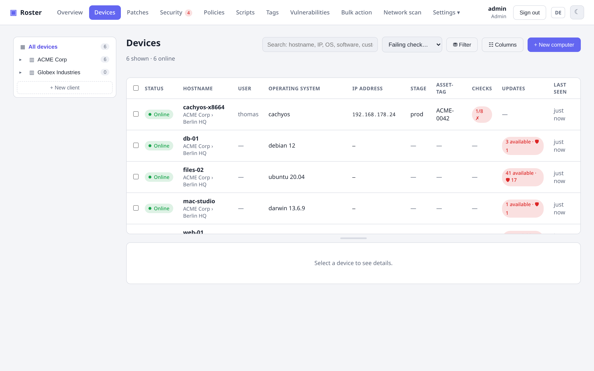

# Erste Schritte

Roster ist ein einzelnes Go-Binary, in das die Web-UI und alle Agent-Binaries eingebettet
sind. **Go 1.26+** und **Node.js** brauchst du nur zum Bauen; zur Laufzeit ist es eine
selbst-enthaltene ausführbare Datei plus eine Datenbank (standardmäßig SQLite).

## 1. Bauen

```bash
# Server bauen (bettet die Web-UI + cross-kompilierte Agents ein)
make server

# oder manuell:
cd web && npm install && npm run build && cd ..
make agents-embed
CGO_ENABLED=0 go build -ldflags "-s -w" -o bin/roster-server ./cmd/server
```

## 2. Starten

```bash
./bin/roster-server run
```

Beim ersten Start legt Roster einen Benutzer **admin** an und gibt ein generiertes Passwort
aus (sofern du keines per Env setzt). Öffne die UI, melde dich an – und du bist auf der
Übersicht.

!!! tip "Lokaler Test vs. Produktion"
    Für einen schnellen lokalen Test kannst du Roster über reines HTTP betreiben. In
    Produktion terminierst du TLS an einem Reverse-Proxy (setze `ROSTER_BEHIND_PROXY=true`,
    `ROSTER_SECURE_COOKIE=true`) oder lässt Roster TLS direkt ausliefern – siehe
    **[Konfiguration](configuration.md)**.

## 3. Ersten Agent enrollen

1. Klicke in der UI auf **+ Neuer Computer**.
2. Wähle das Ziel-Betriebssystem – Roster erzeugt einen einzeiligen Installationsbefehl mit
   eingebauter Server-URL und frischem Enrollment-Token und liefert das passende
   Agent-Binary aus.
3. Führe ihn auf dem Zielrechner aus. Der Agent installiert sich als Dienst, enrollt sich und
   meldet innerhalb einer Minute das erste Inventar.

{ .shadow }

Agents **aktualisieren sich selbst**: Wenn du einen neueren Server ausrollst, holen sich die
Agents beim nächsten Checkin das neue Binary.

!!! note "Unterstützte Plattformen"
    Linux (amd64/arm64, systemd), FreeBSD/OPNsense, macOS und Windows amd64. Der
    Windows-Agent läuft auch auf älteren Systemen wie **Windows Server 2012/2012 R2 und
    Windows 7/8.1**: Der Build senkt die Mindest-Windows-Version im EXE-Kopf, die der
    Go-Linker sonst auf Windows 10 setzt (ältere Windows lehnen die Datei dann als „keine
    gültige Win32-Anwendung“ ab). Der Installationsbefehl kommt mit PowerShell 3 aus und
    erzwingt TLS 1.2.
    Der Windows-Dienst protokolliert nach `C:\ProgramData\Roster\agent.log`.

!!! tip "OPNsense: upgrade-fest als Plugin"
    Auf OPNsense registriert sich der Agent beim Start als Plugin **os-roster-agent**: Er baut
    mit dem `pkg` der Firewall ein lokales Paket, legt es in ein lokales Repo unter
    `/var/lib/roster/pkg` (Definition `/usr/local/etc/pkg/repos/roster.conf`) und trägt sich in
    die Plugin-Liste der `config.xml` ein. Der Dienst wird über `/etc/rc.conf.d/rosteragent`
    aktiviert. Fehlt der Agent nach einem Firmware-Upgrade, unter **System → Firmware →
    Plugins** `os-roster-agent` neu installieren bzw. *fehlende Plugins installieren*. Nach
    einer Neuinstallation mit Konfigurationsimport fehlt das lokale Repo – dann das
    Installationsskript erneut ausführen.

## 4. Flotte organisieren

Roster nutzt eine Hierarchie **Firma → Standort → Gerät** (wie TacticalRMM):

- Lege **Firmen** (Kunden) und **Standorte** unter Einstellungen an.
- Binde ein Enrollment-Token an einen Standort, damit Geräte automatisch dort landen, oder
  verschiebe ein Gerät später über seine Detailseite an einen Standort.

Diese Hierarchie steuert auch den **[Datenbereich pro Benutzer](features/permissions.md)** –
also die Beschränkung eines Benutzers auf bestimmte Firmen/Standorte.

## Weiter

- Lege fest, wer was sieht, mit **[Rollen & Berechtigungen](features/permissions.md)**.
- Setze Schwellwerte und Automatisierung mit **[Checks & Tasks](features/checks-tasks.md)**.
- Verbinde dich mit einem Rechner über **[Fernsteuerung & Terminal](features/remote.md)**.
