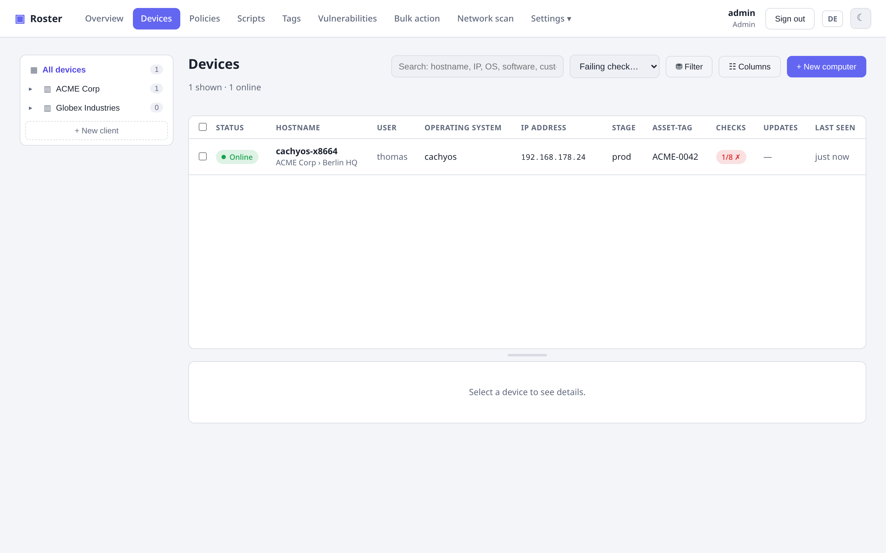

# Erste Schritte

Roster ist ein einzelnes Go-Binary, in das die Web-UI und alle Agent-Binaries eingebettet
sind. **Go 1.26+** und **Node.js** brauchst du nur zum Bauen; zur Laufzeit ist es eine
selbst-enthaltene ausführbare Datei plus eine Datenbank (standardmäßig SQLite).

## 1. Bauen

```bash
# Server bauen (bettet die Web-UI + cross-kompilierte Agents ein)
make server

# oder manuell:
cd web && npm install && npm run build && cd ..
make agents-embed
CGO_ENABLED=0 go build -ldflags "-s -w" -o bin/roster-server ./cmd/server
```

## 2. Starten

```bash
./bin/roster-server run
```

Beim ersten Start legt Roster einen Benutzer **admin** an und gibt ein generiertes Passwort
aus (sofern du keines per Env setzt). Öffne die UI, melde dich an – und du bist auf der
Übersicht.

!!! tip "Lokaler Test vs. Produktion"
    Für einen schnellen lokalen Test kannst du Roster über reines HTTP betreiben. In
    Produktion terminierst du TLS an einem Reverse-Proxy (setze `ROSTER_BEHIND_PROXY=true`,
    `ROSTER_SECURE_COOKIE=true`) oder lässt Roster TLS direkt ausliefern – siehe
    **[Konfiguration](configuration.md)**.

## 3. Ersten Agent enrollen

1. Klicke in der UI auf **+ Neuer Computer**.
2. Wähle das Ziel-Betriebssystem – Roster erzeugt einen einzeiligen Installationsbefehl mit
   eingebauter Server-URL und frischem Enrollment-Token und liefert das passende
   Agent-Binary aus.
3. Führe ihn auf dem Zielrechner aus. Der Agent installiert sich als Dienst, enrollt sich und
   meldet innerhalb einer Minute das erste Inventar.

{ .shadow }

Agents **aktualisieren sich selbst**: Wenn du einen neueren Server ausrollst, holen sich die
Agents beim nächsten Checkin das neue Binary.

## 4. Flotte organisieren

Roster nutzt eine Hierarchie **Firma → Standort → Gerät** (wie TacticalRMM):

- Lege **Firmen** (Kunden) und **Standorte** unter Einstellungen an.
- Binde ein Enrollment-Token an einen Standort, damit Geräte automatisch dort landen, oder
  verschiebe ein Gerät später über seine Detailseite an einen Standort.

Diese Hierarchie steuert auch den **[Datenbereich pro Benutzer](features/permissions.md)** –
also die Beschränkung eines Benutzers auf bestimmte Firmen/Standorte.

## Weiter

- Lege fest, wer was sieht, mit **[Rollen & Berechtigungen](features/permissions.md)**.
- Setze Schwellwerte und Automatisierung mit **[Checks & Tasks](features/checks-tasks.md)**.
- Verbinde dich mit einem Rechner über **[Fernsteuerung & Terminal](features/remote.md)**.
