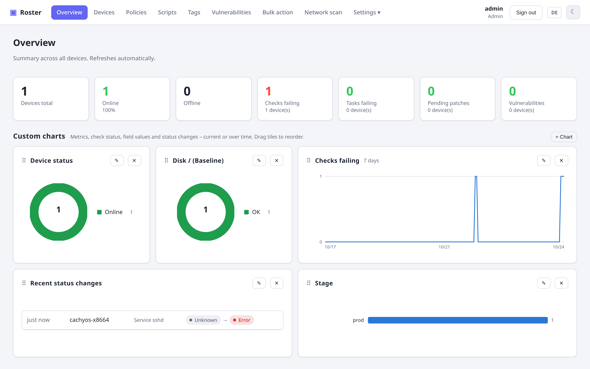
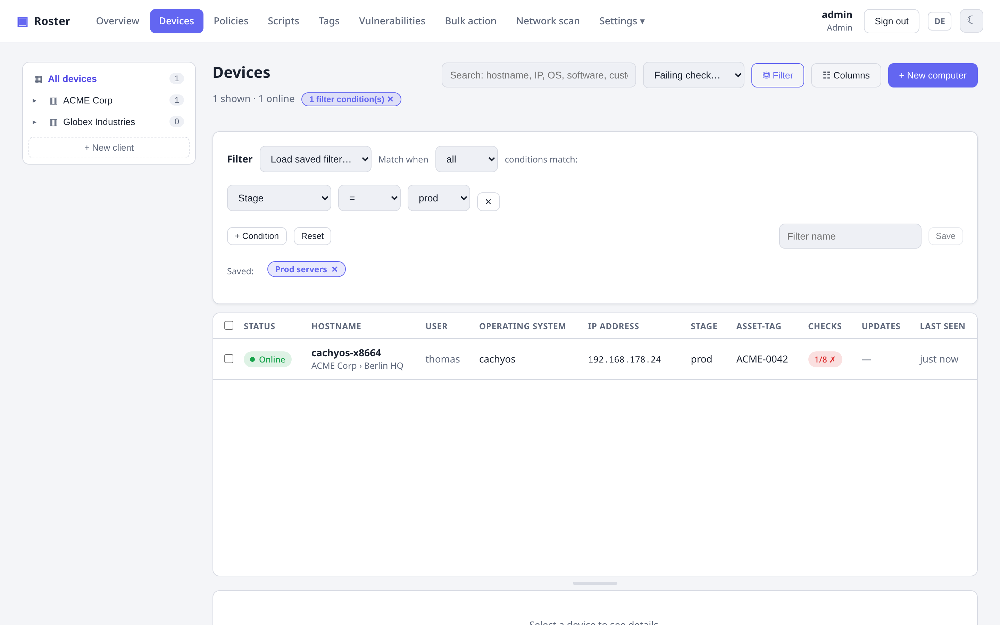
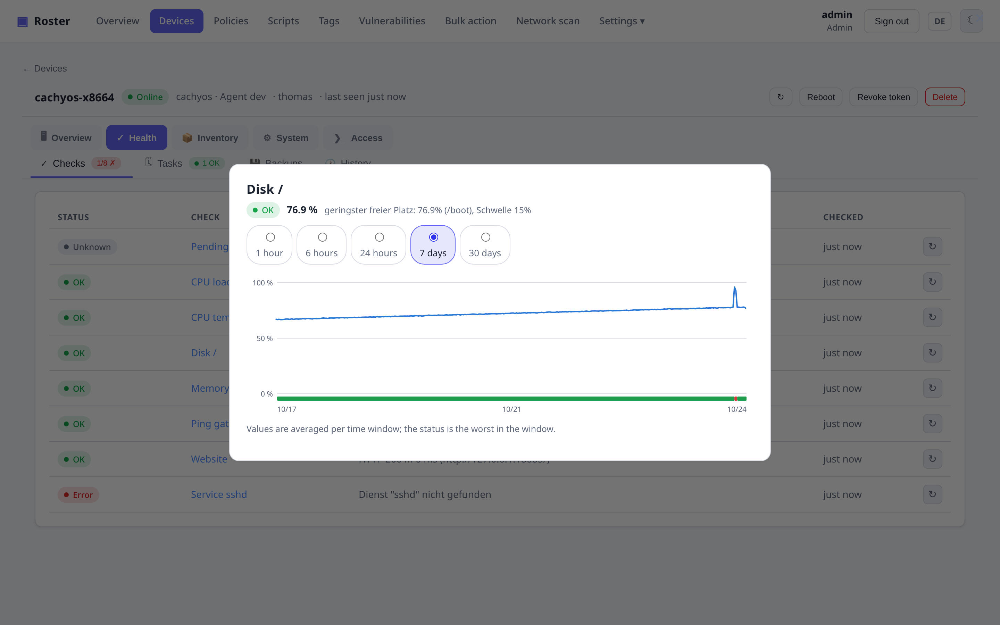
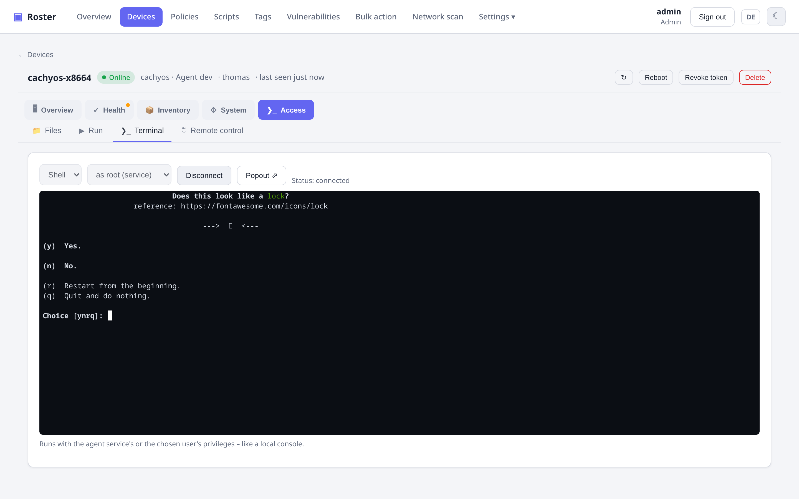
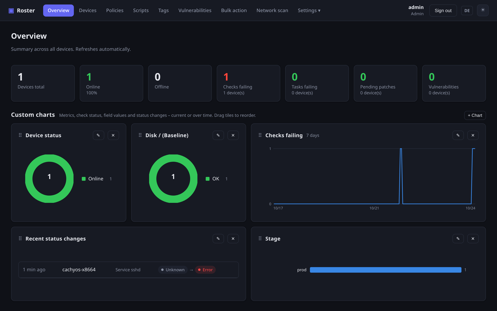
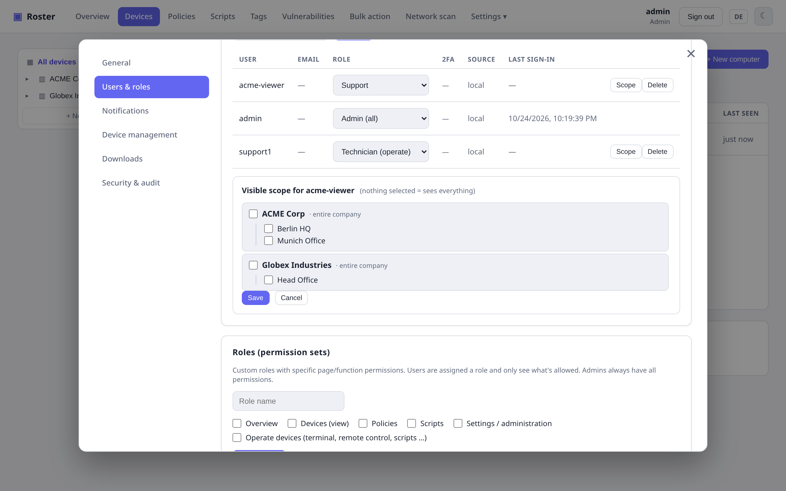
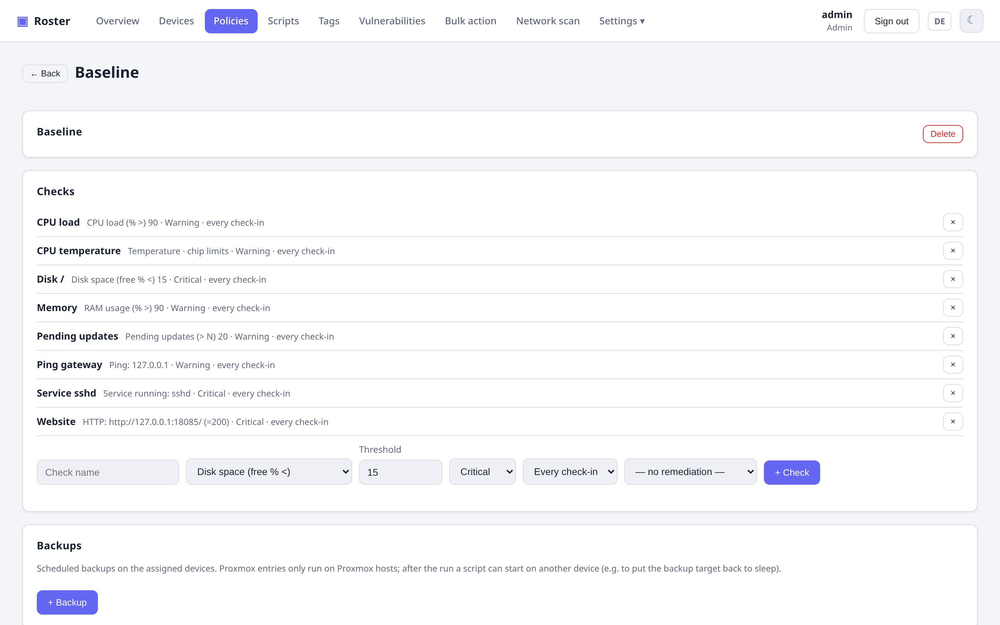
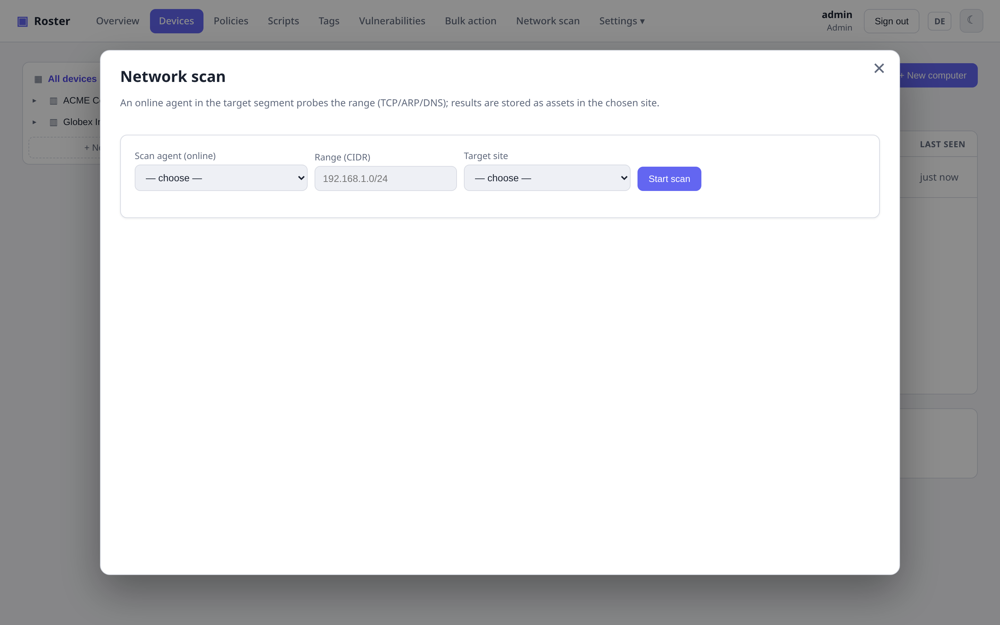

<div class="rs-hero" markdown>

<div class="rs-hero-text" markdown>

# Deine Flotte, ein Binary. { .rs-title }

**Roster** ist eine selbst gehostete Plattform für **Inventar und Fernwartung** im Stil
von TacticalRMM, für Windows, Linux und macOS. Ein Go-Server mit eingebetteter Web-UI und
allen Agents, ein schlanker Agent pro Rechner, sonst nichts zu installieren.

[Erste Schritte](getting-started.md){ .md-button .md-button--primary }
[GitHub](https://github.com/boonkerz/roster){ .md-button }
[Changelog](changelog.md){ .md-button }

```bash
curl -LO https://github.com/boonkerz/roster/releases/latest/download/roster-server-linux-amd64
chmod +x roster-server-linux-amd64 && ./roster-server-linux-amd64 run
```

<p class="rs-hero-note">MIT-Lizenz · SQLite ohne Konfiguration, PostgreSQL optional · UI auf Deutsch und Englisch</p>

</div>

<div class="rs-hero-shot" markdown>
{ .shadow }
</div>

</div>

<div class="rs-pillars" markdown>

- :material-cube-outline: **Ein Binary, selbst gehostet.** Keine externen Dienste, kein zweiter Daemon. Hinter den eigenen Reverse-Proxy stellen oder TLS direkt ausliefern lassen.
- :material-monitor-cellphone: **Agents für alle Plattformen:** Windows, Linux, macOS und FreeBSD, mit Auto-Update bei jedem neuen Server-Release.
- :material-remote-desktop: **Echte Fernsteuerung eingebaut.** Browser oder nativer Viewer, interaktives Terminal und Dateibrowser über einen Tunnel auf Abruf.
- :material-shield-account: **Feingranulare Rechte.** Eigene Rollen plus Firmen- und Standortbereich je Benutzer, Zwei-Faktor-Login, Audit-Log.

</div>

## Alles, was ein RMM braucht { .rs-center }

<section class="rs-feature" markdown>
<div class="rs-feature-shot" markdown>
{ .shadow }
</div>
<div class="rs-feature-text" markdown>
### Inventar, das Fragen beantwortet
Hardware, Betriebssystem, Netzwerk, Datenträger, Software, Drucker, Temperaturen,
Docker-Container: automatisch erfasst und bei jedem Checkin aktualisiert. Eigene Felder
anlegen, Spalten wählen und auf alles filtern, gespeichert je Benutzer.
[Inventar](features/inventory.md){ .rs-more }
</div>
</section>

<section class="rs-feature rs-reverse" markdown>
<div class="rs-feature-shot" markdown>
{ .shadow }
</div>
<div class="rs-feature-text" markdown>
### Checks, Tasks und Selbstheilung
Disk, RAM, CPU, Updates, Ping, TCP, HTTP, offene Ports, Dienste, Zertifikate,
Temperaturen und eigene Skripte. Jedes Ergebnis landet im Verlauf, ein Klick öffnet das
Diagramm. Fehlgeschlagene Checks können erst ein Reparatur-Skript ausführen, bevor
jemand alarmiert wird.
[Checks & Tasks](features/checks-tasks.md){ .rs-more }
</div>
</section>

<section class="rs-feature" markdown>
<div class="rs-feature-shot" markdown>
{ .shadow }
</div>
<div class="rs-feature-text" markdown>
### Fernsteuerung, Terminal und Dateien
Bildschirm im Browser oder im nativen Viewer übernehmen, mit Auflösungswechsel im Betrieb
und echtem Strg+Alt+Entf. Interaktive Shell oder Dateisystem über denselben Tunnel.
Keine VNC-Software von Dritten, nichts am Gerät nach außen offen.
[Fernsteuerung & Terminal](features/remote.md){ .rs-more }
</div>
</section>

<section class="rs-feature rs-reverse" markdown>
<div class="rs-feature-shot" markdown>
{ .shadow }
</div>
<div class="rs-feature-text" markdown>
### Eine Übersicht, die du selbst zusammenstellst
Ringe, Balken und Verlaufslinien über jede Kennzahl, jeden Check-Status oder Feldwert.
Kacheln per Drag-and-drop anordnen, Breite wählen, und aus stündlichen Snapshots wächst
ein Jahr Historie. Helles und dunkles Design inklusive.
[Übersicht](features/dashboard.md){ .rs-more }
</div>
</section>

<section class="rs-feature" markdown>
<div class="rs-feature-shot" markdown>
{ .shadow }
</div>
<div class="rs-feature-text" markdown>
### Rollen und Datenbereich
Eigene Rollen aus einzelnen Berechtigungen zusammenstellen und Benutzer auf bestimmte
Firmen oder Standorte beschränken. Zwei-Faktor-Authentifizierung, API-Tokens für die
iOS-App und ein Audit-Log sind eingebaut.
[Rollen & Berechtigungen](features/permissions.md){ .rs-more }
</div>
</section>

<section class="rs-feature rs-reverse" markdown>
<div class="rs-feature-shot" markdown>
{ .shadow }
</div>
<div class="rs-feature-text" markdown>
### Richtlinien, Patches und Software
Checks, Tasks und Backups an Firmen, Standorte oder einzelne Geräte zuweisen. Updates
suchen, freigeben und installieren, Pakete verteilen, CVEs installierter Software im
Blick behalten.
[Patches & Software](features/patching.md){ .rs-more }
</div>
</section>

<section class="rs-feature" markdown>
<div class="rs-feature-shot" markdown>
{ .shadow }
</div>
<div class="rs-feature-text" markdown>
### Netzwerk-Erkennung und mehr
CIDR-Bereiche scannen, Druckerdetails per SNMP lesen, unverwaltete Hosts übernehmen.
Proxmox-VE-Hosts melden Gäste und Backup-Zustand, geplante Backups laufen mit
Startbedingung und Folgeaktion, und eine Taskleisten-App hält die Flotte einen Klick
entfernt.
[Netzwerk & Erkennung](features/network.md){ .rs-more } · [Proxmox VE](features/proxmox.md){ .rs-more } · [Taskleisten-App](features/tray-app.md){ .rs-more }
</div>
</section>

<div class="rs-cta" markdown>

## In ein paar Minuten startklar { .rs-center }

Server-Binary laden, starten, den ersten Agent mit dem generierten Einzeiler anbinden.
**[Erste Schritte](getting-started.md)** führt durch Build, Start, Enrollment und die
Organisation der Flotte.

[Erste Schritte](getting-started.md){ .md-button .md-button--primary }
[Konfiguration](configuration.md){ .md-button }

</div>
